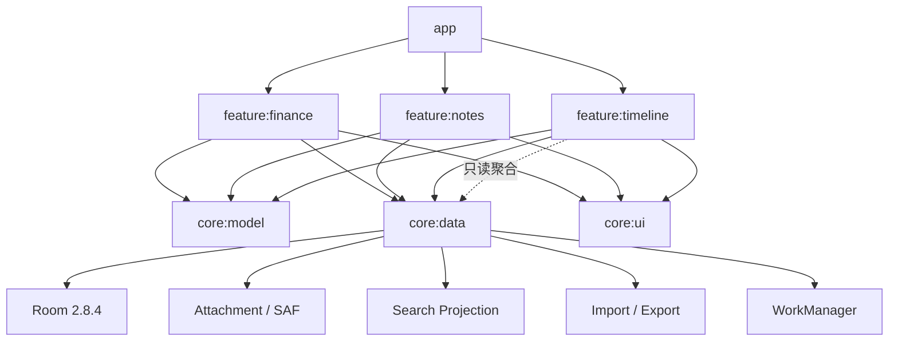
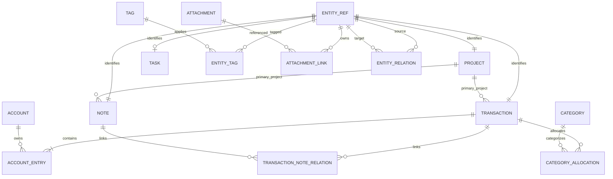
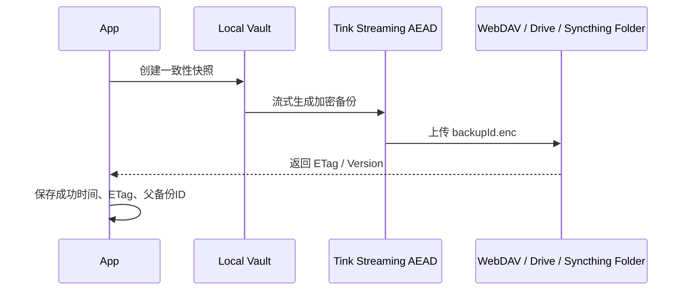

# 融合记账本与备忘录的 Android 手机 App 开源技术调研与最终决策报告

## 执行摘要与核验口径

**核验日期：2026 年 8 月 4 日。**

本轮调研重新核验了 GitHub、GitLab、F-Droid、Gitee 检索结果、项目仓库、Release、许可证、公开 Issue、应用商店说明与 Android 官方文档。调研范围覆盖了十三个财务项目、九个笔记或任务项目、四个日记或时间线项目，以及数据库、图表、Markdown、日历、后台任务、加密、WebDAV 和附件处理组件。

### 最终结论

| 决策项 | 明确结论 |
|---|---|
| 首选开发路线 | **新建原生 Android 工程，自主实现核心领域，不默认 Fork 任何完整 App** |
| 最值得研究的财务项目 | **My Expenses**：作为财务领域规则、导入导出、周期交易、对账和边界用例的主要参考 |
| 次要财务参考 | **Money Manager Ex Android**：参考开放数据库、跨端兼容、SQLCipher 和同步设计 |
| 笔记参考 | **Markor、Quillpad**：分别参考开放文件格式和笔记交互；不直接复用 Quillpad 的备份实现 |
| 时间线参考 | **Daily You、Track & Graph、jtx Board** |
| 推荐 Fork 项目 | **默认无**；只有产品确定采用 GPL-3.0、并通过剥离与扩展 PoC 时，才条件性考虑 My Expenses |
| Android 技术栈 | Kotlin、Jetpack Compose、Coroutines、Flow、ViewModel、Room 2.8.4、WorkManager、SAF |
| 数据模型 | 独立财务与笔记实体 + `EntityRef` + 强类型关系表 + 受限通用 `EntityRelation` |
| 财务模型 | `Transaction` 交易头 + `AccountEntry` 账户流水 + `CategoryAllocation` 分类分摊 |
| MVP 同步 | 不做实时同步；只做本地数据库、完整导出和恢复 |
| MVP 加密 | 不强制启用 SQLCipher；优先完成可靠备份、导入恢复和应用访问锁 |
| MVP 不包含 | 预算、任务提醒、周期交易、复杂多币种、OCR、AI、实时云同步、协作 |
| iOS 扩展 | V1 以后评估 Kotlin Multiplatform；不为尚未验证的 iOS 需求牺牲 Android 首版质量 |

Android 官方当前仍将 Jetpack Compose 定位为推荐的现代原生 UI 工具包，并建议采用清晰的 UI 层、数据层、Repository、ViewModel、协程、Flow 与单向数据流；这些建议应按项目规模裁剪，而不是机械建立过多层次。citeturn14search3turn19view2turn7search18

截至核验日，传统 `androidx.room` 稳定版仍为 **Room 2.8.4**，发布于 2025 年 11 月 19 日；新的 `androidx.room3` 已在 2026 年 7 月 29 日更新至 **3.0.1**。Room 3 已是稳定分支，但它使用不同包名和新的数据库驱动体系。结合首版需要兼顾迁移、全文搜索、导出和潜在 SQLCipher 集成，本项目继续采用已经复审确定的 **Room 2.8.4**。citeturn17view2turn17view3

这一选择不是因为 Room 3“不稳定”，而是为了减少首版同时引入的基础设施变量。SQLCipher 当前正式 Android 集成仍通过 `SupportOpenHelperFactory` 或原有 Support SQLite 适配接口接入 Room；虽然新的 `sqlcipher-android` 4.15.0 在 2026 年仍维护并提供 Room 集成，但本轮没有核验到“Room 3.0.1 与 SQLCipher 已形成低风险、完整验证组合”的充分证据。citeturn15search22turn15search4

### 调研口径与证据等级

本报告对信息采用以下分级：

| 等级 | 含义 |
|---|---|
| 源码或配置确认 | 仓库目录、Gradle 配置、数据库代码、License 文件直接可见 |
| 官方项目说明 | README、F-Droid、项目官网、Release 或官方应用商店声明 |
| Issue 或变更记录 | 用于识别真实缺陷、维护状态和迁移风险 |
| 未核实 | README 未说明，且本轮未能从源码或 Release 中可靠确认 |
| 研究判断 | 基于功能、代码体量、许可证、维护状态和项目目标形成的工程结论 |

评分不以 Star 数作为主要依据。Star 只能反映关注度，不能替代构建成功率、数据迁移、测试、License、维护状态和领域模型质量。

Gitee 检索结果中没有发现比本报告 GitHub/F-Droid 候选更成熟、证据更完整的原生项目；GitLab 结果主要包括 F-Droid 收录请求、小型预算应用和 MoneyBuster 等特定共享账本客户端。它们可作为补充线索，但未越过“完整领域、活跃维护、可迁移数据、明确许可和足够工程证据”的候选门槛。citeturn20search1turn20search2turn20search14turn20search16

## 候选项目全景、评分模型与评分结果

### 评分方法

基础评价采用用户要求的 100 分模型：

| 维度 | 权重 | 评价重点 |
|---|---:|---|
| 功能匹配度 | 20 | 财务、笔记、附件、搜索、时间线和关联能力 |
| 架构与代码质量 | 15 | 分层、模块边界、依赖治理、测试可读性 |
| 可扩展性 | 15 | 数据模型扩展、迁移、跨模块关联和新增领域成本 |
| 维护活跃度 | 10 | 最近提交、Release、Issue 与 PR 情况 |
| 数据所有权和导出 | 10 | 本地优先、开放格式、完整导出、恢复能力 |
| 隐私与安全 | 10 | 无强制账号、无广告、加密、第三方 SDK |
| 二次开发成本 | 10 | 构建难度、历史负担、学习成本、剥离成本 |
| 许可证友好程度 | 5 | 修改、再分发、商业化和组合限制 |
| Android 体验 | 5 | 原生集成、Compose、分享、Widget、后台任务 |

在同一证据基础上，分别形成三类评分：

- **领域参考分**：项目是否值得研究其业务规则、交互与边界情况；
- **Fork 适配分**：是否适合直接成为本产品代码基础；
- **代码复用分**：能否抽取相对独立、许可证兼容的代码或模块。

这些分数是工程决策工具，不是对项目质量的绝对排名。GPL 或 AGPL 项目可能拥有很高的领域参考分，但在计划闭源商业发行时 Fork 分会显著降低。

### 财务与记账项目

| 项目 | 栈与定位 | 主要能力、数据所有权 | 活跃度与许可 | 参考 / Fork / 复用 | 结论 |
|---|---|---|---|---:|---|
| My Expenses | Kotlin/Java 混合、原生 Android、大型多模块 | 多账户、跨币种转账、周期交易、对账、QIF/CSV、图表、快捷方式；本地为主 | 仓库约 1.7 万次提交，仍维护；GPL-3.0 | **91 / 58 / 55** | 最强财务行为参考；仅条件性 Fork |
| Money Manager Ex Android | 原生 Android、MMEX 桌面伴侣 | 账户、分类、币种、周期交易、QIF、桌面数据库兼容、SQLCipher、文件同步 | 2026 年 6 月仍发布版本；GPL-3.0 | **86 / 49 / 52** | 数据库兼容和同步参考，不适合作融合底座 |
| Oinkoin | Flutter、离线个人财务 | 账户、预算、周期记录、统计、备份；无广告、离线优先 | 2026 年 7 月仍更新；GPL-3.0 | **71 / 45 / 48** | 产品与隐私参考，不适合原生 Fork |
| Cashew | Flutter、Drift SQL、部分 Firebase 能力 | 功能丰富，预算、周期交易、图表、搜索与备份 | 正式 GitHub Release 页面长期停留在 2024 年版本；GPL-3.0 | **83 / 42 / 38** | UX 参考；技术栈和服务依赖不匹配 |
| Monekin | Flutter、跨平台个人财务 | 账户、预算、资产负债、周期记录、备份和统计 | 2026 年仍维护；AGPL-3.0；曾出现关键数据库迁移修复 | **82 / 43 / 40** | 功能边界和迁移风险参考 |
| Buckwheat | Kotlin + Jetpack Compose | 简化预算、每日额度、旅行消费控制 | 2025 年仍发布；GPL-3.0 | **64 / 59 / 62** | Compose 财务交互参考，领域覆盖较窄 |
| Tallybook | 本地优先；具体数据库栈未核实 | 多钱包、预算、周期记录、无账号 | F-Droid 2026 年 7 月仍更新；GPL-3.0-or-later | **68 / 55 / 50** | 简洁产品参考；需进一步源码审计 |
| Ivy Wallet | Kotlin + Compose | 账户、分类、预算、统计和导入导出 | **2026 年 4 月归档只读**；GPL-3.0 | **69 / 28 / 45** | 只参考 Compose UI，不 Fork |
| MoneyWallet | 原生 Android | 账户、预算、周期交易和报表 | GPL-3.0，但 README 中存在额外再发布措辞 | **66 / 24 / 35** | 许可证表述存在风险，不采用 |
| Paisa | Flutter | 账户、分类、预算和基础统计 | 小型项目；GPL-3.0，维护能力有限 | **55 / 36 / 35** | 适合学习，不适合作产品底座 |
| Cashiro | Android 财务自动化 | SMS/PDF 解析、离线分析和导出 | 2026 年仍有 F-Droid 版本；AGPL-3.0 | **67 / 37 / 44** | 解析思路参考，地区和场景过于特化 |
| Firefly III | PHP/Web 自托管服务器 | 完整预算、规则、周期交易、API | 活跃；AGPL-3.0 | **79 / 10 / 30** | V3 服务端参考，不是 Android 本地底座 |
| Actual Budget | TypeScript、本地优先桌面/Web | 本地账本、同步服务、预算和规则 | 活跃；MIT | **82 / 8 / 35** | 同步模型参考，不是原生 Android 基础 |

My Expenses 的官方仓库和 F-Droid 页面确认了账户、转账、周期交易、QIF/CSV、对账、图表、快捷录入和多种扩展；其仓库同时包含 Drive、Dropbox、OneDrive、WebDAV、FinTS、OCR、ML Kit、SQLCipher 和测试模块，显示出较高成熟度，也意味着较高的历史复杂度。citeturn18view0turn0search4turn8search2

MMEX Android 明确以桌面 Money Manager Ex 数据库为互操作目标，仓库包含同步设计文档，F-Droid 说明中还包含云存储、Syncthing 和 SQLCipher 支持；2026 年发布记录出现了远程同步试验。citeturn18view1turn1search26turn1search6

Oinkoin、Cashew 和 Monekin 都提供较完整的个人财务体验，但均以 Flutter 为主要技术路线。Oinkoin强调离线、无广告和隐私；Cashew使用 Drift SQL 并包含 Firebase 相关能力；Monekin 在 2026 年仍活跃，但其 9.0.1 Release 包含对前一版本关键数据库迁移问题的修复，说明财务应用的迁移测试是不可省略的核心工程。citeturn1search3turn1search11turn1search19turn1search4turn2search18turn2search0turn2search4turn12search27

Buckwheat 是少数明确使用 Kotlin 和 Jetpack Compose 的财务候选，但产品聚焦“控制每日可花金额”和旅行预算，而不是完整账户、对账、导入导出和资产负债系统。citeturn18view2turn12search6turn12search10

Ivy Wallet 的原生 Compose 参考价值仍在，但仓库已于 2026 年 4 月 11 日归档。它不再满足“有可靠上游、持续依赖升级和安全修复”的 Fork 门槛。citeturn2search15turn12search22

### 笔记、备忘录与任务项目

| 项目 | 栈与定位 | 主要能力、数据所有权 | 活跃度与许可 | 参考 / Fork / 复用 | 结论 |
|---|---|---|---|---:|---|
| Quillpad | 原生 Android Markdown 笔记 | Markdown、清单、提醒、Notebook、标签、附件、Nextcloud、ZIP 备份 | 社区维护；GPL-3.0 | **78 / 57 / 56** | 交互参考；备份和附件需自研验证 |
| Markor | Java/Android Views、文件型编辑器 | Markdown、todo.txt、纯文本、开放目录、HTML/PDF/ZIP、离线 | 2026 年 3 月仍发布；Apache-2.0 | **74 / 63 / 78** | 开放格式、分享和文件管理首选参考 |
| Joplin | React Native、多端笔记 | Markdown、附件、全文搜索、多后端同步、E2EE | 活跃；AGPL-3.0 | **88 / 35 / 45** | 同步/E2EE 参考，不 Fork |
| Notesnook | TypeScript/React Native、多端安全笔记 | 零知识、E2EE、附件、历史版本、同步 | 2026 年 7 月仍更新；GPL-3.0 | **84 / 30 / 40** | 密钥与零知识参考，不适合作 Android 底座 |
| NotallyX | 原生 Android 笔记 | 富文本、清单、提醒、附件、标签 | 仍有 Release；许可证细节本轮未完全核实 | **76 / 60 / 58** | 笔记交互候选，需进一步代码审计 |
| Orgzly Revived | 原生 Android、Org 文件 | 大纲、任务、Org 文件、WebDAV/Dropbox | 2026 年活跃；GPL-3.0-or-later | **80 / 56 / 62** | 开放格式与任务模型参考 |
| Tasks.org | 原生 Android 任务管理 | 标签、列表、子任务、筛选、提醒、CalDAV 等同步 | 活跃；GPL 系列许可证 | **78 / 50 / 54** | V1 任务提醒参考 |
| Simple Notes Sync | Kotlin + Compose、本地优先 | Markdown 导入导出、加密本地备份、自托管同步 | 较新；AGPL-3.0 | **70 / 58 / 60** | 小型架构参考，成熟度不足 |
| Nouto | Kotlin、Material 3 Expressive | 富文本、本地存储、回收站、无账号 | F-Droid 收录仍在流程中；MIT | **58 / 60 / 65** | 轻量 UI/编辑器参考，尚非成熟底座 |

Quillpad 官方说明确认 Markdown、任务清单、提醒、Notebook、标签和附件，并明确其由停止维护的 Quillnote 社区 Fork 而来。项目定位与本产品笔记部分接近，但公开资料不足以证明其备份恢复、附件清理和迁移机制已经达到财务数据所需的可靠性，因此相关模块只能作为交互参考。citeturn17view0turn14search11turn3search12

Markor 以普通文件为事实源，支持 Markdown、todo.txt、CSV、JSON 等格式，可在用户选择的目录中工作，并可交由 Syncthing、Nextcloud 等外部工具同步。它还支持分享文本快速录入和 AES256 文本文件加密，但图片、附件不随文本加密。这种“文件开放性”非常值得参考，但不适合作为需要强事务约束的财务数据库。citeturn18view3turn3search9turn3search13

Joplin 支持端到端加密、多同步后端、附件和全文搜索；Notesnook 公开说明使用 XChaCha20-Poly1305、Argon2 等零知识设计。两者安全能力强，但均是复杂多端系统，将财务账户、余额、转账和预算逻辑植入其现有同步领域的成本高于新建工程。citeturn3search10turn3search14turn3search28turn3search11turn3search29

Orgzly Revived 使用开放 Org 文件，并在原项目停止后由社区继续维护；Tasks.org 则提供成熟的任务筛选、标签、列表、子任务和多种同步能力。两者更适合在 V1 研究任务和提醒，而不是作为 MVP 主体。citeturn4search1turn4search5turn4search24turn4search8turn4search23

### 日记、生活记录与统一时间线项目

| 项目 | 能力 | 活跃度与许可 | 参考 / Fork / 复用 | 推荐用途 |
|---|---|---|---:|---|
| Daily You | 本地日记、图片、按日期回顾、隐私优先 | 2026 年 7 月仍发布；GPL-3.0 | **78 / 61 / 60** | 日时间线与低摩擦记录交互 |
| Track & Graph | 自定义个人数据、时间序列、统计图表 | 2026 年 7 月仍更新；GPL-3.0-or-later | **76 / 48 / 58** | 统一事件、指标和图表投影 |
| jtx Board | Journal、Note、Task、iCalendar、CalDAV | 2026 年 7 月仍发布；GPL-3.0-only | **82 / 51 / 57** | Journal/Task/Note 统一语义和标准同步 |
| Lifeograph | 日记、标签、时间线、加密日记 | 仍可获得；GPL | **68 / 42 / 45** | 日记信息架构参考 |

Daily You 强调本地保存、无需账号和无追踪，适合研究“每天一页”和附件回顾；Track & Graph 将个人事件、数值和图表统一起来；jtx Board 则把 Journal、Note 和 Task 映射到 iCalendar/RFC 5545 及 CalDAV 生态。这三者比单纯笔记 App 更能启发统一时间线与场景集合设计。citeturn5search0turn5search3turn5search1turn5search4turn5search25turn5search2turn5search15turn5search23

## 重点候选深度分析与淘汰结论

以下七个项目按要求覆盖二十六项分析维度。无法从官方资料或源码可靠确认的内容明确标记为“未核实”。

### My Expenses

**①项目与仓库：** `mtotschnig/MyExpenses`。**②定位：** 成熟 Android 个人费用追踪工具。**③核心功能：** 收支、转账、多账户、跨币种、分类、周期交易、对账、报表、Widget、快捷方式及 QIF/CSV。

**④技术栈：** Kotlin/Java 混合。**⑤UI：** 长期演进的 Android View/XML 为主，局部现代化情况需按模块确认。**⑥架构：** 大型多模块工程，不是简洁的教学式 Clean Architecture。**⑦数据库：** SQLite 体系，仓库中存在 SQLCipher 相关模块。**⑧模型特点：** 财务领域成熟，覆盖转账、分拆、周期交易、对账等复杂边界。

**⑨同步备份：** 含 WebDAV、Google Drive、Dropbox、OneDrive 等集成，但部分能力与付费 Key 体系相关。**⑩导入导出：** QIF、CSV 等。**⑪隐私：** 本地账本为基础，无需强制云端。**⑫加密：** 密码/设备锁及 SQLCipher 相关能力。**⑬附件：** 票据、图片及扫描能力存在，但部分属于高级功能。**⑭全文搜索：** 支持交易搜索和筛选，是否采用 FTS 未核实。**⑮提醒后台：** 周期交易、自动备份等。**⑯统计图表：** 成熟。**⑰财务覆盖：** 七个候选中最完整。

**⑱测试文档：** 仓库包含测试模块和大量工程代码，但整体覆盖率未核实。**⑲活跃度：** 仍维护，仓库历史超过 1.7 万次提交。**⑳许可证：** GPL-3.0。**㉑商业分发：** 可商业使用，但分发衍生客户端通常需要履行 GPL 源码和许可证义务，具体发行方案应进行法律复核。

**㉒可复用内容：** 财务规则、导入映射、对账流程、周期交易边界和测试场景。**㉓二开难度：** 高。**㉔融合匹配：** 财务高、笔记低。**㉕主要风险：** 历史架构、模块体量、许可证、无关云服务和高级功能剥离成本。**㉖推荐用途：** **领域行为基准；默认不 Fork，GPL 产品可做条件性 Fork PoC。** citeturn18view0turn0search4turn8search2

### Money Manager Ex Android

**①项目与仓库：** `moneymanagerex/android-money-manager-ex`。**②定位：** MMEX 桌面财务软件的移动伴侣。**③核心功能：** 账户、交易、分类、收款方、币种、周期交易、图表、QIF 和数据库互操作。

**④技术栈：** Java/Kotlin 原生 Android。**⑤UI：** 传统 Android UI 为主。**⑥架构：** 长期演进工程。**⑦数据库：** 与 MMEX 桌面 SQLite 数据库兼容，可使用 SQLCipher。**⑧模型特点：** 优先维护桌面互操作，而不是自由扩展移动端内容模型。

**⑨同步备份：** 文件存储、Syncthing、云盘及实验性远程同步。**⑩导入导出：** QIF 和共享数据库。**⑪隐私：** Local-first。**⑫加密：** SQLCipher。**⑬附件：** 不是其主要优势。**⑭全文搜索：** 基础筛选存在，FTS 实现未核实。**⑮后台任务：** 同步相关。**⑯图表：** 支持。**⑰财务能力：** 成熟，尤其是账户和多币种。

**⑱测试文档：** 有用户文档，但仓库 README 仍将完整 CI 测试覆盖标记为待办。**⑲活跃度：** 2026 年仍发布。**⑳许可证：** GPL-3.0。**㉑商业分发：** 受 GPL 义务约束。

**㉒可复用内容：** 公开财务数据库、桌面兼容、SQLCipher 和同步策略。**㉓二开难度：** 高。**㉔融合匹配：** 财务高，笔记低。**㉕风险：** 修改数据库可能破坏 MMEX 兼容性。**㉖用途：** **只作数据库与同步参考，不作为融合 App Fork 基础。** citeturn18view1turn1search26turn1search6

### Buckwheat

**①仓库：** `danilkinkin/buckwheat`。**②定位：** 以控制每日可支出额度和旅行预算为核心的 Android App。**③功能：** 快速记录支出、预算节奏和旅行消费控制。

**④技术栈：** Kotlin。**⑤UI：** Jetpack Compose、Material You。**⑥架构：** 单 App 模块为主，具体分层需进一步源码审计。**⑦数据库：** 本轮未充分核实。**⑧模型：** 重点是可支出额度，不是完整多账户账本。

**⑨同步备份：** 未核实。**⑩导入导出：** 未核实。**⑪隐私：** 项目政策页面可用，但具体数据流需进一步审计。**⑫加密：** 未核实。**⑬附件：** 非主要能力。**⑭搜索：** 非主要能力。**⑮后台：** 未核实。**⑯图表：** 有预算反馈。**⑰财务能力：** 适合轻量预算，不足以覆盖对账、多币种和资产负债。

**⑱测试文档：** 有仓库、翻译和工程配置，覆盖率未核实。**⑲活跃度：** 2025 年仍发布版本。**⑳许可：** GPL-3.0。**㉑分发：** 受 GPL 义务约束。

**㉒复用：** Compose 金额输入、每日预算反馈和旅行模式。**㉓难度：** 中。**㉔匹配：** UI 较高、财务领域中低。**㉕风险：** 功能基线过窄，Fork 后仍需重写大部分账本。**㉖用途：** **Compose 财务 UX 参考，不作为核心账本。** citeturn18view2turn12search6

### Quillpad

**①仓库：** `quillpad/quillpad`。**②定位：** 社区维护的 Markdown 笔记、清单和提醒 App。**③功能：** Markdown、Notebook、标签、任务清单、提醒、附件和 Nextcloud Notes。

**④技术栈：** 原生 Android；具体 Kotlin/Java 比例需源码统计。**⑤UI：** 原生 UI，是否全面 Compose 未核实。**⑥架构：** 从 Quillnote 社区 Fork 演进。**⑦数据库：** 本地结构化存储，具体 Room 版本未核实。**⑧模型：** Note、Notebook、Tag、Task List 和 Attachment。

**⑨同步备份：** Nextcloud Notes、ZIP 备份。**⑩导入导出：** Markdown/ZIP 路径。**⑪隐私：** 官方明确无广告、无无关权限，不会在用户不知情时上传笔记。**⑫加密：** 数据库级加密未核实。**⑬附件：** 支持。**⑭搜索：** 支持笔记搜索。**⑮提醒：** 支持。**⑯统计：** 非核心。**⑰财务：** 无。

**⑱测试文档：** 产品文档存在，备份恢复和附件生命周期的系统测试证据不足。**⑲活跃度：** 社区维护。**⑳许可：** GPL-3.0。**㉑分发：** 受 GPL 义务约束。

**㉒复用：** 编辑器信息架构、标签、Notebook、提醒入口和附件 UI。**㉓难度：** 中高。**㉔匹配：** 笔记高、财务低。**㉕风险：** 将强财务一致性植入笔记模型成本很高；备份不能直接照搬。**㉖用途：** **交互和功能参考；不复制备份、附件生命周期和同步核心。** citeturn17view0turn14search11turn3search12

### Markor

**①仓库：** `gsantner/markor`。**②定位：** Android 纯文本、Markdown 和 todo.txt 编辑器。**③功能：** Markdown、纯文本、todo.txt、QuickNote、分享录入、搜索、HTML/PDF、ZIP 和开放目录。

**④技术栈：** Java、Android SDK、AndroidX。**⑤UI：** Android Views。**⑥架构：** 文件编辑器和格式处理器结构。**⑦存储：** 用户可访问文件系统，而非封闭数据库。**⑧模型：** 文档即文件，任务采用 todo.txt 等开放格式。

**⑨同步：** 不内置同步协议，支持配合 Syncthing、Nextcloud 等目录同步。**⑩导入导出：** 天然开放文件，可输出 HTML、PDF 和 ZIP。**⑪隐私：** 完全离线、无广告和无多余权限。**⑫加密：** 可加密文本文件，但不加密图片和附件。**⑬附件：** 文件引用和图片插入。**⑭搜索：** 内容搜索。**⑮后台：** 不依赖复杂后台服务。**⑯图表：** Markdown 扩展可展示部分图表，不是结构化财务图表。**⑰财务：** 无。

**⑱测试文档：** README、文档、Makefile 和测试/检查入口较完整。**⑲活跃度：** 2026 年仍发布。**⑳许可：** Apache-2.0。**㉑商业分发：** 相比 GPL 更容易局部复用，但仍需保留版权和许可证声明。

**㉒复用：** 分享菜单、QuickNote、开放格式、文件选择和 Markdown 交互。**㉓难度：** 低至中。**㉔匹配：** 数据可迁移性高，结构化关联能力低。**㉕风险：** 文件同步无法自动提供财务事务一致性。**㉖用途：** **开放格式与快速输入的首选参考，部分代码可在许可证审查后复用。** citeturn18view3turn3search9

### Daily You

**①仓库：** `Daily You` 官方开源仓库。**②定位：** 私密、本地优先的每日生活记录。**③功能：** 每日条目、图片、日历和回顾。

**④技术栈：** 原生 Android；具体数据库与模块分层未完全核实。**⑤UI：** 现代 Android UI。**⑥架构：** 小型本地日记。**⑦存储：** 本地。**⑧模型：** 日期驱动的日记 Entry。

**⑨同步备份：** 不以账号云同步为前提。**⑩导出：** 具体格式需进一步核验。**⑪隐私：** 无账号、无追踪、本地保存。**⑫加密：** 未核实。**⑬附件：** 图片。**⑭搜索：** 不是其最突出能力。**⑮提醒：** 未核实。**⑯统计：** 以回顾而非财务图表为主。**⑰财务：** 无。

**⑱测试文档：** 未核实完整覆盖。**⑲活跃度：** 2026 年 7 月仍有 F-Droid 版本。**⑳许可：** GPL-3.0。**㉑分发：** GPL 义务。

**㉒复用：** 每天一页、图片卡片、空状态和回顾体验。**㉓难度：** 中。**㉔匹配：** 时间线高、财务低。**㉕风险：** 日记 Entry 不能直接承担财务不变量。**㉖用途：** **统一时间线和生活记录 UX 参考。** citeturn5search0turn5search3

### jtx Board

**①仓库：** `jtx Board` 官方仓库。**②定位：** 将 Journal、Note 和 Task 统一到 iCalendar/CalDAV 生态。**③功能：** 日志、笔记、任务、标签、附件和 DAVx⁵/CalDAV 同步。

**④技术栈：** Kotlin 原生 Android。**⑤UI：** 仓库标识包含 Jetpack Compose。**⑥架构：** 本地数据与标准化同步边界。**⑦存储：** 本地结构化数据，具体 Room 版本未核实。**⑧模型：** Journal、Note、Task 与 RFC 5545/iCalendar 语义关联。

**⑨同步：** 通过 DAVx⁵/CalDAV。**⑩导入导出：** iCalendar 标准。**⑪隐私：** 用户可以选择自己的 CalDAV 服务。**⑫加密：** CalDAV 数据本身不等于端到端加密，需由服务和额外加密层保证。**⑬附件：** 支持相关内容。**⑭搜索：** 支持结构化筛选。**⑮提醒：** Task/Calendar 体系。**⑯统计：** 非核心。**⑰财务：** 无。

**⑱测试文档：** 有 Release 和标准协议背景，完整测试覆盖未核实。**⑲活跃度：** 2026 年 7 月仍发布。**⑳许可：** GPL-3.0-only。**㉑分发：** GPL 义务。

**㉒复用：** Journal/Task/Note 统一语义、开放标准和 CalDAV 边界。**㉓难度：** 高。**㉔匹配：** 内容融合高、财务低。**㉕风险：** CalDAV 不适合直接同步账户余额和复杂财务事务。**㉖用途：** **V1 任务提醒与 V2 标准同步参考，不 Fork。** citeturn5search2turn5search15turn5search23

### 淘汰或降级项目

| 项目 | 淘汰或降级原因 |
|---|---|
| Ivy Wallet | 已归档；无法依赖上游持续修复，只保留 Compose UI 参考价值 |
| MMEX Android | 数据库设计受桌面兼容约束，融合实体会破坏互操作性 |
| Cashew | Flutter、Drift 与 Firebase 依赖不符合原生和低第三方依赖优先原则 |
| Monekin | Flutter/AGPL，功能范围过大，且近期出现关键迁移修复，Fork 风险高 |
| Oinkoin | 产品方向良好，但 Flutter 与原生 Android 技术路线不一致 |
| Joplin | 同步和 E2EE 成熟，但 React Native 多端架构过重，植入财务领域成本过高 |
| Notesnook | 安全架构值得研究，但零知识同步系统复杂，不适合三人以内团队作为首版底座 |
| Firefly III | 服务端优先，不满足 Android 本地优先和无服务器 MVP |
| Actual Budget | 本地优先理念优秀，但不是原生 Android 项目 |
| MoneyWallet | README 的再发布措辞与标准 GPL 预期存在潜在冲突，应规避法律不确定性 |
| Gitee/GitLab 小型项目 | 多为镜像、演示、收录请求或特定场景应用，工程证据不足 |

Ivy Wallet 已归档是硬性淘汰因素；Firefly III 和 Actual Budget 则不是低质量，而是部署形态和技术栈不适合作为本地 Android 客户端基础。citeturn12search22turn2search7turn2search23

## 可复用组件、技术路线与许可证策略

### 可复用组件清单

| 模块 | 推荐组件或平台能力 | 采用建议 |
|---|---|---|
| 数据库 | Room 2.8.4 | MVP 采用；开启 schema export、显式 Migration、事务和外键 |
| 跨平台数据库参考 | SQLDelight | 不用于 MVP；未来 KMP PoC 可评估 |
| 图表 | Vico | 首选 Compose 图表库；Apache-2.0，2026 年仍活跃 |
| Markdown 渲染 | Markwon | 成熟、无 WebView；Compose 中可用 `AndroidView` 包装 |
| Markdown Compose 编辑 | MarkdownTwain 或自研轻量语法高亮 | 先 PoC，不让编辑器库控制 Note 数据模型 |
| 富文本 | compose-rich-editor 等候选 | 非 MVP；版本、许可证和大文档性能需重新核验 |
| 后台任务 | WorkManager | 自动备份、附件清理、索引重建；精确提醒另用 AlarmManager |
| 日历 | Kizitonwose Calendar | V1 日历视图候选；MIT、Compose 支持 |
| 图片加载 | Coil | 推荐，但引入时锁定版本并做 EXIF、超大图和缓存测试 |
| 图片压缩 | Android 原生解码或 Compressor | Compressor 可参考，但仓库更新节奏偏慢，关键链路宜自控 |
| 文件选择 | Android Photo Picker + Storage Access Framework | 优先使用平台 API，避免长期持有不稳定外部路径 |
| 加密备份 | Google Tink Streaming AEAD | 适合大 ZIP 和附件流式认证加密 |
| 数据库加密 | SQLCipher for Android | V1 可选；不进入 MVP 默认组合 |
| WebDAV | dav4jvm + OkHttp | V2 备份文件上传候选，MPL-2.0 需保留文件级许可义务 |
| 压缩包 | 平台 ZIP API 或 Zip4j | 先评估 Zip64、流式处理和路径穿越防护 |
| 崩溃收集 | 本地结构化日志；可选 ACRA | 默认不引入商业追踪 SDK；用户主动导出诊断包 |
| OCR | ML Kit 或 Tesseract | V2 后评估，不进入 MVP |
| 搜索 | 可重建 `SearchDocument` + FTS4/LIKE PoC | 中文搜索必须先做真实语料基准 |

Room 2.8.4 是本项目确认的 MVP 数据库基线。Vico 原生支持 Jetpack Compose、Compose Multiplatform 和 Android View，采用 Apache-2.0，并在 2026 年 5 月仍发布版本。citeturn17view2turn15search0

Markwon 将 CommonMark 内容渲染为 Android 原生 Spannable，不需要 WebView；但其核心仍偏 View 体系，因此在 Compose 中应封装在单独 adapter，不让 UI 库渗透到领域层。citeturn14search2turn14search17

WorkManager 适合必须在 App 离开前台、进程退出或设备重启后继续可靠执行的工作，并支持约束、重试和链式任务；精确到时提醒则应根据 Android 官方建议使用 AlarmManager，而不是把 WorkManager 当成精确定时器。citeturn19view1

Tink Streaming AEAD 为大文件和数据流提供分段认证加密，适合加密完整备份，不需要把整个 ZIP 一次性载入内存。citeturn15search2turn15search11

dav4jvm 是 JVM/Kotlin 的 WebDAV、CalDAV 和 CardDAV 库，采用 MPL-2.0；它适合 V2 上传不可变备份文件，但不应被误认为已经解决了记录级同步和冲突合并。citeturn16search1

Kizitonwose Calendar 支持 Compose 和高度定制化日历，采用 MIT；Vico、Kizitonwose 和 Markor 的宽松许可证使其比完整 GPL App 更适合局部借鉴或复用。citeturn15search15turn15search0turn18view3

### 技术路线比较

| 路线 | 优点 | 主要问题 | 结论 |
|---|---|---|---|
| Fork 财务 App | 财务功能起点高，可快速获得账户、报表和导入 | 大型历史代码、GPL、笔记模型缺失、数据库扩展风险 | 条件性备选，不是首选 |
| Fork 笔记 App | 编辑、附件、搜索、同步较成熟 | 账户余额、转账原子性、对账和预算必须重建 | 不推荐 |
| 组合开源组件重新开发 | 可复用成熟库，同时掌握核心模型 | 需要自主实现领域逻辑和迁移 | **首选** |
| 完全自主、只参考开源项目 | 长期控制力最高 | 初期工作量最大 | 与上一条合并实施 |
| Kotlin Multiplatform | 可未来共享模型、导出和同步逻辑 | 过早引入会扩大测试面 | V1 后次选 |
| Flutter | 跨端 UI 效率高 | Android 系统集成需要平台桥，且与既定原生路线冲突 | 仅在 iOS 同期交付成为硬约束时考虑 |
| React Native | JavaScript/TypeScript 团队上手快 | 原生模块、后台任务、文件和加密仍需桥接 | 不推荐 |

Kotlin Multiplatform 可以共享领域和数据逻辑，并允许 Android 保持原生 Compose UI；Flutter 和 React Native 在调用 Android 特有能力时仍依赖平台通道或 Native Modules。对强调分享菜单、Widget、提醒、SAF、后台备份和本地数据库的产品，原生 Android 在首版具有更低的集成风险。citeturn11search0turn11search4turn14search14turn11search1turn11search2turn11search10

### 许可证策略

商业化并不等于必须避开 GPL，但必须在产品立项时先决定发行模式：

- 若客户端计划闭源，完整 Fork GPL/AGPL App 通常不符合目标；
- 若客户端愿意完整开源，GPL Fork 在法律上更可行，但仍需保留版权、许可证、源码提供和修改声明；
- Apache-2.0、MIT、BSD 类库更适合局部代码复用；
- MPL-2.0 通常要求修改过的 MPL 文件继续遵循 MPL，但允许与其他许可证文件组合；
- UI 思路、业务规则和独立重新实现的测试用例可以参考，但不能通过复制代码规避原许可证义务。

许可证结论不是法律意见，正式商业发布前应对全部直接依赖、传递依赖、字体、图标和示例代码进行 Software Bill of Materials 与法律审查。

## 推荐系统架构与融合数据模型

### 系统架构

MVP 不采用十五个以上 Gradle 模块。建议从七个模块开始：



模块职责如下：

| 模块 | 职责 |
|---|---|
| `app` | Application、导航、依赖注入、主题、Deep Link 和分享入口 |
| `core:model` | 领域 ID、金额、币种、实体枚举、公共值对象 |
| `core:data` | Room、DAO、Repository、事务、迁移、搜索、附件、导入导出 |
| `core:ui` | Design System、金额输入、日期选择、通用列表和错误状态 |
| `feature:finance` | 账户、交易、分类、标签和基础统计 |
| `feature:notes` | 笔记、Markdown、图片附件和账单关联 |
| `feature:timeline` | 日期聚合、项目视图和统一搜索结果 |

达到下列条件后再拆出 `core:backup`、`core:attachments`、`core:reminders`、`feature:budgets` 和 `feature:tasks`：

- 模块具有独立公共接口；
- 有两个以上调用方；
- 有独立测试边界；
- 拆分能减少依赖，而不是只增加 DTO 和映射代码。

架构采用 **MVVM + UDF**。ViewModel 暴露不可变 `StateFlow<UiState>`，UI 发送 Intent/Event；Repository 负责数据访问；只有跨多个聚合、需要事务或被多个 ViewModel 复用的复杂操作才建立 Use Case，例如：

- `CreateTransferUseCase`；
- `DeleteTransactionWithRelationsUseCase`；
- `ExportVaultUseCase`；
- `RestoreVaultUseCase`；
- `LinkTransactionToNoteUseCase`。

不建立“一张表一个 Repository、一条 DAO 一层 Use Case”的机械 Clean Architecture。

### 数据建模方案比较

| 方案 | 优点 | 缺点 | 结论 |
|---|---|---|---|
| A：`Transaction.note_id` | 最简单；查询直接；外键清晰 | 一笔账单只能关联一篇笔记；无法表达关联类型；笔记反向多账单受限 | 仅适合原型，不采用 |
| B：`TransactionNoteRelation` | 多对多、强外键、类型安全、查询简单 | 每新增稳定关系可能需要新表 | **核心账单—笔记关系采用** |
| C：通用 `EntityRelation` | 可连接交易、笔记、任务、项目等任意实体 | `type + id` 无法直接建立多态外键，查询复杂，容易产生孤儿数据 | 经 `EntityRef` 修正后用于长尾关系 |
| D：统一 `Entry/TimelineItem` | 时间线和搜索天然统一，扩展新条目容易 | 财务、笔记和任务字段差异巨大；易形成巨表和过度抽象；财务不变量难表达 | 只作投影，不作事实源 |

### 最终推荐：领域实体 + EntityRef + 强类型关系

核心思想是：

1. `Transaction`、`Note`、`Project`、未来的 `Task` 继续是独立领域实体；
2. 每个可被标签、附件、提醒或通用关系引用的实体，拥有同 ID 的 `EntityRef`；
3. 高频且有业务约束的关系使用专用表；
4. 低频、未来不确定的关系使用 `EntityRelation`；
5. 时间线和统一搜索是可重建投影，不是事实表。



### Room 表结构建议

**实体身份与交易头：**

```kotlin
@Entity(
    tableName = "entity_refs",
    indices = [
        Index("type"),
        Index("updatedAt"),
        Index("deletedAt")
    ]
)
data class EntityRefEntity(
    @PrimaryKey val id: String,
    val type: EntityType,
    val createdAt: Long,
    val updatedAt: Long,
    val deletedAt: Long? = null
)

@Entity(
    tableName = "transactions",
    foreignKeys = [
        ForeignKey(
            entity = EntityRefEntity::class,
            parentColumns = ["id"],
            childColumns = ["id"],
            onDelete = ForeignKey.CASCADE
        ),
        ForeignKey(
            entity = ProjectEntity::class,
            parentColumns = ["id"],
            childColumns = ["projectId"],
            onDelete = ForeignKey.SET_NULL
        )
    ],
    indices = [
        Index("occurredAt"),
        Index(value = ["projectId", "occurredAt"]),
        Index("updatedAt")
    ]
)
data class TransactionEntity(
    @PrimaryKey val id: String,
    val type: TransactionType,
    val occurredAt: Long,
    val payee: String?,
    val memo: String?,
    val projectId: String?,
    val status: TransactionStatus,
    val createdAt: Long,
    val updatedAt: Long
)
```

`Transaction` **不保存 `accountId`**，因为账户归属已经由 `AccountEntry` 表达。

**账户流水和分类分摊：**

```kotlin
@Entity(
    tableName = "account_entries",
    foreignKeys = [
        ForeignKey(
            entity = TransactionEntity::class,
            parentColumns = ["id"],
            childColumns = ["transactionId"],
            onDelete = ForeignKey.CASCADE
        ),
        ForeignKey(
            entity = AccountEntity::class,
            parentColumns = ["id"],
            childColumns = ["accountId"],
            onDelete = ForeignKey.RESTRICT
        )
    ],
    indices = [
        Index(value = ["accountId", "transactionId"]),
        Index("transactionId")
    ]
)
data class AccountEntryEntity(
    @PrimaryKey val id: String,
    val transactionId: String,
    val accountId: String,
    val amountMinor: Long,
    val currencyCode: String,
    val exchangeRateSnapshot: String? = null
)

@Entity(
    tableName = "category_allocations",
    foreignKeys = [
        ForeignKey(
            entity = TransactionEntity::class,
            parentColumns = ["id"],
            childColumns = ["transactionId"],
            onDelete = ForeignKey.CASCADE
        ),
        ForeignKey(
            entity = CategoryEntity::class,
            parentColumns = ["id"],
            childColumns = ["categoryId"],
            onDelete = ForeignKey.RESTRICT
        )
    ],
    indices = [
        Index("transactionId"),
        Index(value = ["categoryId", "transactionId"])
    ]
)
data class CategoryAllocationEntity(
    @PrimaryKey val id: String,
    val transactionId: String,
    val categoryId: String,
    val amountMinor: Long
)
```

MVP 中：

- 支出：一个负的 `AccountEntry`，并有一个或多个正值分类分摊；
- 收入：一个正的 `AccountEntry`，分类为收入类；
- 转账：同一 `Transaction` 下至少两个账户流水；
- 跨币种转账：分别保存源金额、目标金额和实际汇率快照；
- 不使用 `Double` 保存金额或汇率；
- `exchangeRateSnapshot` 使用规范化十进制字符串或自定义 Decimal Value Object。

这个模型借鉴复式记账的“一个业务交易包含多个账户流水”思想，但 MVP 若不建立收入、费用、权益等完整会计科目，就不应对外宣称完整复式记账。

**强类型账单—笔记关系：**

```kotlin
@Entity(
    tableName = "transaction_note_relations",
    primaryKeys = ["transactionId", "noteId"],
    foreignKeys = [
        ForeignKey(
            entity = TransactionEntity::class,
            parentColumns = ["id"],
            childColumns = ["transactionId"],
            onDelete = ForeignKey.CASCADE
        ),
        ForeignKey(
            entity = NoteEntity::class,
            parentColumns = ["id"],
            childColumns = ["noteId"],
            onDelete = ForeignKey.CASCADE
        )
    ],
    indices = [
        Index(value = ["noteId", "transactionId"])
    ]
)
data class TransactionNoteRelationEntity(
    val transactionId: String,
    val noteId: String,
    val relationType: TransactionNoteRelationType,
    val createdAt: Long
)
```

关系类型可以限定为：

- `EXPLAINS`：笔记解释该账单；
- `RECEIPT_NOTE`：票据或消费详情；
- `GENERATED_FROM`：账单由笔记创建；
- `RELATED`：普通关联。

不要让用户在 MVP 中面对过多关系类型。界面可以只显示“关联”，类型主要服务未来迁移和自动化。

**通用关系、标签与附件：**

```kotlin
@Entity(
    tableName = "entity_relations",
    primaryKeys = ["sourceRefId", "targetRefId", "relationType"],
    foreignKeys = [
        ForeignKey(
            entity = EntityRefEntity::class,
            parentColumns = ["id"],
            childColumns = ["sourceRefId"],
            onDelete = ForeignKey.CASCADE
        ),
        ForeignKey(
            entity = EntityRefEntity::class,
            parentColumns = ["id"],
            childColumns = ["targetRefId"],
            onDelete = ForeignKey.CASCADE
        )
    ],
    indices = [
        Index(value = ["sourceRefId", "relationType"]),
        Index(value = ["targetRefId", "relationType"])
    ]
)
data class EntityRelationEntity(
    val sourceRefId: String,
    val targetRefId: String,
    val relationType: EntityRelationType,
    val createdAt: Long
)
```

`EntityTag`、`AttachmentLink` 和未来的 `Reminder` 都引用 `EntityRef.id`，从而避免传统 `entityType + entityId` 多态关联无法建立真实外键的问题。

### 主键策略

MVP 推荐使用应用生成的随机 UUID 字符串：

- 导出稳定；
- 导入时不依赖数据库自增值；
- 为未来多设备同步保留空间；
- 用户数据量较小，字符串索引开销可接受。

未来如确认有大量数据或同步性能需求，可迁移到 UUIDv7 的 16 字节 BLOB；不建议在 MVP 为理论性能提前增加 Converter 和调试复杂度。

### 删除和级联策略

| 实体 | 删除策略 |
|---|---|
| Transaction、Note、Project | 先软删除，写 `deletedAt`；回收站清空后才物理删除 |
| Account | 有流水时 `RESTRICT`；使用归档，不允许直接删除 |
| Category | 有历史分摊时 `RESTRICT`；允许归档或合并 |
| Project | V1 可 `SET NULL`，项目删除不应删除账单和笔记 |
| Relation、Tag Link、Attachment Link | 父实体物理删除时 `CASCADE` |
| Attachment 文件 | 只有引用计数为零且超过清理宽限期后才删除 |
| Currency | 被引用后不得删除，只能停用 |

### 标签设计

采用统一 `Tag`：

```text
Tag(id, name, normalizedName, colorToken, createdAt, archivedAt)
EntityTag(entityRefId, tagId, createdAt)
```

建立：

- `UNIQUE(normalizedName)`；
- `INDEX(tagId, entityRefId)`；
- `INDEX(entityRefId, tagId)`。

分类和标签不能合并：

- Category 是财务报表维度，通常每个分摊只能有一个分类；
- Tag 是跨账单、笔记、项目和任务的横向组织维度；
- 将二者合并会破坏预算和统计语义。

### 附件设计

```text
Attachment(
  id,
  sha256,
  mimeType,
  byteSize,
  relativePath,
  originalName,
  width,
  height,
  createdAt,
  status
)

AttachmentLink(
  entityRefId,
  attachmentId,
  role,
  sortOrder,
  createdAt
)
```

文件写入顺序：

1. 从 Photo Picker 或 SAF 复制到临时文件；
2. 校验大小、MIME 和可解码性；
3. 计算 SHA-256；
4. 原子移动到按哈希组织的正式路径；
5. 在数据库事务中写 `Attachment` 与 `AttachmentLink`；
6. 后台清理无数据库引用的孤儿文件。

该顺序使崩溃最多产生可清理的孤儿文件，而不是界面可见但文件不存在的附件记录。

### 搜索设计

MVP 建立可重建的 `SearchDocument` 投影：

```text
SearchDocument(
  entityRefId,
  entityType,
  title,
  body,
  auxiliaryText,
  occurredAt,
  updatedAt
)
```

`auxiliaryText` 包含：

- 交易商户；
- 备注；
- 分类名；
- 标签；
- 项目名；
- 账户名；
- 笔记标题和正文。

Room 2.8.4 可以使用 FTS4，但中文分词效果必须以真实语料验证。Tech PoC 同时比较：

- FTS4 `unicode61`；
- 规范化投影表上的受控 `LIKE`；
- 手工 FTS5/trigram 的设备兼容性。

若 FTS4 的中文搜索不可接受，个人数据规模下宁可先使用可分页的投影表查询，也不要为搜索单独引入服务器或立即迁移到 Room 3。Room 3.0.1 可以在独立分支研究 FTS5，但不进入 MVP 主干。citeturn17view3

### 导出结构

推荐完整备份采用开放 ZIP：

```text
vault-backup.zip
├── manifest.json
├── accounts.jsonl
├── transactions.jsonl
├── account_entries.jsonl
├── category_allocations.jsonl
├── notes.jsonl
├── projects.jsonl
├── tags.jsonl
├── entity_tags.jsonl
├── relations.jsonl
├── attachments.jsonl
├── attachments/
│   └── <sha256>
└── transactions.csv
```

`manifest.json` 至少包含：

```json
{
  "formatVersion": 1,
  "databaseSchemaVersion": 1,
  "appVersion": "1.0.0",
  "createdAt": "ISO-8601",
  "backupId": "UUID",
  "deviceId": "UUID",
  "files": [
    {
      "path": "transactions.jsonl",
      "sha256": "..."
    }
  ]
}
```

逻辑导出格式版本与 Room schema 版本必须分离。未来数据库表可重构，只要仍能读写旧导出格式，用户数据就不会被某个内部 schema 锁死。

### Schema Version 与迁移

必须执行：

- Room schema JSON 纳入版本控制；
- 禁止生产环境使用 `fallbackToDestructiveMigration()`；
- 每次数据库升级先生成备份；
- 使用 `MigrationTestHelper`；
- 至少测试 N-1、N-2 到当前版本；
- 建立“导出 → 清空 → 导入 → 逐表比对”往返测试；
- 建立真实附件、中文文本、跨币种金额和孤儿关系测试；
- 对每个 migration 记录数据不变量，而不只检查表是否存在。

## 同步、安全、MVP 优先级与产品边界

### 本地版本

首个可用版本采用：

- Room 2.8.4；
- App 私有目录存储附件；
- 手动导出完整 ZIP；
- 手动导入和覆盖恢复；
- 交易 CSV 导出；
- 每次数据库升级前自动生成本地迁移快照；
- 用户可选应用 PIN 或生物识别入口锁；
- 不默认启用 SQLCipher。

Android Auto Backup 可以作为辅助恢复机制，但不能作为产品承诺的主要备份。官方说明 Auto Backup 每个 App 的文件型数据上限为 25 MB，并依赖设备 Google 账号、网络和系统调度；包含大量图片和票据的 App 很容易超过这一限制。citeturn19view0

数据库加密是否进入 V1，应基于威胁模型决定：

| 威胁 | App 锁 | Room 明文库 | SQLCipher |
|---|---:|---:|---:|
| 防止他人随手打开 App | 有效 | 无关 | 有效 |
| 防止普通备份直接读取 | 无效 | 无效 | 较有效 |
| 防止 Root/动态注入 | 很弱 | 很弱 | 仍不能完全防止 |
| 密钥丢失后的恢复 | 简单 | 简单 | 复杂 |
| 数据库迁移复杂度 | 低 | 低 | 高 |

因此 MVP 更优先解决“可靠导出和恢复”，而不是先加入用户忘记密码后无法恢复的数据库加密。

### 用户自有云盘版本

V2 第一阶段不做记录级同步，而是同步**不可变加密备份包**：



推荐顺序：

1. SAF 用户指定目录；
2. Syncthing 同步不可变备份文件；
3. WebDAV；
4. Google Drive、OneDrive、Dropbox 专用适配器。

不建议同步正在使用的 SQLite 文件。文件同步工具无法理解 WAL、事务和并发写入，冲突时容易产生两个数据库副本或不一致快照。

备份级冲突处理只需比较：

```text
backupId
parentBackupId
deviceId
createdAt
sha256
remoteETag
```

发现两个设备从同一父备份分叉时，不自动覆盖，提示用户选择主版本或分别导入为恢复副本。

### 自建同步服务

记录级同步放到 V2 后期或 V3。基本模型：

```text
ChangeLog(
  operationId,
  entityRefId,
  entityType,
  revision,
  deviceId,
  hybridLogicalClock,
  operationType,
  payloadCiphertext,
  tombstone,
  createdAt
)
```

服务端必须支持：

- 幂等 `operationId`；
- 增量拉取游标；
- 软删除 tombstone；
- 设备撤销；
- 附件分块和内容寻址；
- Schema/Protocol Version；
- 重放保护；
- 端到端加密；
- 密钥轮换和设备加入流程。

冲突不能统一使用简单 Last-Write-Wins：

| 数据类型 | 建议冲突策略 |
|---|---|
| 标题、颜色、置顶等标量 | HLC/LWW，并保留冲突日志 |
| 笔记正文 | 生成冲突副本或文本合并，禁止静默丢失 |
| 财务交易 | 将交易视为近似不可变聚合；冲突时复制并要求确认 |
| 转账 | 整个交易及所有 AccountEntry 原子同步 |
| 标签关系 | 集合合并 |
| 删除 | tombstone 优先，但保留恢复窗口 |
| 附件 | SHA-256 内容寻址，元数据单独合并 |

服务端若要做到零知识，只能保存密文、索引最小化元数据和附件块。此时服务端全文搜索、智能分类和服务器端报表都无法直接实现，需要明确接受功能取舍。

### MVP 功能优先级

| 功能 | 用户价值 | 复杂度 | 前置依赖 | 开源复用 | 不做的影响 |
|---|---|---:|---|---|---|
| 账户管理 | 建立资金来源和余额 | 中 | Account、AccountEntry | 参考 My Expenses/MMEX | 无法构成真正账本 |
| 收入、支出、转账 | 记账核心 | 高 | 事务和金额模型 | 规则参考，逻辑自研 | 产品不可用 |
| 一级分类 | 统计消费方向 | 低 | CategoryAllocation | 可参考财务 App | 报表价值大幅下降 |
| 统一标签 | 跨账单与笔记组织 | 中 | EntityRef、EntityTag | 交互可参考 | 融合能力明显减弱 |
| 基础笔记 | 记录生活上下文 | 中 | Note、编辑器 | Markor/Quillpad 参考 | 退化成普通记账 App |
| 账单—笔记多对多 | 核心差异化 | 中高 | 关系表、双向 UI | 必须自研 | 无法验证产品假设 |
| 单一主项目 | 管理旅行、装修和活动 | 中 | Project、ProjectId | Daily You/jtx 参考 | 跨记录场景组织较弱 |
| 图片附件 | 保存票据和现场照片 | 高 | 文件生命周期、权限 | 平台 API + 图片库 | 消费上下文不完整 |
| 日时间线 | 同日查看账单和生活记录 | 中高 | 聚合查询、分页 | Daily You 参考 | 两模块仍像简单拼接 |
| 统一搜索 | 找回账单和笔记 | 高 | SearchDocument | 数据层自研 | 数据增长后难以使用 |
| 月收支与分类统计 | 最基础财务反馈 | 中 | 聚合 SQL、Vico | 图表组件可复用 | 记账价值不足 |
| 完整 ZIP 备份恢复 | 数据所有权和信任基础 | 高 | 导出格式、附件哈希 | 加密/ZIP 库可复用 | 不应公开发布 |
| 交易 CSV 导出 | 与表格和其他工具互通 | 低 | 稳定字段映射 | 可参考 My Expenses | 可迁移性下降 |
| 分享文本/图片生成草稿 | 降低快速录入成本 | 中 | Intent、草稿模型 | Markor 交互参考 | 不阻塞 MVP，但体验下降 |

**MVP 必须具备：**

- 账户；
- 收入、支出、转账；
- 一级分类；
- 统一标签；
- 基础 Markdown 笔记；
- 账单与笔记多对多；
- 一个主项目；
- 图片附件；
- 日时间线；
- 统一搜索；
- 月度和分类统计；
- 完整 ZIP 导出恢复；
- 交易 CSV；
- 分享文字和图片生成草稿。

**V1 建议具备：**

- 预算；
- 周期交易；
- Task 与 Reminder；
- 归档、回收站；
- 子分类；
- 基础多币种；
- 任意文件附件；
- 日历视图；
- Widget 和 App Shortcut；
- SAF 自动备份；
- 加密备份；
- 笔记简单历史版本；
- 报销状态。

**V2 以后：**

- WebDAV 记录级同步；
- 自建同步服务；
- 实时多设备；
- OCR；
- AI 自动分类；
- 语音转写；
- 多人协作；
- 完整资产负债；
- 分期、贷款和摊销；
- 复杂汇率历史；
- iOS/KMP 客户端。

## 开发路线图、风险控制与最终决策

### Tech PoC

| 验证项 | 必须通过的验收标准 |
|---|---|
| Room schema | 完成 EntityRef、Transaction、AccountEntry、Note、Relation 最小库 |
| 财务事务 | 转账任一写入失败时全部回滚 |
| 金额 | 仅使用整数小单位；无 `Float/Double` 金额计算 |
| 中文搜索 | 一万条混合账单和笔记下，常用查询结果正确且交互可接受 |
| 附件 | 导入、崩溃模拟、孤儿清理、重复文件去重通过 |
| 导出恢复 | 导出后清库再恢复，实体、关系、金额和附件哈希完全一致 |
| Compose 性能 | 一千个日期分组、混合卡片时间线可流畅滚动 |
| My Expenses Fork 评估 | 仅用于验证构建、剥离和 schema 扩展；失败立即停止 Fork 路线 |

Tech PoC 的退出标准非常重要：不要因为已经投入时间而继续维护一个无法安全扩展的 Fork。

### MVP 阶段

验收标准：

- 所有财务写操作均通过 Repository 事务入口；
- 账户余额可由 `AccountEntry` 完整重算；
- 删除、恢复和回收站不会产生孤儿关系；
- 笔记和账单可以双向关联；
- 时间线只依赖可重建查询投影；
- 备份恢复具有自动化往返测试；
- 无网络权限也可完成全部核心流程；
- Release 构建不包含广告、分析或闭源跟踪 SDK。

### V1 阶段

重点不是继续堆功能，而是完成产品可靠性：

- Budget、RecurringRule、Task、Reminder；
- 自动 SAF 快照；
- 加密导出；
- 多币种基础模型；
- 回收站和版本恢复；
- Widget、Shortcut、提醒；
- 性能基准和数据库迁移测试矩阵。

### V2 阶段

只有达到以下条件才启动同步：

- 导出格式至少经历一次向后兼容升级；
- 所有实体都具有稳定 UUID；
- 软删除和变更时间已在 V1 验证；
- 附件使用内容寻址；
- 财务冲突产品交互已设计；
- 团队可以维护服务端、客户端和密钥恢复三条链路。

### 主要风险清单

| 风险 | 严重度 | 控制措施 |
|---|---:|---|
| GPL/AGPL 许可证不兼容 | 高 | 默认不复制完整 App 代码；建立 SBOM；发行前法律复核 |
| 上游停止维护 | 高 | 核心领域自研；依赖封装；定期替换性评估 |
| 数据迁移破坏账本 | 极高 | schema export、MigrationTestHelper、真实备份、余额重算 |
| 财务计算错误 | 极高 | 整数金额、不变量、属性测试、转账原子事务 |
| 同步冲突造成重复或丢失 | 极高 | MVP 不做；未来使用 ChangeLog、tombstone 和冲突副本 |
| 备份不可恢复 | 极高 | 往返测试、校验和、格式版本、故障注入 |
| 附件膨胀 | 中高 | SHA-256 去重、压缩、配额提示、孤儿清理 |
| Android 后台限制 | 中高 | WorkManager、唯一任务、重试退避、精确提醒与后台工作分离 |
| 搜索中文效果差 | 中 | PoC 比较 FTS4、LIKE、FTS5；投影可重建 |
| 过度架构 | 高 | MVP 七模块；Use Case 按复杂度建立 |
| 多项目代码拼接 | 高 | 只复用稳定库；不复制多个 App 的领域层 |
| 商业 SDK 隐私 | 高 | 默认无统计 SDK；诊断由用户主动导出 |
| 数据库加密密钥丢失 | 高 | MVP 不强制 SQLCipher；V1 先设计恢复流程 |
| 项目主键和未来同步不兼容 | 中高 | 从 MVP 使用应用生成 UUID |
| 用户误解为完整复式记账 | 中 | 文档明确模型范围，完整会计科目放入后续版本 |

### 最终明确决策

**首选方案**

新建 Kotlin + Jetpack Compose 原生 Android 工程，以 Room 2.8.4 为事实数据库，自主实现财务领域、EntityRef 融合层、关系模型、附件生命周期、搜索投影和开放备份格式。

**次选方案**

若产品明确采用 GPL-3.0 开源发行，并且存在强烈的“必须快速获得成熟财务功能”约束，可对 My Expenses 进行有退出条件的 Fork PoC。PoC 只在以下全部通过时继续：

- 当前工具链能够稳定构建；
- 可以剥离无关云服务、银行接口、OCR 和商业 Key 逻辑；
- 可以安全增加 Note、Project、EntityRef 与 Relation；
- 可以编写可维护的迁移；
- 团队接受 GPL 的持续发行义务。

**不推荐方案**

- Fork Ivy Wallet；
- 以 Quillpad、Joplin 或 Notesnook 为基础再加入完整账本；
- 将 My Expenses 与 Quillpad 两个代码库直接合并；
- 首版选择 Flutter 或 React Native；
- MVP 同时使用 Room 3、SQLCipher、实时同步和复杂 FTS；
- 直接同步正在使用的 SQLite 文件；
- 采用统一巨型 `Entry` 表保存全部交易、笔记和任务字段。

**推荐只参考、不 Fork**

- My Expenses：财务领域和测试场景；
- MMEX Android：开放数据库、加密和跨端兼容；
- Ivy Wallet：Compose 财务 UI；
- Markor：开放文件、分享录入和 Markdown；
- Quillpad：笔记、标签、提醒和附件交互；
- Daily You：日时间线；
- Track & Graph：个人数据图表；
- jtx Board：Journal/Note/Task 和标准同步；
- Joplin、Notesnook：同步、加密和密钥管理。

**推荐直接复用的组件**

- Room 2.8.4；
- WorkManager；
- Vico；
- Markwon；
- Kizitonwose Calendar；
- Tink Streaming AEAD；
- dav4jvm；
- Android Photo Picker 和 SAF；
- 经版本与许可证复核后的图片加载、ZIP 和压缩组件。

**必须自主实现的模块**

- 财务交易和余额不变量；
- 转账原子事务；
- 分类分摊；
- 账单—笔记关联；
- EntityRef 和通用关系；
- 项目语义；
- 统一搜索投影；
- 附件状态和引用计数；
- 导出格式；
- 导入恢复；
- 数据库迁移；
- 未来同步协议和冲突规则。

**最终数据模型**

> `Transaction/Note/Project/Task` 独立领域实体<br>
> + `EntityRef` 提供稳定通用身份<br>
> + `TransactionNoteRelation` 等强类型关系承担核心语义<br>
> + `EntityRelation` 只承担长尾关系<br>
> + `SearchDocument` 和 Timeline 查询作为可重建投影。

**最终技术栈**

```text
Kotlin
Jetpack Compose
Material 3
ViewModel + StateFlow + UDF
Coroutines
Room 2.8.4
WorkManager
Android Photo Picker / SAF
Vico
Markwon 或轻量 Markdown 实现
Tink Streaming AEAD（V1 加密备份）
SQLCipher（V1 可选，不进入 MVP 默认配置）
```

**最终 MVP 边界**

> 账户、收入、支出、转账、一级分类、统一标签、基础笔记、账单—笔记多对多、单一主项目、图片附件、日时间线、统一搜索、基础统计、完整 ZIP 备份恢复、CSV 导出和分享录入。

产品首版只验证一个核心命题：

> **用户是否愿意把“花了什么钱”与“当时发生了什么”放在同一条本地、私密、可迁移的生活时间线中。**

这一命题得到验证后，再增加预算、任务、提醒、多币种和同步；在此之前，不应让复杂云服务、AI、OCR 或跨平台框架掩盖核心产品价值。
