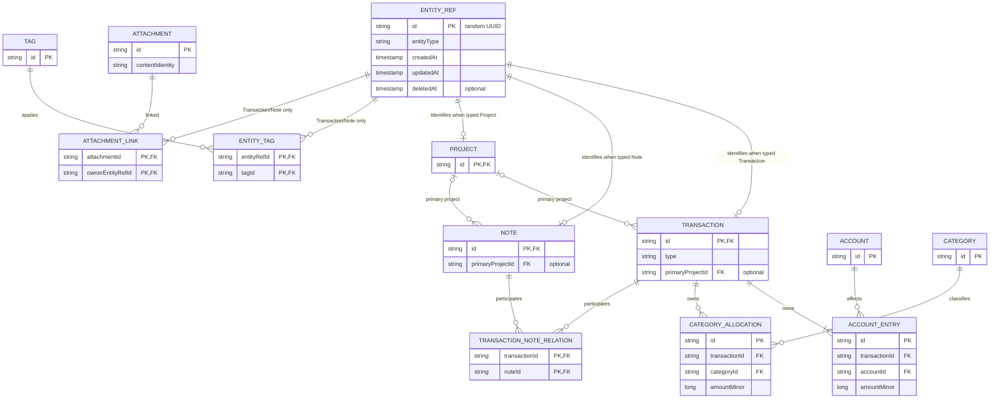

# Domain model

This document is the source of truth for domain identities, relationships, and invariants. It describes logical facts rather than persistence or UI forms. Observable MVP behavior remains defined by the [MVP requirements](../product/mvp-requirements.md).

## Core identity

`EntityRef` is the stable common identity used by capabilities that apply across selected entity types. It contains:

- an app-generated random UUID string ID;
- an entity type discriminator;
- created, updated, and deleted timestamps, with the deleted timestamp absent while active.

Every `Transaction`, `Note`, and `Project` has exactly one same-ID `EntityRef`. From the `EntityRef` side, each of those three subtype relationships is optional. They form an XOR constraint: `entityType` selects exactly one matching domain subtype, and exactly one of the three optional subtype relationships exists.

The three optional identity edges at the top of the diagram are conditional on `entityType` and subject to the XOR constraint: exactly one exists for each `EntityRef`.

## Finance aggregate

`Transaction` is an independent business fact and the header of a financial business event. It owns the event type, occurrence information, descriptive fields, and the references needed to interpret the event; it is not an account balance.

`AccountEntry` is an account effect owned by a `Transaction`. It associates one account with a signed integer amount in that account's currency. An MVP income or expense owns exactly one non-zero entry. Its transaction magnitude is the absolute value of that entry's `amountMinor`.

`CategoryAllocation` is a positive absolute allocation whose lifecycle is owned by a `Transaction`. It references exactly one required `Category` as its classifier; the category does not own the allocation. An income or expense has one or more allocations whose amounts sum exactly to the transaction magnitude.

`Account` identifies a balance-bearing account and its currency. Its balance is derived from effective entries rather than stored as a directly editable fact. `Category` is a first-level-only classifier for income or expense; MVP has no category parent, child, path, or hierarchy field.

The financial rules in this document refine, but do not duplicate, the user journeys in the [MVP requirements](../product/mvp-requirements.md).

## Shared capabilities

`Note` is an independent Markdown fact. Its body and confirmed attachments describe the note itself; its existence does not depend on a transaction.

`Project` is an independent fact. A `Transaction` or `Note` has zero or one primary project assignment, while one project may be primary for many transactions and notes.

`TransactionNoteRelation` is the plain many-to-many association between transactions and notes in MVP. It permits multiple notes per transaction and multiple transactions per note without a relation kind, placeholder metadata, or a generic relation abstraction.

`Tag` is a reusable label. `EntityTag` provides many-to-many assignment through `EntityRef`. The exact MVP endpoint whitelist is `Transaction` and `Note` EntityRefs only.

`Attachment` represents attachment metadata and content identity. `AttachmentLink` represents ownership through an owner's `EntityRef`. The exact MVP endpoint whitelist is `Transaction` and `Note` EntityRefs only. A `Project` has an `EntityRef` for stable identity and primary-project references, but MVP does not tag projects or attach images to them. Extending either endpoint whitelist requires a product decision and an accepted ADR. Storage location and file-operation policy are outside this domain model.

`Timeline` and `SearchDocument` are rebuildable read projections, never facts. They may reference domain IDs and be rebuilt from facts; they never become write authorities. Their persistence and indexing details belong to the owning data and storage architecture document.

## Catalog lifecycle

`Category`, `Tag`, and `Project` are three separate catalogs. Each catalog may contain zero items; absence of seeded items is valid domain state. The persisted naming, lifecycle, backup, and migration contract is accepted in [ADR 0004](decisions/0004-catalog-lifecycle-and-normalized-names.md).

Each item has a user-visible name. After Unicode trim, the name must contain 1–40 Unicode code points. Name semantics version 1 derives the comparison key by applying Unicode trim, then NFKC, then full Unicode case folding without locale dependence. Within each catalog, that versioned key is unique across active and archived items together. The comparison key is an invariant, not a second user-visible name. Renaming updates the one referenced catalog fact, so every historical allocation, tag association, or project assignment resolves the current name. A create request colliding with an archived item is rejected as a duplicate and identifies Restore as the valid transition.

The availability rule distinguishes a historical reference from a new request:

- only an active `Category` may be introduced by a new or changed `CategoryAllocation`;
- only an active `Tag` may be introduced by a new `EntityTag` assignment;
- only an active `Project` may be introduced as a new primary-project assignment;
- an existing reference to an item that was archived later remains valid and resolvable, may remain unchanged during an unrelated owner edit, and displays the current name plus archived state;
- once an archived reference is removed, it cannot be added again unless the catalog item is restored first.

Category and Tag expose `create`, `rename`, `archive`, and `restore` lifecycle transitions. They have no MVP hard-delete transition. Project exposes the same user-visible lifecycle, with Archive represented by the Project `EntityRef` soft-delete state and Restore clearing that recoverable state. Each lifecycle transition is one atomic durable catalog operation: validation or persistence failure leaves the prior catalog fact and every historical reference unchanged.

Catalog names are user content even though they are not credentials or cryptographic secrets. They are forbidden from retained or exported diagnostic events under the engineering logging boundary.

## Deletion and archive

- `Transaction` and `Note` use soft delete first: deletion records a deleted timestamp on their `EntityRef` and excludes the fact from effective reads while preserving recoverability and history.
- User-visible Project Archive uses the Project `EntityRef` soft-delete state. It removes the project from the default active list and new-assignment choices, but existing primary assignments continue to resolve it as archived. Restore makes it active and selectable again.
- Category and Tag use an explicit recoverable archived state. Archiving prevents new allocation or assignment without altering historical `CategoryAllocation` or `EntityTag` records; Restore makes the item available again.
- `Account` with history is archived, not deleted. Its account-specific lifecycle is outside the shared catalog contract.
- MVP exposes no hard delete or physical purge action for Category, Tag, or Project.

### Physical purge invariant

A physical purge is an internal maintenance invariant rather than an MVP user action. If a future approved maintenance flow invokes it, it is one atomic operation: it deletes the concrete fact (`Transaction`, `Note`, or `Project`), its same-ID `EntityRef`, all owned children, and all applicable relation records. If any required cleanup fails, none of the purge changes is committed. The type-specific cleanup is:

- `Transaction`: delete its `AccountEntry` and `CategoryAllocation` children; delete its `TransactionNoteRelation`, `EntityTag`, and `AttachmentLink` records; then delete the `Transaction` and same-ID `EntityRef`.
- `Note`: delete its `TransactionNoteRelation`, `EntityTag`, and `AttachmentLink` records; then delete the `Note` and same-ID `EntityRef`.
- `Project`: first, within the same atomic operation, clear every primary-project assignment on referencing transactions and notes; never delete those `Transaction` or `Note` facts; then delete the `Project` and same-ID `EntityRef`.

Deleting an `AttachmentLink` removes only the ownership relation and never directly deletes attachment physical content. Physical content is deleted only when its reference count is zero and the cleanup grace period has elapsed, so purge cannot bypass the attachment lifecycle rule.

## Deferred scope

The following concepts are explicitly deferred and must not acquire placeholder fields or abstractions in MVP:

- generic `EntityRelation`;
- cross-currency transfers or rate snapshots;
- `Task` and `Reminder`;
- sync metadata or a change log;
- a full chart of accounts.

## Invariants

### Identity and relationship invariants

- All IDs are app-generated random UUID strings and remain stable for the lifetime of the logical fact.
- Every `Transaction`, `Note`, and `Project` has exactly one same-ID `EntityRef`; the `EntityRef.entityType` matches that fact.
- The subtype relationships form an XOR: each `EntityRef.entityType` selects exactly one matching domain subtype, and exactly one of its optional `Transaction`, `Note`, or `Project` relationships exists.
- A transaction or note has at most one primary project assignment.
- `EntityTag` and `AttachmentLink` endpoints are limited to `Transaction` and `Note` EntityRefs in MVP; a `Project` EntityRef is not a valid endpoint for either capability.
- Typed relation endpoints must exist and match the relation's declared entity types.
- `Timeline` and `SearchDocument` are disposable projections and cannot originate domain writes.
- Category, Tag, and Project catalogs may be empty and receive no personalized seed data.
- Category is first-level only and has no hierarchy relationship in MVP.
- Every Category, Tag, and Project name is 1–40 Unicode code points after Unicode trim and has a version-1 key derived by Unicode trim → NFKC → full Unicode case fold, unique across active and archived items within that catalog.
- Archived Category, Tag, and Project items cannot be introduced by new allocations or assignments; existing historical references remain valid, retain their endpoint type, and resolve the current name plus archived state.
- Category and Tag have no hard-delete transition in MVP. Project Archive is its recoverable `EntityRef` soft-delete transition; no Category, Tag, or Project physical purge is exposed to the user.

### Financial invariants

- All money is stored and calculated as integer minor units. `Float` and `Double` are forbidden for monetary amounts.
- An MVP income or expense has exactly one non-zero `AccountEntry`. An expense entry is negative; an income entry is positive; the transaction magnitude is `abs(AccountEntry.amountMinor)`.
- Every category allocation amount is a positive absolute value.
- An income or expense has one or more category allocations that sum exactly to the transaction magnitude.
- A same-currency transfer has exactly two `AccountEntry` rows, references two distinct accounts, and is zero-sum (its algebraic sum is zero; 代数和为零) across those entries.
- A transfer has no category allocation.
- `OPENING_BALANCE` is a transaction with exactly one `AccountEntry`; there is no direct balance field.
- Creating an `Account`, its `OPENING_BALANCE` transaction, and that transaction's unique `AccountEntry` is one atomic operation: all three are created or none is created.
- Account balance equals the sum of all effective `AccountEntry` values and must be reproducible from those entries. An entry is effective when its owning transaction is not soft-deleted.
- A `Transaction`, its entries, allocations, and requested relations commit atomically. Failure leaves none of the requested changes committed.
- MVP does not claim full double-entry accounting.

### Transaction type invariant matrix

| Type | AccountEntry cardinality | Sign/sum | CategoryAllocation | Atomic participants |
|---|---|---|---|---|
| `OPENING_BALANCE` | Exactly one | Its signed value defines the opening balance | None | `Account` + `Transaction` + its unique `AccountEntry`; requested relations, if any, join the same commit |
| `INCOME` | Exactly one, non-zero | Positive; magnitude = `abs(entry.amountMinor)` | One or more positive allocations summing exactly to magnitude | `Transaction` + `AccountEntry` + all allocations + requested relations |
| `EXPENSE` | Exactly one, non-zero | Negative; magnitude = `abs(entry.amountMinor)` | One or more positive allocations summing exactly to magnitude | `Transaction` + `AccountEntry` + all allocations + requested relations |
| `TRANSFER` | Exactly two, non-zero, for distinct same-currency accounts | Source negative, destination positive, algebraic sum zero | None | `Transaction` + both `AccountEntry` rows + requested relations |
