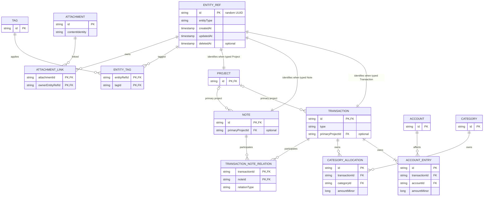

# Domain model

This document is the source of truth for domain identities, relationships, and invariants. It describes logical facts rather than persistence or UI forms. Observable MVP behavior remains defined by the [MVP requirements](../product/mvp-requirements.md).

## Core identity

`EntityRef` is the stable common identity used by capabilities that apply across selected entity types. It contains:

- an app-generated random UUID string ID;
- an entity type discriminator;
- created, updated, and deleted timestamps, with the deleted timestamp absent while active.

`EntityRef` has a one-to-one identity relationship with each eligible concrete fact: `Transaction`, `Note`, or `Project`. The relationship selected by the entity type is mutually exclusive: one `EntityRef` identifies exactly one concrete fact, and that fact uses the same ID.

The three identity edges at the top of the diagram are conditional on `entityType`; they do not imply that one `EntityRef` identifies all three concrete facts.

## Finance aggregate

`Transaction` is an independent business fact and the header of a financial business event. It owns the event type, occurrence information, descriptive fields, and the references needed to interpret the event; it is not an account balance.

`AccountEntry` is an account effect owned by a `Transaction`. It associates one account with a signed integer amount in that account's currency. A transaction has one or more entries according to its type.

`CategoryAllocation` is a positive absolute allocation owned by both a `Transaction` and a `Category`. It explains the categorized magnitude of an income or expense without carrying the account-effect sign.

`Account` identifies a balance-bearing account and its currency. Its balance is derived from effective entries rather than stored as a directly editable fact. `Category` classifies income or expense and may be archived while historical allocations continue to reference it.

The financial rules in this document refine, but do not duplicate, the user journeys in the [MVP requirements](../product/mvp-requirements.md).

## Shared capabilities

`Note` is an independent Markdown fact. Its body and confirmed attachments describe the note itself; its existence does not depend on a transaction.

`Project` is an independent fact. A `Transaction` or `Note` has zero or one primary project assignment, while one project may be primary for many transactions and notes.

`TransactionNoteRelation` is the typed many-to-many association between transactions and notes. It permits multiple notes per transaction and multiple transactions per note without introducing a generic relation abstraction.

`Tag` is a reusable label. `EntityTag` provides the many-to-many assignment of tags to eligible facts through `EntityRef`, so the tagging capability uses stable common identity rather than type-specific duplicate associations.

`Attachment` represents attachment metadata and content identity. `AttachmentLink` represents ownership of that attachment through an owner's `EntityRef`. Storage location and file-operation policy are outside this domain model.

`Timeline` and `SearchDocument` are rebuildable read projections, never facts. They may reference domain IDs and be rebuilt from facts; they never become write authorities. Their persistence and indexing details belong to the owning data and storage architecture document.

## Deletion and archive

- `Transaction`, `Note`, and `Project` use soft delete first: deletion records a deleted timestamp on their `EntityRef` and excludes the fact from effective reads while preserving recoverability and history.
- An `Account` or `Category` with history is archived, not deleted. Archiving prevents inappropriate new use without altering past entries or allocations.
- When a parent fact is eventually physically removed, its relation records cascade with it so no `TransactionNoteRelation`, `EntityTag`, or `AttachmentLink` is orphaned.
- Attachment physical content is deleted only after its reference count reaches zero and the cleanup grace period has elapsed. Removing one owner never removes content still referenced by another owner.

## Deferred scope

The following concepts are explicitly deferred and must not acquire placeholder fields or abstractions in MVP:

- generic `EntityRelation`;
- cross-currency transfers or rate snapshots;
- `Task` and `Reminder`;
- sync metadata or a change log;
- a full chart of accounts.

## Invariants

### Identity and relationship invariants

- All IDs are app-generated random UUID strings and remain stable for the lifetime of the logical fact.
- Every `Transaction`, `Note`, and `Project` has exactly one same-ID `EntityRef`; the `EntityRef.entityType` matches that fact.
- A transaction or note has at most one primary project assignment.
- Typed relation endpoints must exist and match the relation's declared entity types.
- `Timeline` and `SearchDocument` are disposable projections and cannot originate domain writes.

### Financial invariants

- All money is stored and calculated as integer minor units. `Float` and `Double` are forbidden for monetary amounts.
- An expense has a negative account effect; income has a positive account effect.
- Every category allocation amount is a positive absolute value.
- For income or expense, category allocations sum exactly to the transaction magnitude.
- A same-currency transfer has exactly two `AccountEntry` rows, references two distinct accounts, and is zero-sum (its algebraic sum is zero; 代数和为零) across those entries.
- A transfer has no category allocation.
- `OPENING_BALANCE` is a transaction with exactly one `AccountEntry`; there is no direct balance field.
- Account balance equals the sum of all effective `AccountEntry` values and must be reproducible from those entries. An entry is effective when its owning transaction is not soft-deleted.
- A `Transaction`, its entries, allocations, and requested relations commit atomically. Failure leaves none of the requested changes committed.
- MVP does not claim full double-entry accounting.
