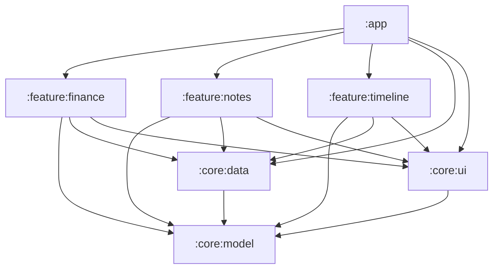
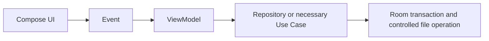
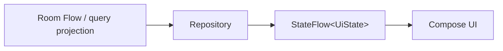

# Architecture overview

This document is the source of truth for module boundaries, dependency direction, and application data flow. Product behavior remains owned by the [MVP requirements](../product/mvp-requirements.md), while entity relationships and invariants are owned by the [domain model](domain-model.md).

## Module map

The application has exactly seven Gradle modules:

An arrow means “depends on.” `:app` composes all three feature modules and owns their application-level wiring. The absence of arrows between feature modules is intentional.

## Responsibilities

| Gradle module | Responsibility |
|---|---|
| `:app` | Application, navigation, dependency injection, theme, deep links, and the system share entry. |
| `:feature:finance` | Accounts, transactions, categories, balances, and basic statistics. |
| `:feature:notes` | Markdown notes, images, and transaction-note interaction. |
| `:feature:timeline` | Day timeline, project aggregation, and unified search results. |
| `:core:model` | Pure Kotlin domain IDs, `Money`, enums, and public value objects. |
| `:core:data` | Room, repositories, transactions, attachments, search, migration, and import/export. |
| `:core:ui` | Design system, amount input, date components, and shared UI states. |

## Dependency rules

- `:app` is the composition root. It may depend on feature modules and the core modules needed to wire them, but it does not absorb feature behavior.
- A feature module depends only on the core modules it needs. Feature modules never depend on one another.
- No core module depends on a feature module. `:core:model` is platform-independent and has no dependency on another project module.
- `:core:data` owns persistence and external data operations; `:core:ui` may use public values from `:core:model`, but neither core module owns a product journey.
- `:feature:timeline` consumes read projections and queries. It never writes finance or notes facts; edits navigate to the owning feature.
- UI code does not access a DAO, Room Entity, or a physical attachment path. UI may use Android `Context` for legitimate platform UI integration, but never to bypass repositories for persistence, file I/O, or physical-path access. Platform and storage details stay behind application-facing interfaces.

## State and data flow

Write flow:

Read flow:

Each ViewModel exposes an immutable `StateFlow<UiState>`. The UI sends events and renders state; it does not receive persistence representations. A ViewModel keeps all entered fields and selected media in draft state until the complete durable save succeeds. Failure leaves the draft available for correction or retry and does not surface a success state. The precise user-visible durability contract is defined by the [MVP requirements](../product/mvp-requirements.md).

## Use Case policy

A Use Case exists only when at least one of these conditions holds:

- the operation requires cross-aggregate atomicity;
- the behavior is reused by multiple ViewModels;
- a domain invariant must be maintained centrally.

The initially valid Use Cases are:

- transfer;
- transaction-note association;
- delete plus relation cleanup;
- complete export;
- overwrite restore.

Do not introduce mechanical table → repository → Use Case layering. A Repository may directly serve a ViewModel when the operation stays within one aggregate, has one consumer, and does not centralize an invariant. Financial and relationship invariants remain governed by the [domain model](domain-model.md).

## Future split thresholds

Split an existing module only when all four conditions are true:

1. the candidate boundary has a stable public interface;
2. at least two consumers need that interface;
3. the candidate provides an independent test boundary;
4. the split reduces the dependency surface.

Growth in file count, package count, or team preference alone is not a split signal. Until every threshold is met, keep the boundary inside its current module and avoid speculative interfaces or empty modules.
