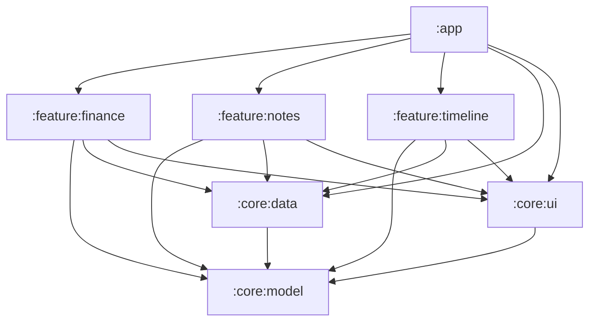
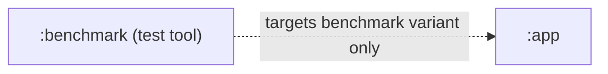
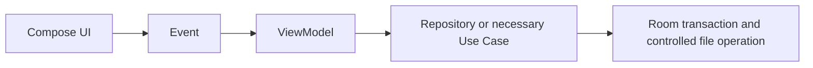
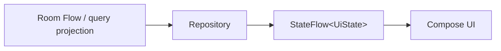
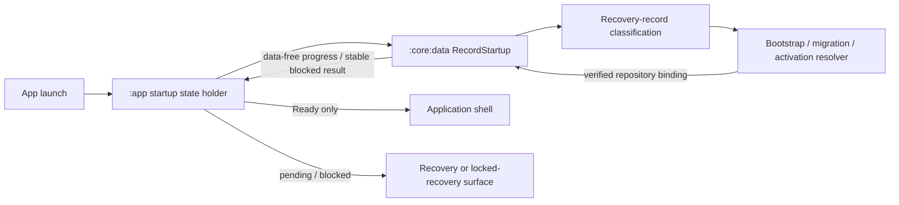

# Architecture overview

This document is the source of truth for module boundaries, dependency direction, and application data flow. Product behavior remains owned by the [MVP requirements](../product/mvp-requirements.md), while entity relationships and invariants are owned by the [domain model](domain-model.md).

## Module map

The production application has exactly seven Gradle modules. This production graph is the product architecture and is exact:

An arrow means “depends on.” `:app` composes all three feature modules and owns their application-level wiring. The absence of arrows between feature modules is intentional.

Build tooling may add a Gradle project only through an accepted ADR that defines a test-only owner, dependency edge, release exclusion, machine check, and removal path. [ADR 0011](decisions/0011-macrobenchmark-test-module-boundary.md) authorizes exactly one such project, `:benchmark`, for out-of-process Macrobenchmark execution:

`:benchmark` is not an eighth production module. It cannot contribute code, resources, manifest entries, dependencies, or behavior to `main` or `release`; it owns no product journey and exposes no application API. The machine check treats the exact seven-module production graph and the test-tool allowlist as separate sets, permits only the `:benchmark` → `:app` test edge, and rejects every unapproved project or edge.

## Responsibilities

| Gradle module | Responsibility |
|---|---|
| `:app` | Application, navigation, dependency injection, theme, deep links, the system share entry, and application-scoped startup progress plus recovery/shell routing. |
| `:feature:finance` | Accounts, transactions, categories, balances, and basic statistics. |
| `:feature:notes` | Markdown notes, images, and transaction-note interaction. |
| `:feature:timeline` | Day timeline, project aggregation, and unified search results. |
| `:core:model` | Pure Kotlin domain IDs, `Money`, enums, and public value objects. |
| `:core:data` | Room, repositories, transactions, attachments, search, migration, import/export, the single startup/recovery coordinator, and idempotent maintenance handlers. |
| `:core:ui` | Design system, amount input, date components, and shared UI states. |

The test-tool project has a separate responsibility:

| Test-tool project | Responsibility |
|---|---|
| `:benchmark` | Out-of-process Macrobenchmark runner for an explicitly approved benchmark variant; never an application or feature owner. |

## Dependency rules

- `:app` is the composition root. It may depend on feature modules and the core modules needed to wire them, but it does not absorb feature behavior.
- A feature module depends only on the core modules it needs. Feature modules never depend on one another.
- No core module depends on a feature module. `:core:model` is platform-independent and has no dependency on another project module.
- `:core:data` owns persistence and external data operations; `:core:ui` may use public values from `:core:model`, but neither core module owns a product journey.
- `:feature:timeline` consumes read projections and queries. It never writes finance or notes facts; edits navigate to the owning feature.
- UI code does not access a DAO, Room Entity, or a physical attachment path. UI may use Android `Context` for legitimate platform UI integration, but never to bypass repositories for persistence, file I/O, or physical-path access. Platform and storage details stay behind application-facing interfaces.
- A test-tool project may target an application benchmark variant only when an accepted ADR authorizes it. It cannot be on a production module's dependency path, cannot relax production dependency rules, and cannot make benchmark-only declarations visible in `main` or `release`.

## State and data flow

Write flow:

Read flow:

Startup flow:

`:app` owns one application-scoped startup-state lifetime and invokes the suspend `:core:data` coordinator off the main thread. `:core:data` remains the sole owner of recovery records, ordering, mutation, validation, and repository construction. Progress contains no persistence representation and cannot be used as completion evidence. The shell is constructed only from the coordinator's verified Ready result.

Each ViewModel exposes an immutable `StateFlow<UiState>`. The UI sends events and renders state; it does not receive persistence representations. A ViewModel keeps all entered fields and selected media in draft state until the complete durable save succeeds. Failure leaves the draft available for correction or retry and does not surface a success state. The precise user-visible durability contract is defined by the [MVP requirements](../product/mvp-requirements.md).

For M2 finance, `:app` passes the startup-verified repository binding and typed navigation callbacks into `:feature:finance`; it does not translate finance commands or own drafts. Finance ViewModels consume typed application values and Flows from `:core:data`. Account/opening, Income/Expense plus allocations, Transfer, Transaction Withdraw/Restore, and Category lifecycle each cross one repository-owned atomic boundary. A potentially committed response is reconciled by stable identity inside the data boundary before UI success; no ViewModel or composable infers commit state from an exception.

## Deferred maintenance boundary

AndroidX WorkManager is part of the approved native stack. It schedules only delayed, idempotent, non-user-blocking maintenance whose correctness preconditions are already durably represented: zero-reference attachment cleanup after its grace period, retry of retiring-generation cleanup, and another maintenance operation only after explicit architecture approval.

WorkManager never owns user Save, CSV export, logical backup, overwrite restore, migration, generation activation/rollback, startup validation, or another correctness-critical path. `:app` owns the foreground startup lifetime and invokes the single `:core:data` coordinator; the gate remains synchronous with respect to correctness—migration/activation resolution finishes before Room-backed normal use and the shell—even though suspend work runs off the main thread and emits data-free progress. Foreground operations remain in their owning ViewModel/repository state machine. Workers call `:core:data` maintenance handlers through unique work keyed by persisted operation/content identity and may retry only typed transient failures under bounded policy.

## Use Case policy

A Use Case exists only when at least one of these conditions holds:

- the operation requires cross-aggregate atomicity;
- the behavior is reused by multiple ViewModels;
- a domain invariant must be maintained centrally.

The initially valid Use Cases are:

- transfer;
- transaction-note association;
- delete plus relation cleanup;
- complete export;
- overwrite restore.

Do not introduce mechanical table → repository → Use Case layering. A Repository may directly serve a ViewModel when the operation stays within one aggregate, has one consumer, and does not centralize an invariant. Financial and relationship invariants remain governed by the [domain model](domain-model.md).

## Future split thresholds

Split an existing production module, or add another production module, only when all four conditions are true:

1. the candidate boundary has a stable public interface;
2. at least two consumers need that interface;
3. the candidate provides an independent test boundary;
4. the split reduces the dependency surface.

Growth in file count, package count, or team preference alone is not a split signal. Until every threshold is met, keep the boundary inside its current module and avoid speculative interfaces or empty modules.

A test-tool project is not a production split and does not use these four thresholds. It instead requires the narrower ADR-controlled boundary above and must remain removable without changing production source, schema, behavior, or release artifacts.
