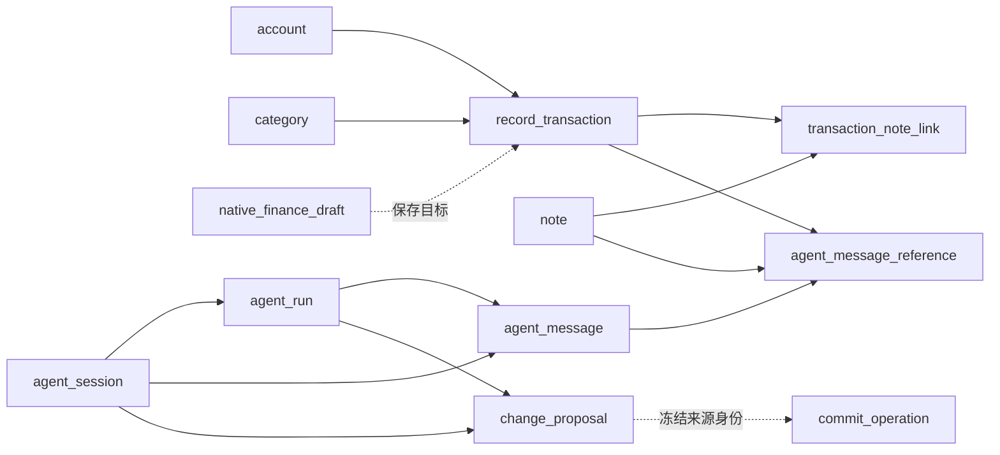

# Record 2.0 B0 数据模型审查包

2026-10-23（Asia/Shanghai）。**负责人审查条件已落实，修订版及Schema v1实施已获批准**。设计审查记录由[V1 Plan §19](../specs/record2/v1/plan.md#19-b0数据模型设计授权与交付)拥有，当前精确授权/实际结果见[Plan §20](../specs/record2/v1/plan.md#20-schema-v1实施授权与执行)。本文拥有设计字段和语义，不包含实施SQL/实体或迁移；获批Schema实现在R2源码/生成文件中。长期取舍见[Accepted ADR 0018](decisions/0018-record2-data-concurrency-and-history.md)。

## 1. 结论与范围

推荐在R2独立私有`record2.db`内，以**业务事实、原生草稿、提案/提交、用户历史、设备授权**五类职责组织14张候选表，不建立通用EntityRef、余额分录或第二份聊天历史库。表数是完整V1字段归属的结果，不是模块数量或本轮实现任务。

核心建议：每个Transaction/Note只有一个业务`version`，字段、生命周期和关联变化共同参与CAS；已确认Operation独立保存完整冻结输入与结果，不依赖聊天存活；新数据代际使旧执行资格失效，保留可读历史。前两项减少实现分叉，代价分别是保守冲突和必须保留必要提交材料。

依据：[Spec §4–6](../specs/record2/v1/spec.md)、[冻结架构](record2-v1-unified-architecture.md)、[来源基线](../product/record2-v1-decision-baseline.md)、[A0身份结论](record2-a0-engineering-design.md#3-正式身份建议与兼容边界)。正式根为`record2/`、单`:app`、namespace/release为`com.paherdin.record2`，debug为`.debug`。本设计不读取R1或C1数据库，不接纳C1实验Schema或源码；现有R2只有金额实现和编译接缝，没有正式业务库。

不扩展账户数量、分类分摊、附件、标签、余额、转账、云同步、审计事件流或自动后台恢复。所有最终视觉和未确认交互仍为`DESIGN-OWNER：待负责人指导与确认`。

## 2. 共同表示与责任

| 项目 | 推荐表示与约束 | 校验owner |
|---|---|---|
| 稳定身份 | 新业务/会话/Run/Proposal/Operation使用创建前生成的规范小写UUID文本；默认账户及种子分类使用实现时固定的保留身份，不按名称查重。ID不由模型指定，不因编辑/恢复改写 | 对应Application Service；导入预检 |
| 记录引用 | `TransactionId`与`NoteId`为不同业务类型；统一排序使用`(recordType, id)`，不新建公共实体父表 | records；查询/导航适配 |
| 钱 | `amountMinor: Long`，范围`1..Long.MAX_VALUE`；方向只允许INCOME/EXPENSE；币种固定CNY。分开累加收入/支出并精确检测溢出 | records；复用现有Money；独立BigInteger/BigDecimal oracle |
| 文本 | Note原始正文原样存储；全空白校验只判断可保存性，不trim后存。交易`memo`为非空字符串，可为空串；不引入旧500字符/Unicode归一化约定 | records；有界工具/导入解析 |
| 时间 | 正式发生/创建/修改/删除时刻统一为UTC epoch millis Long，转换使用受校验的Instant范围；发生时间不晚于提交时Clock。历史日期不另存第二份事实日期 | records；Clock/ZoneId注入 |
| 相对时间 | prepare阶段解析为具体时刻；展示/冻结同时保留`zoneId`、本地日期时刻和选定offset的解释。DST gap拒绝、overlap取较早offset；B只校验已冻结时刻，不重解“昨天” | proposals；原生时间输入适配 |
| 版本 | 业务version、draftRevision、proposal revision、historyVersion、authEpoch等为正Long，初始化1；消息序号和businessRevision可从0起。递增前检查溢出，失败零变化；墙钟不充当版本 | 对应服务；storage事务 |
| 代际 | `dataGeneration`为本地初始化/成功整体恢复生成的UUID；与Room版本、ZIP格式版本、processOwnerId分别表示。所有旧请求须先通过代际检查 | storage；恢复协调 |
| 序列化 | Proposal/Operation/草稿收据为有版本的封闭结构化UTF-8 JSON；字段类型/必填/未知操作严格验证，无任意类名反序列化。金额/版本保持整数；完整冻结字节和SHA-256同时保留，校验和不提供保密或真实性认证 | proposals；导入解析 |

数据库负责主键、非空、唯一索引、外键；枚举、值域、状态组合、JSON语义、CAS及可见性由统一服务在事务内负责，恢复入口执行同等校验。**不能声称Room注解已经提供所有CHECK约束。** 本轮不引入自定义触发器或第二套建表系统；实现时若确需增加物理机制，先回到设计审核。

主要关系如下。实线是生命周期外键；虚线只表示已冻结来源或待保存目标，不随父对象级联删除。

## 3. 候选物理模型

下列为设计字段清单；未写nullable的字段必填。`id`均为主键；所有外键的子列应有相应索引。默认外键删除策略为RESTRICT，显式列出的会话清理按§8逐步事务执行，不靠跨域级联。

### 3.1 业务事实与代际：6张表

| 候选表 / owner | 字段 | 物理约束与业务约束 |
|---|---|---|
| `record_data_state` / storage | 固定单行`id=1`；`dataGeneration`、`businessRevision`、`processOwnerId`；nullable `restoreReceipt` | 主键保证单行身份，服务拒绝其他id；记录全局业务变化及进程所有权。restoreReceipt只在成功恢复事务内写入已验证候选身份/目标代际，最终字段随G0批准 |
| `account` / records | `id`、`name`、`currency`、`version`、`createdAt`、`updatedAt` | 仅接受保留默认账户身份、非空可见名称和CNY；V1无创建第二账户/删除入口。初始化按固定id“缺失才插入”，禁止REPLACE或覆盖用户改名 |
| `category` / records | `id`、`name`、`direction`、`version`、`createdAt`、`updatedAt` | `direction`仅INCOME/EXPENSE；唯一索引`(id,direction)`供组合外键。种子按固定id幂等补齐，不按显示名称生成新身份；不引入分类编辑/归档产品 |
| `record_transaction` / records | `id`、`direction`、`amountMinor`、`currency`、`accountId`、nullable `categoryId`、`memo`、`occurredAt`、`version`、`createdAt`、`updatedAt` | accountId外键；`(categoryId,direction)`组合外键指向分类，未分类为null。正整数分/CNY/合法时刻在服务和导入校验；同身份编辑，不物理删除交易 |
| `note` / records | `id`、`body`、`occurredAt`、`version`、`createdAt`、`updatedAt`、nullable `deletedAt` | deletedAt为空即正常，非空即已删除，避免双字段状态矛盾；删除时刻不得早于创建。正文非全空白；删除保留正文和原发生时刻；正常查询必须加可见性条件 |
| `transaction_note_link` / records | `transactionId`、`noteId` | 复合主键，两端RESTRICT外键；反向`(noteId,transactionId)`索引。关系不复制金额/正文，不单独存删除状态或版本；合法隐藏关系仍有真实端点 |

业务读取索引：交易`(occurredAt,id)`、`(direction,occurredAt,id)`、`accountId`、`(categoryId,direction)`；Note的`(deletedAt,occurredAt,id)`供正常时间线和删除列表范围查询。是否再加查询索引由B4执行计划与预算证明，不预建FTS/影子投影。

预置分类的具体名称/数量尚未单独批准；本设计只确定方向与稳定身份规则。B1初始化验收前须有负责人确认的种子清单，不能把来源基线中的示例当作批准。账户改名递增账户version；未来如允许分类修改，也必须递增分类version并单独授权范围。

### 3.2 原生草稿：1张表

`native_finance_draft`由records拥有，固定`slot=1`为主键，字段为`draftId`、`draftRevision`、`state`、`mode`、`recordId`、nullable `baseVersion`、`inputJson`、`updatedAt`和nullable `saveReceiptJson`。

- `state`为EDITING/SAVED/DISCARDED；只有EDITING属于待恢复草稿。slot不等于draft身份；新一次编辑生成新draftId，同一slot上的revision递增，不重置。
- `mode`为NEW/EDIT。NEW提前固定recordId、baseVersion为空；EDIT固定既有recordId与读取时version。inputJson保留原金额文本、方向、账户/分类及其版本、说明、日期解释和表单输入，不冒充合法正式值。
- 更新/放弃/消费都校验`draftId + expectedDraftRevision + dataGeneration`，迟到写不能覆盖新草稿。首次写入和替换slot也需比较当前slot状态/版本，不用无条件upsert。
- 保存前补齐最新草稿，正式交易写入、版本推进、草稿SAVED及保存收据在同一事务提交；收据绑定draftId/revision、规范化输入、recordId和结果version。重复同次保存返回原收据，不重写交易。
- SAVED仅为最后一次保存的核查依据，不显示为待新增；开始另一草稿可以替换该收据。旧draftId此后拒绝写入，只能重读稳定recordId核查，不能盲目重放旧编辑。空slot首次成功写入后才可声称已保留。
- 明确放弃置DISCARDED并清除未提交输入；不能用AI提案替换slot。约500ms延迟和离开前补写沿用冻结行为；进程终止只承诺最近成功持久化的输入。

### 3.3 Proposal与Operation：2张表

| 候选表 / owner | 字段 | 约束 |
|---|---|---|
| `change_proposal` / proposals | `id`、`sessionId`、`originRunId`、`lastWriterRunId`、`creationRequestId`、`creationPayloadJson`、`revision`、`payloadJson`、`payloadDigest`、`payloadFormatVersion`、`dataGeneration`、`state`、nullable `activeSlot`、`createdAt`、`updatedAt` | session外键；originRun/lastWriterRun与session使用组合外键，父Run具备唯一`(id,sessionId)`。creationRequestId全库唯一，保留最初规范化内容以判断重复，后续修订不改它。唯一`(sessionId,activeSlot)`；活跃为1，否则null |
| `commit_operation` / proposals+storage | `id`、`proposalId`、`confirmedRevision`、`createdGeneration`、`frozenPayloadJson`、`payloadDigest`、`payloadFormatVersion`、`state`、`createdAt`、nullable `finishedAt`、nullable `resultJson`、nullable `rejectionCode` | proposalId唯一：建议一份Proposal一生只绑定一项Operation，比“最多一个非终态”更简单。proposalId为不可变来源身份，**无指向Proposal/Session/Run的生命周期外键**；核查输入完整独立。正式业务目标也不建立会删除Operation的外键 |

Operation的payload包含执行/核查必需的具体变更字段、新稳定ID、existing expectedVersions、账户/分类版本、localRef解析结果及依赖、确认时区解释和不可变`confirmedDisplayDigest`；该摘要与confirmedRevision共同标识用户当时确认的展示内容，独立于新ID解析后的payloadDigest，删除Proposal后仍可核对。result包含创建ID映射、受影响身份/提交后版本和足以核查原子结果的摘要。Applied后的result不可改写；目标后来合法编辑不修改旧结果，也不要求当前正文/金额仍等于提交时payload。

Proposal状态为EDITABLE、LOCKED、APPLIED、REJECTED_CONFLICT、REJECTED_INVALID、ABANDONED、NEEDS_REVIEW。EDITABLE/LOCKED占活跃slot；其余不占。NEEDS_REVIEW只表示恢复或失效后的待审材料，不能直接确认执行；重新读取目标和版本后生成新的活跃提案。Operation状态严格保留Pending/Applied/RejectedConflict/RejectedInvalid，不把“恢复隔离”伪装成业务拒绝。

JSON内引用是历史/意图，不是可绕过验证的外键替代品；A/B及恢复逐个解析并检查真实目标。不得为了保留旧提案而允许普通Agent访问软删除正文或Operation冻结正文。

### 3.4 Room权威会话历史：4张表

| 候选表 / owner | 字段 | 约束 |
|---|---|---|
| `agent_session` / sessions | `id`、nullable `title`、`createdAt`、`updatedAt`、`historyVersion`、`nextMessageSequence` | 不保留可被upsert复活的已删除会话行；删除后旧sessionId只会查无结果。暂不持久化导航焦点，后续若有需要只作可失效提示 |
| `agent_run` / sessions | `id`、`sessionId`、`dataGeneration`、`processOwnerId`、`receiverIdentity`、`authEpoch`、`proposalCreationRequestId`、`historyBoundarySequence`、`historyBoundaryVersion`、`state`、nullable `activeSlot`、`startedAt`、nullable `finishedAt`、nullable `safeErrorCode` | session外键；唯一`proposalCreationRequestId`、`(id,sessionId)`与`(sessionId,activeSlot)`。RUNNING占1，其他null；终态COMPLETED/FAILED/CANCELLED/INTERRUPTED不再转RUNNING。预算配置随D0冻结，不在库内保存敏感请求Trace |
| `agent_message` / sessions | `id`、`sessionId`、`runId`、`sequence`、`role`、`body`、`createdAt`、`resultKind`、nullable `resultJson`、nullable `proposalId`及`proposalRevision` | session外键，`(runId,sessionId)`组合外键；唯一`(sessionId,sequence)`和`(runId,role)`。每Run一条USER输入，至多一条最终ASSISTANT消息；流式片段非权威。resultKind限定普通输入/Answer/Navigate/ProposalReady/ClarificationNeeded，不保存隐藏推理或tool消息 |
| `agent_message_reference` / sessions | `messageId`、`ordinal`、nullable `transactionId`、nullable `noteId` | 主键`(messageId,ordinal)`；message外键；两个业务目标外键，服务保证恰一非空。引用不复制全文，不使用模型路由。删除消息前显式清理引用，不删除正式记录 |

消息完成性由关联Run终态确定，不再保存可冲突的第二份“完成”布尔值。ProposalReady等需要的目标/版本属于有界结构化结果，proposalId为历史引用，不要求删除会话后Proposal仍存活。正常打开引用始终重新校验存在/可见性，历史文字不是未来访问权限。

### 3.5 本机AI控制：1张表

`ai_control`由授权服务拥有，固定`id=1`，字段为`mode`（OFF/FULL）、`selectedReceiverIdentity`（nullable）、`grantReceiverIdentity`（nullable）、`grantScopeVersion`（nullable）、`grantDisclosureVersion`（nullable）、`grantedAt`（nullable）、`authEpoch`。接收方身份由受控配置描述真实Provider/接收方，不由模型提交任意URL。

初始OFF且无grant。开关、持续授权和Keystore凭据分别判断；凭据只通过独立本机安全存储查询，不进此表，包括密文/IV/Key别名材料也不放入逻辑备份。关闭/撤销/换接收方/凭据替换先递增authEpoch并失效当前Run，再取消网络；网络取消不替代落盘资格检查。恢复不导入此行，重置OFF/无授权；已有本机凭据是否清理由明确凭据操作处理，绝不自动沿用其授权。

## 4. 统一CAS及业务事务

### 4.1 为什么只用一个业务version

V1推荐统一`version`，不拆fieldVersion/relationVersion。一次成功事务内，一个已有Transaction/Note只递增一次，即便组合操作同时改字段和多条关系；新对象最终初始version为1。expectedVersion始终指事务前基线，不把同一提案里的操作序号当版本。账户/分类自己的version独立校验。

代价：正文自动保存会与并行关联提交冲突，关系变化也会阻止旧字段编辑。处理为重读和明确重审，不能自动用最新version覆盖旧意图。将来若确有高冲突证据再讨论拆向量，现阶段少一套混合比较规则更可靠。

| 写操作 | 提交前检查 | 原子修改 | 拒绝/重试 |
|---|---|---|---|
| 新建/编辑收支 | 代际、草稿身份/revision、金额/发生时间、账户/分类存在及版本、方向；编辑目标version | 完整字段；旧对象version+1；草稿消费/收据；businessRevision+1 | 非法返回Invalid；旧版本Conflict；提交未知查原draft/record身份，不生成新ID |
| Note首次保存/自动保存 | 新建稳定ID；非空白正文；旧Note必须正常且version匹配 | 正文/必要字段；既有version+1；businessRevision+1 | 新建空白无事实；清空旧正文拒绝；冲突不自动套新version重写 |
| Note软删除/撤销/恢复 | 原生入口；目标身份/代际/version；期望状态 | 只改deletedAt/修改元数据及Note version；保留全部关系；businessRevision+1 | 同目标状态可返回AlreadyInState并重读，不toggle、不写正文、不重复递增；状态不同且旧version则Conflict |
| 关联add/remove批次 | 两端类型/存在/正常可见/全部expectedVersions；add/remove集合互斥且无重复 | 增量关系；所有实际受影响已有端点version各+1；businessRevision+1 | 隐藏关系不参与remove；任一候选失效整批失败；重复已满足的合法增量在当前版本下为无变化，不推进版本 |
| 账户改名 | 合法名称/账户expectedVersion | 名称/version/updatedAt；businessRevision+1 | 不改既有交易accountId；冻结账户旧version的提案冲突 |

所有读取基线、值域验证和写入放在同一短Room事务；数据库更新还要包含version/状态条件并检查受影响行数。多对象先收集唯一端点/基线，任一失败抛出并回滚；不把逐表成功累计为“部分成功”。没有实际变化的合法请求不递增版本。相同目标出现不同expectedVersion直接Invalid，不挑一个继续。

Note编辑器按同一稳定身份串行提交最新待保存文本，前一回执确认数据库version后才发下一次CAS；迟到显示回执按编辑序号判断。外部改写/删除导致的冲突必须保留尚未成功保存的本地文本，重读结果不得静默覆盖编辑缓冲，也不得重试时盲目更新expectedVersion。B2必须验证这条状态行为，F0 D-NOTE确定冲突反馈及重审交互；本设计不指定新布局。AI预览只修改Proposal，不接入Note自动保存器。

删除Note只递增该Note版本，不递增关联Transaction：关系事实没有增减，旧提案/选择器必须同时携带Note版本并重验可见性，仍会失败。恢复同理；两侧列表由同一业务变化通知重新查询，不持久化可能漂移的可见计数。

### 4.2 查询、分页与汇总

时间线合并两张业务表，按`occurredAt DESC, recordType, id`固定全序；同类型id采用二进制文本排序。日期范围由查询时ZoneId求`[start,nextStart)`，不保存每天24小时假设。正常Note查询、详情、关联计数、候选和Agent分页统一隐藏deletedAt非空项，恢复入口使用独立原生查询。

cursor绑定代际、businessRevision、过滤/时区摘要及最后排序键；每页在一致读取快照中检查revision与取数。业务变化使旧cursor明确过期，调用方保留锚点重建当前结果，不跨不同revision直接拼页。这样避免并发修改发生时间造成静默漏重，不声称持有跨进程长读事务。连续浏览/返回上下文仍由B4/F1实证。

关键词读取正式正文/说明，不增加持久搜索副本；匹配规则、分段限额、查询预算由B4/D1收口。财务汇总从正式交易按真实范围精确累加，不包括草稿/Proposal，不借SQLite浮点total或未经检查的整数SUM处理溢出；具体实现由B4用独立大整数oracle验证。

## 5. prepare、确认和提交

### 5.1 创建身份、修订与规范化

Record在Run创建时固定并持久化`proposalCreationRequestId`，作为该Run首次“创建提案”的稳定creationRequestId；同Run只能借该身份创建一份提案，后续内容变化使用Revise。不得每次tool调用重造身份，也不使用tool_call_id。服务和导入同时检查Proposal的creationRequestId与originRun的该字段一致，不另外建请求表。

同请求/同最初规范化内容返回原提案及当前revision，不能覆盖后续修订；同请求/不同最初内容拒绝。重试发生于Run失效后也不得改写；历史核查走本地只读入口，不借过期工具恢复资格。新Run可在明确上下文下修订当前EDITABLE提案，须以当前Run身份、proposalId/expectedRevision CAS更新lastWriterRunId；originRunId保持来源身份。

Rejected后的重新审核必须由**用户主动发起新的AI任务**，通过E1正常启动事务创建新Run和新的proposalCreationRequestId；不能复用旧Run的创建身份或伪造无授权Run。C0在新Run内重读目标、可见性、版本与账户/分类，创建新的proposalId，用户重新确认后产生新的operationId。旧Proposal/Operation的终态、冻结输入和结果保持不变；Session已删除时通过正常会话入口开始新任务，不复活原会话。无新Run准入条件时只保留核查与既有原生业务入口，不自动创建可执行提案。

这与同代际Pending核查不同：Pending查原operationId，排除并发后仅用户主动受控同ID重试，不新造Proposal/Operation。恢复后的NEEDS_REVIEW或旧Pending若要形成新操作，也必须走上述新Run/新创建身份/重新确认路径，不能把待审状态当作执行授权。C0负责身份/提案约束，E1负责正常Run启动，C1负责确认与核查，G0/G1验证恢复隔离；不新增抽象层或改变原任务依赖。

payload只含六类封闭操作。prepare验证金额、绝对时间、真实账户/分类与版本、目标身份/版本；新对象由本提案localRef引用，拒绝重复/悬空/跨提案/类型错误/循环依赖。同一对象多个意图先规范化为唯一字段变更与增量关系集合，矛盾意图返回Invalid，不采用“最后一个赢”。C0冻结规范化编码、长度/操作数及解析预算，未定限额前不开放无界输入。

### 5.2 Transaction A

原生确认命令携带`proposalId + displayedRevision + displayedPayloadDigest + dataGeneration`。原生确认不要求原Run仍在运行，也不依赖AI开启；Agent不得调用这个入口。A在同一个短Room事务内按下列顺序处理：

1. **先按proposalId查唯一Operation，不以Proposal当前状态或是否仍存在作为核查前提。** 若已存在，比较其confirmedRevision与冻结payload内的confirmedDisplayDigest；同revision/同展示摘要返回原operationId及数据库中的当前状态/结果，无论Pending、Applied、RejectedConflict或RejectedInvalid。不创建新Operation、不重置状态、不改冻结输入；不同revision或不同摘要均拒绝，不能用幂等返回掩盖修改。
2. 既有Operation返回属于核查路径，不触发Transaction B。Pending仍需确认是否正在执行，并遵守§5.3的主动同ID重试条件；Applied返回原结果，Rejected返回原拒绝。跨代际返回的旧Operation只能作为历史核查，尤其旧Pending仍不可执行。Session/Proposal删除不影响上述只读核查；不得借返回结果复活父对象或暴露整份冻结正文。
3. 仅在没有既有Operation时，重新取Proposal的规范化字节核对已展示内容，要求EDITABLE、Session存在、同当前代际、revision/摘要相符；校验失败拒绝。为全部新对象分配稳定ID，生成operationId，冻结全部必要字段/基线/依赖及confirmedDisplayDigest，插入Pending并将Proposal改LOCKED。新ID替换localRef后另算冻结payloadDigest，不能混用展示摘要。Proposal唯一Operation约束拦截并发双击；若遇唯一竞争，先让本次A回滚，再重新核查同一Operation，不另造身份或吞异常继续提交。

首次创建成功后的前台确认链可继续B；重复确认返回既有Operation时，调用方必须展示/核查其当前状态，不能把这次返回当成新的提交指令。A不改正式业务表，也不消费原生草稿。只有首次创建分支要求当前Proposal可编辑，终态Proposal的相同确认不会因此被错误拒绝。

### 5.3 Transaction B与核查

1. 以operationId进入本地确定性服务，读完整持久payload并校验字节/digest/格式。Applied返回原result；Rejected返回原拒绝，均不再执行业务。
2. Pending必须满足createdGeneration等于当前代际；首次A后的前台确认链可继续B。恢复后旧Pending不符合；同代际进程中断的Pending仅在排除当前执行后由用户主动重试，启动核查本身不执行。
3. B单一事务内先校验所有账户/分类/目标版本、存在/可见性、金额/时间、依赖与新ID未被其他事实占用。确定性问题在任何业务写前写RejectedConflict/RejectedInvalid并结束；Proposal若仍在则同步终态/释放slot。
4. 验证通过后写全部事实、关系和版本、businessRevision，最后写Applied/result/finishedAt并同步仍存在的Proposal。写后异常或取消必须越过事务边界抛出，整体回滚到Pending；不能在事务内catch后写Rejected并提交已有修改。
5. 两个执行者依赖同一数据库写事务及Operation状态重验串行化；后到者读Applied返回相同结果。内存mutex只用于调度，不构成唯一幂等证明。网络/Koog调用永不进入A/B事务。

结果未知先查同operationId。Pending与“B未提交或已整体回滚”一致，Applied与全部事实同生效；数据库不可读则报告无法核查，不推断失败重建Operation。Rejected或NEEDS_REVIEW要重读并新建Proposal/新确认，不解锁旧冻结payload。

## 6. Run、消息与迟到保护

发起Run在一个事务校验mode/grant/凭据可用性及Session/代际/进程owner，插入带activeSlot=1的RUNNING与当前USER消息，并推进消息序号。Run记录此前历史sequence/historyVersion边界；无有效授权时不把原话送入Koog。唯一索引使同Session并发发起只成功一个事务。

ChatHistoryProvider只加载边界内COMPLETED Run的用户输入/最终回复；失败/中断输入在UI仍可读，但不拼成完成对话。当前输入仅经本Run参数加入一次。COMPLETED可包括Answer、合法导航、已持久ProposalReady或澄清；保存最终ASSISTANT、Run终态、释放slot及historyVersion更新必须同事务，ProposalReady还须校验对应持久提案身份/revision。

Koog上下文首版使用内存可丢弃适配，跨Run从Room重建，不新建缓存表。store不能修改用户消息；新Provider从完成历史重建，隐藏推理和未完成Tool序列只在当前Koog运行内存中处理。流式文本/缓存成功都不能单独使Run完成。

每个工具入口、请求外发前、prepare/修订写入、最终消息提交都重验`sessionId + runId + RUNNING + activeSlot + processOwnerId + dataGeneration + receiverIdentity + authEpoch`。取消、关闭/撤销/换Provider先持久失效并释放slot，再取消协程/HTTP。发送与撤销在同一应用调度边界排序；已开始远程请求无法撤回，尚未发送/迟到结果须被拦截。页面切换/Activity重建/关面板不改变Run资格。

冷启动先取得唯一应用进程所有权，再在启动门禁内把旧owner的RUNNING标INTERRUPTED、释放slot，设置新的processOwnerId。PID不足以识别生命周期，owner为每次进程启动UUID；多进程支持不在V1，不能未核旧owner退出就抢占活进程。业务/工具入口在恢复门禁完成前不开放。不自动执行旧模型、工具或Pending。

## 7. 唯一约束与外键实现边界

活跃Run/Proposal使用普通nullable槽位加唯一复合索引；SQLite唯一约束将null视为互异，因此可保留多条历史行，同时只允许一个`activeSlot=1`。slot与状态的一致性由服务事务及导入校验负责，不声称唯一索引能阻止非法slot=2。Room支持唯一索引及外键，正式生成与真实磁盘约束仍需后续验证。[SQLite UNIQUE/NULL说明](https://www.sqlite.org/nulls.html)、[Room唯一索引说明](https://developer.android.com/training/data-storage/room/defining-data#column-indexing)、[Room ForeignKey](https://developer.android.com/reference/androidx/room/ForeignKey)。

组合外键保证Run/消息/Proposal属于同Session；自引用/循环外键不用于绑定Run输入，输入的存在与恰一USER由Run启动事务保证。普通关系外键不检查软删除，所以可见性检查不能省略。分类组合外键中的categoryId为空代表未分类，方向枚举仍需服务校验。[SQLite外键说明](https://www.sqlite.org/foreignkeys.html)。

SQLite写事务同时只有一个writer，但语句约束失败不等于之前所有语句自动回滚；因此不能吞异常后继续提交。[SQLite事务语义](https://www.sqlite.org/lang_transaction.html)。Room事务/取消真实行为由C1故障矩阵证明，本轮只核官方机制，不运行建库实验。

## 8. 删除Session后的提交依据

Session删除是未来明确原生用户操作，本设计不授权现在执行删除。协议推荐在一个事务内：使有效Run终态/失效；未确认Proposal废弃；清理消息引用、消息、Proposal、Run，最后删除Session。外部缓存/焦点随后失效，持久Session已不存在使迟到写无法复活；事务失败则用户历史保持完整。实际删除提示归F0/E2设计。

commit_operation没有上述父行外键，保留已确认冻结输入、状态、结果与稳定来源proposalId。删除Session前先逐项确认Operation自包含、无依赖将删除的消息/提案才能核查；不满足就阻止不安全删除。冻结时只保留执行、幂等和核查必需的变更字段及身份/版本，不复制整段聊天、隐藏推理、模型Trace或无关记录快照；例如纯关联操作不复制两端Note正文。必要材料仍可能包含用户确认创建/修改的Note正文或交易说明，不能为隐藏这些材料而破坏不可变输入。

F0 D-SAFE/E2必须明确披露：**“删除AI会话”不等于删除已确认事务的全部提交依据**。历史管理/删除反馈不能声称所有相关文本已彻底消失，应说明必要冻结业务材料仍用于提交核查；具体文案和呈现待负责人设计批准。这个约束不授权永久保留完整聊天，也不引入新的后台清理或保留期限产品。

Operation核查与当前Session、AI模式和旧Run无关。当前代际Pending在Session删除后仍可从独立本地待核查入口由用户主动核查/受控同ID重试；具体入口归F0，不能因此给Agent开放commit。Applied结果在目标后来编辑/软删除后仍是历史结果，不通过重放恢复旧字段。

## 9. 完整备份、代际与恢复接缝

| 数据 | 备份/恢复语义 | 负责收口 |
|---|---|---|
| account/category/交易/Note/全部link | 同一逻辑快照保留稳定ID、版本、原文、删除时刻和隐藏关系；未分类null保持 | B1–B3、G0/G1 |
| 原生草稿 | 建议作为独立段保留EDITING与原输入/基线，明确未提交；恢复后只提示继续/放弃，基线重验。SAVED收据非草稿，是否保留核查材料由G0冻结 | G0（O4），不能静默消费或变流水 |
| Session/Message/引用/Run | 保留完整用户历史/顺序；RUNNING恢复为INTERRUPTED并清slot；旧owner/授权不恢复资格 | E1/E2、G0/G1 |
| Proposal | 未确认EDITABLE及旧Pending对应LOCKED均恢复为NEEDS_REVIEW、清slot，保留可解释内容及原Operation历史；终态保持可读。重新审查后新Proposal/新确认，不让旧锁占住活跃slot | C0、G0/G1 |
| CommitOperation | Applied及结果完整保留；Rejected保留；Pending保留原createdGeneration/冻结输入为不可直接执行历史，可由显式新审核形成新Proposal。不得改写旧payload为新代际 | C1、G0/G1 |
| record_data_state | 来源代际仅作来源；恢复成功原子生成新本地代际/新的processOwner，写验证收据并失效旧业务cursor/服务请求 | G0 |
| ai_control/凭据/Koog缓存 | 不导出有效授权、Key/密文/IV/Keystore材料/隐藏推理/Trace；恢复OFF/无grant，上下文从完成历史重建 | E0、G0/G1 |

原库同进程重启不更换dataGeneration；ZIP整体恢复必须更换。对旧Pending的执行检查始终先比较createdGeneration；即便Session/Proposal ID相同也不能直接执行。Operation原结果和payload不可为了跨代际导入而改写；活跃slot/新本地控制资格在逻辑恢复层转换。

默认建议由G0评估**单一数据库内原子整体导入**：隔离预检完成后，在独占写门禁中停止并等待自动保存/Run/B执行、清空旧请求资格，使用同一个本地事务替换逻辑内容并更新代际/收据；中途失败回滚O，成功提交完整S。这个建议不批准删除数据，也不提前冻结G0的恢复实现；G0须结合C1/E1证据、空间/时长/进程终止矩阵选择唯一协议，若不可行再审核物理切换，不同时建设两套恢复框架。

导入不能受本机当前Clock漂移影响而擅改合法历史：正常写禁止未来时刻；ZIP时刻的范围、跨设备时钟差与拒绝策略由G0明确，不能静默截断。ZIP编码/formatVersion/条目布局/哈希/长度/解压量/压缩比/余量数值由G0冻结，不能从本设计推导旧格式兼容。

同一快照需要同时覆盖业务、Operation和用户历史；备份开始时Running/Pending/自动保存竞态的停写/快照方式也属G0。Applied映射验证身份/结果合法历史，不把后续合法编辑判为损坏；所有外键、JSON引用、可读消息/提案状态与隐藏关系在隔离候选中整体验证，不跳坏行。

## 10. 验证接缝与拒绝矩阵

以下是完整业务实现阶段必须证明的oracle；设计交付时全部NOT RUN。后续Schema v1批次的物理约束/内部DAO/独立磁盘重开实证由[Plan §20.2](../specs/record2/v1/plan.md#202-完成交付与实际验证2026-10-23)拥有，不抵扣本表的完整业务、并发故障或联合验收。T0只证明文档一致。fixtures只用合成数据；独立磁盘观察器不能调用被测写入/汇总/导出规范化逻辑得出预期值。

| 设计项/边界 | 未来最小证据和oracle | 首个owner / AC |
|---|---|---|
| 默认来源/分类 | 反复/并发初始化仅固定身份集合，改名不重置，失败零部分种子；实际Room FK/唯一约束违规测试 | B1 / B-AC1、3，B-P4 |
| 金额/时间/文本 | Long最大/越界/分累加溢出；DST gap/overlap/23h/25h日；换行/中文/符号原样；全空白新建零行、清空旧文零变化 | B1/B2/B4 / B-AC2、3、5，C-P1～4 |
| 草稿与未知回执 | 保存事务前后终止、双击、旧revision晚到、新slot替换后旧写、编辑旧version；独立比较交易/slot/收据，不产生第二笔 | B1 / B-AC2、3；AI-AC6 |
| 统一CAS | 字段/关联/自动保存/删除/恢复并发；多操作同端点只增一次；版本MAX拒绝；无变化操作不递增；自动保存冲突后未存文本保留，重读不覆盖、不自动套新expectedVersion重试 | B2/B3/C1、F0 D-NOTE / TP-05、06；SD-P1～3 |
| 隐藏关系 | T1–N1/T1–N2/T2–N1跨日；删除N1隐藏不删link；选择期间删除整批失败；恢复原关联；所有端点金额正文不变 | B3 / B-AC4、9；SD-P2、4 |
| 时间线/查询/统计 | 同刻跨类型稳定序；编辑日期使cursor过期；跨页一致/无漏重；已删除Note在所有普通工具不可读；独立大整数汇总 | B4/D1 / B-AC5；AI-AC5；CTX-02、05、08、09 |
| Proposal身份/状态 | 同request同/异初始payload；修订后重试初始创建；两个活跃slot；旧Run/代际；localRef重复/悬空/循环/错型；Rejected后新用户任务产生新Run/request/proposal/operation，旧创建身份不能创建第二份 | C0/E1/C1 / TP-01、02、04；AI-AC2、3、7、8 |
| A/B/Operation | A前/后、每个业务写后、Applied前/后、commit后回执前异常/取消/真强停；Pending/Applied/两类Rejected各自同确认返回原ID/状态/结果，异revision或摘要一律拒绝；Applied回执丢失后再确认不新增；Proposal/Session删除后仍可核查；旧代际Pending核查不执行；双执行同结果，Rejected零事实变化，独立连接只能见完整前/后态 | C1 / TP-01～08；AI-AC4、8、9 |
| Session/Run历史 | 同Session双Run、跨Session不混；当前输入一次；最终回复/终态原子；窗口裁剪后完整历史；用户消息落盘/load/store/final各故障点 | E1/E2 / SES-01～04、10～12、15 |
| 取消/授权/删除 | 每个外发/写回边界交错撤销/取消/换Provider；删除带Proposal/Pending/Applied会话后事实/核查不丢、不复活；无AI也可核查；删除告知准确披露必要冻结材料保留，不保留整段聊天/隐藏推理/Trace | E0/E2/C1、F0 D-SAFE / CTX-01、03、04、06、10；SES-05、08、13、16 |
| 秘密与备份 | Key/密文/授权资格不入ZIP/Room历史/模型上下文/日志；APK/系统备份/设备迁移独立检查；受控Keystore测试 | E0/G1 / CTX-07；SES-06、07、09、14 |
| 恢复 | 独立S→ZIP→R→重启逐字段比对；旧Pending不执行、Running中断、NEEDS_REVIEW不活跃；损坏/非法身份状态/资源边界、故障仅O/S、验证文件变化重验 | G0/G1 / BK1～5；SD-P4；SES-09、14；TP-08 |

完整验收仍沿Spec全部63条和六联合旅程；UI与AI角色的纯视觉验收归F0/F1/F2，本表不以数据设计抵扣。T1解析/状态验证、T2真实Room磁盘与重开、T3并发/取消/终止/恢复、T4正式联合验收按获准任务分层执行。

## 11. 交付边界与下一步

负责人审查所需的全状态重复确认、新Run重新审核、自动保存输入保留及会话删除披露已落实。后续明确接受修订ADR并批准[Schema v1实施](../specs/record2/v1/plan.md#20-schema-v1实施授权与执行)；该授权按§20精确范围执行，不重做数据模型、不扩大到未授权产品任务。

后续G-SCHEMA申请须写清实际文件、Room初始版本/本次完整表集合、生成Schema路径、回退方法和写入对象。建议独立`RecordDatabase`初始版本1、导出到`record2/app/schemas/`，完整V1字段按获批实施批次落地；若分批增加表，每批真实Schema版本递增并重新匹配授权，不提前承诺“全部永远是v1”。已存在R2数据必须非破坏演进；不使用destructive fallback。Schema设计/源码授权与隔离库初始化/设备执行分别申请。

C0涉及Run/Session引用，但不增加对E1完整ChatMemory/真实模型的反向依赖：获准C0实现/真实Room测试时，明确接纳本设计所需的最小Session/Run身份与状态字段，以合成合法上下文验证prepare；用户历史和运行生命周期的完整行为仍归E1/E2。任何跨职责Schema字段按当批授权串行协调，不能用测试fixture声称真实Agent已完成。

其余未决只影响各自任务：B1种子清单；C0规范化编码/输入预算；D0/E0接收方/授权文本/模型预算；B4查询语义/性能预算；F0所有最终设计；G0 ZIP/草稿/资源限额及单一恢复协议。没有重开C1、Koog、BYOK、两AI模式或完整Agent范围。

设计轮仅修改本设计/当时Proposed ADR及路由状态，未写源码/Schema或开库；实际T0由Plan §19拥有。后续已授权Schema批次的具体写入/专用合成库验证与回退边界由Plan §20拥有，不以设计轮的未执行描述覆盖实际结果。
