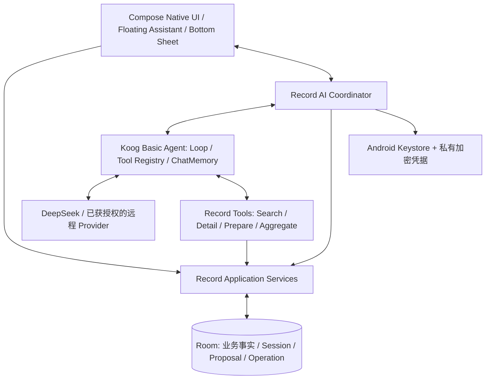

# Record 2.0 V1 — 统一架构设计

> **版本：** R1（已由负责人在对话中确认；由 Draft R1 冻结）  
> **文档性质：** Record 2.0 V1 产品与技术架构基线，供后续正式实施 Spec/Plan 引用  
> **项目：** https://github.com/paher-din/record  
> **技术基座：** C1 — Kotlin + Jetpack Compose + Room；Android 最低 API 34（阶段 1B 决策）  
> **Agent Runtime：** Koog Basic Agent  
> **决策依据：** 已确认的 ARCH-01～ARCH-06、阶段 1B 产品设计、阶段 1C-A 的 C1/C2 实验及 C1 选型裁决  
> **权限边界：** 本文确认逻辑架构，**不构成代码、物理 Schema、依赖安装、数据库迁移、APK 部署、正式开发或旧文件清理的授权**。

## 1. 产品定位与 V1 交付边界

Record 2.0 是一款融合个人记账、独立笔记与 AI Agent 的 Android 本地优先应用。原生功能可靠地保存和管理业务事实，AI Agent 在用户主动交互中帮助创建、修改、检索、关联、理解和归纳记录。关闭 AI 后，全部原生业务必须可离线正常使用。

**首个正式可日用版本必须联合交付完整原生业务与完整 V1 Agent**，包括：

- CNY 收入/支出、独立纯文本笔记、收支—笔记跨日多对多关联、混合时间线、日期/类型筛选及原生记账草稿；
- 本地持久化、笔记软删除/撤销/恢复、手动完整逻辑备份与可靠恢复；
- 自然语言创建及修改收支/笔记、查询与跨记录归纳、创建/解除关联、组合提案；
- Koog Basic Agent、受控 Record Tools、用户确认、原子业务提交、业务版本、幂等和故障恢复；
- App 内全局悬浮虚拟角色、底部对话面板、原生页面导航与提案确认；
- 会话历史、跨进程恢复、BYOK、Android Keystore 保护凭据；
- **完整 AI / 无 AI** 两种模式，不再提供受限 AI 模式。

允许按照工程依赖分阶段实施，但任何中间里程碑都不能冒称完整 V1 已验收。阶段 1C-A 的 A-AC1～6 仅证明选型实验，不代表 B-AC、BK、SD、AI 等正式验收完成。

**V1 AI 所需的底层检索与确定性汇总能力必须实现**，但不自动将阶段 1B 的 P1 独立原生全局搜索页面、统计仪表盘、CSV 导出、图片附件等功能提前为 V1 必交项。

## 2. 总体逻辑架构

这些是**逻辑职责**，不要求一一对应 Kotlin 类、Repository、Gradle Module 或新增框架。原生 UI 与 Agent 共用 Application Services；Application Services 不依赖 Koog。Record 不建设通用 Workflow、Command Bus、Graph Planner、独立 Memory 平台、分布式事务或首版服务端。

## 3. ARCH-01：统一业务服务与原生数据契约

### 3.1 收支与笔记

- 收支仅支持人民币 CNY 的收入、支出；金额使用 **Long 整数分**精确处理，拒绝不合法输入，不借 Float/Double 处理财务金额。
- 一个可见、可改名的默认“日常账户”；分类可选，每笔至多一个；不引入余额、转账、多币种。
- 交易拥有稳定 ID、发生时间、单调增加的业务 `version: Long`；正式编辑不更换身份。
- Note 是独立纯文本实体，正文保留原始换行、符号，正式 Note 支持自动保存。
- **SD1**：Note 软删除、撤销及恢复属于原生 UI 功能；保留原 ID、正文、发生时间和隐藏关联；迟到的自动保存、过期 AI 提案不得覆盖新正文或使已删除笔记复活。

### 3.2 关联、时间线与草稿

- 交易和 Note 支持双向、跨日、多对多关联；`LINK_RECORDS`、`UNLINK_RECORDS` 是增量语义，不用局部列表覆盖整组关联。
- 关联变更在业务事务内更新受影响端点的版本；校验两端存在、版本、可见性和软删除状态；解除关联不删除实体。
- 时间线按**发生时间**混排，支持日期跳转、类型筛选、查看详情及返回时恢复筛选/滚动上下文。
- 保留一份可跨进程恢复的**原生记账草稿**；它不是已记账事实，且与 AI Proposal 完全独立。

Application Services 集中提供金额验证、查询、交易/笔记/关联写入、业务版本控制、事务及备份恢复。Agent 不得绕过它直接操作 DAO 或修改正式记录。

**C1 原型的六表 Room Schema 只作为验证通过的技术起点**，并非已批准的 V1 正式物理数据模型。

## 4. ARCH-02：Koog Basic Agent 与 Android 协调

- **Koog Basic Agent 是 V1 唯一确定的 Agent Runtime**。Koog 管理 LLM Executor、Agent Loop、Tool Registry、工具结果回传、ChatMemory、运行事件及最大执行步数。
- 不开发自研 Tool Calling Loop、Graph Engine、Planner 或多 Agent 系统。
- **Record AI Coordinator 保持轻量**：管理 AI 模式和 Provider 授权、Session/Run 生命周期、提案确认交接、取消及原生导航；它不复制 Koog 的执行循环。
- 每个 Session 同时最多一个有效 `AgentRun`，每 Run 有稳定 ID；过期、取消或被关闭的 Run 结果不得写入当前 Session 或修改 Proposal。
- Agent 产出并持久化 Proposal 后即可结束本次 Run，**无需等待用户确认**；确认属于 Record 确定性业务流程。
- Activity 重建、页面切换或关闭 Bottom Sheet 不自动取消 Run；采用适当的应用级生命周期管理，但不建设常驻后台 Agent Service。
- `maxIterations` 是 Koog 的执行步数限制，不应误认为精确模型轮数；同时控制超时、Token、费用与无进展重复检索。最终 Koog/Kotlin/AGP/Compose/Room 版本及 DeepSeek 协议需要真实 Android 集成验证。

## 5. ARCH-03 R1：Proposal 与 CommitOperation

### 5.1 Agent 允许准备的固定操作集合

Koog 经 `prepare_changes` **仅能准备**下列六种操作：

1. `CREATE_TRANSACTION`
2. `UPDATE_TRANSACTION`
3. `CREATE_NOTE`
4. `UPDATE_NOTE`
5. `LINK_RECORDS`
6. `UNLINK_RECORDS`

不得隐式开放软删除、恢复、正式提交、任意 SQL/文件/网络/代码/系统命令等能力。Application Services 拥有一项业务能力，不意味着该能力自动成为 Agent 工具。

### 5.2 Proposal 与创建/修订保护

- `ChangeProposal` 是**未生效**、本地持久化的结构化操作集合，包含稳定 Proposal ID、所属 Session/Run、单调 Revision、预期业务版本、必要的 `localRef`。
- 每 Session 同时最多有**一份活跃待确认 Proposal**。
- `PrepareNewProposal` 使用由 Record 定义的稳定创建请求身份，重复调用不得生成两份提案；Koog `tool_call_id` 不是业务幂等身份。
- `ReviseProposal` 要求 `proposalId + expectedRevision` 并使用原子 CAS；旧模型响应、旧 Run 及已冻结提案不能覆盖较新的修订。
- Proposal 内部“58 元改 68 元”与正式 `UPDATE_TRANSACTION` 是不同语义。

### 5.3 Transaction A：用户确认并冻结

在**同一个短 Room 事务**中：检查 Proposal 可编辑、用户确认的 Revision 和实际展示的规范化 Payload 相符、同 Proposal 不存在第二个非终态 Operation；然后冻结 Payload、新建记录稳定身份和预期版本，创建稳定 `operationId` 的 `Pending CommitOperation`，锁定提案。

冻结 Payload 必须明确：整数分金额、具体发生时间/必要时区解释、真实账户/分类 ID 与所需版本、已有目标版本、新建稳定 ID、有效 `localRef` 和操作依赖。确认后不得再由 Koog 解释相对日期或重新决定字段。同一 Proposal 同时最多一项非终态 CommitOperation。**事务 A 不修改正式业务事实。**

### 5.4 Transaction B：正式业务原子提交

Application Services 在另一**单个 Room 事务**内：核查 Operation ID 和不可变 Payload、已 Applied/已拒绝状态、正式对象版本/存在/可见性，再解析引用，执行全部业务变更，同时持久化 `Applied` 结果和真实 ID 映射，并同步 Proposal 终态或由结果确定性推导。

确定性拒绝可在未产生业务修改时记录为 `RejectedConflict` / `RejectedInvalid`。异常或协程取消必须使已执行的业务写入整体回滚，不能吞掉异常并正常结束事务。A/B 是**两个本地事务**，不是分布式两阶段提交协议。

### 5.5 幂等与恢复

- 同一 Operation ID 永远绑定同一不可变 Payload；两次点击、网络超时或进程重启不得为同一确认重新创建业务事实。
- `Applied` 返回原结果；`RejectedConflict`、`RejectedInvalid` 不重试旧 Payload；`Pending` 先核对数据库和是否存在并发执行，不能盲目重新提交。
- 自动核查可以进行，**不自动后台重放 Pending**；仅在状态可验证、同 Operation ID 保持不变且用户主动操作后允许受控重试。
- 跨设备/新数据代际 ZIP 恢复的旧 Pending **不再具有直接执行资格**，需要重新审核和新的用户确认。
- 记录字段修改、关联集合变化、Note 自动保存和软删除都遵守明确的业务版本 CAS；软删除记录不被隐式恢复。
- 已确认 Operation 的核查与幂等不能因 AI 关闭、Session 删除而丢失。

## 6. Agent 输出与原生 UI 交接

Koog 的逻辑结果交给 Coordinator 处理：

| 结果 | 行为 |
|---|---|
| `Answer` | 在聊天 Bottom Sheet 展示回答或归纳及可点击真实记录引用 |
| `Navigate` | 经 Record 身份/可见性校验后跳转原生详情、结果或关联页面 |
| `ProposalReady` | 持久化提案后打开带有明确未提交状态的原生预填/确认页面 |
| `ClarificationNeeded` | 在面板补问当前请求需要的事实 |

模型不能直接拼接和执行任意 NavHost 路由；Record 生成强类型合法导航目标。跳转和返回须保留必要日期、筛选和滚动上下文。全局悬浮角色仅在 App 内的 Compose 层实现，不申请系统级悬浮窗权限；支持关闭/隐藏、移动和贴边，在键盘及敏感交互期间避免遮挡。

**原生草稿冲突：** 已有 D5 记账草稿时，Agent 的预填页面不能静默覆盖或消费它；用户必须明确选择继续原草稿、保留原草稿而处理 AI 提案或按明确操作放弃内容。

**原生页面保存即可以成为对当前 Proposal Revision 的用户确认**，不强制在聊天面板二次确认，但必须走 ARCH-03 Transaction A/B。AI Note 预览在正式确认前不能触发原生 Note 自动保存；关闭编辑页面不等于提交。

## 7. ARCH-04 R2：完整 AI / 无 AI 与 Record Tools

### 7.1 两种模式与持续授权

- **完整 AI：** 用户首次明确授权所选 Provider 和数据处理范围后，Agent 可在用户主动发起的任务中按需读取并向该 Provider 发送**全部正常可见的 Record 业务数据**，包括笔记全文、收支详情、关联和必要的历史对话。无需每次查询或访问全文重复授权；不默认整库上传，也不获得后台自主扫描权限。
- **无 AI：** 不执行 Koog 推理、模型请求或供 Agent 使用的业务工具；原生功能完整可用，已有本地聊天可查看。
- 不提供第三种“受限 AI 模式”。关闭/撤销授权后阻止后续请求、用户原话/历史/工具结果外发及迟到结果回写；无法承诺收回已发送的远程数据。
- 更换实际 Provider/数据接收方需重新告知并取得授权。AI 开关、Provider 授权和 BYOK 凭据是独立状态，缺凭据不能静默降级为第三种模式。

### 7.2 固定 Record Tools

| Tool | 职责 |
|---|---|
| `search_records` | 按日期、类型、关键词等对真实可见记录进行分页检索 |
| `get_record_detail` | 按稳定 Record ID 读取详情、笔记全文及关联；长文本可分段读取 |
| `prepare_changes` | 仅创建或修订 §5 的六类待确认操作 |
| `aggregate_finances` | 在本地确定性统计服务通过验证后开放精确财务汇总 |

V1 为实现完整 AI 查询与财务归纳，必须提供必要的**底层业务查询和精确统计服务**；这不等于把阶段 1B 的 P1 原生搜索中心、独立统计仪表盘、CSV 或附件功能提升为 V1 必交项。

完整授权不等于任意命令执行：不注册通用 SQL、文件、网络、系统命令、动态工具或 `commit` 工具。使用稳定 Record ID，每次详情、关联和导航重新校验记录真实存在、可见、版本有效。笔记正文、外部文本和 Tool Result 是不可信**数据**，不能提升为用户指令、改变 Provider/工具范围或绕过确认。保留分页、Token、时间、费用与重复无进展调用限制，以保证模型效果和成本稳定。

## 8. ARCH-05 R1：会话、ChatMemory、恢复与 BYOK

### 8.1 用户会话的唯一权威

Room 保存 `AgentSession`、用户可见 `AgentMessage`、`AgentRun` 状态及其引用，作为聊天历史的**唯一权威记录**。Koog `ChatMemory`/`ChatHistoryProvider` 只负责跨 Run 组织模型上下文，可选用可重建缓存，不得成为第二个用户历史库。

- `ChatHistoryProvider.store()` 不得把被窗口裁剪/过滤后的 Koog 消息覆盖或删除 Room 的用户可见历史。
- 当前用户消息可以在远程调用前先落盘，但 Koog 在当前 Run 加载**此前已完成**的历史，不能重复注入当前输入。
- 用户可见最终回复与 Run 终态在同一短 Room 事务中保存；Koog 缓存先写成功但正式回复未落盘时，以 Room 为准并丢弃不一致缓存。
- 不将未完成 Tool Call/Tool Result 序列拼成伪完整对话；新 Run 重新校验所引用的记录、关联、Proposal 和版本。Provider 切换后从已完成用户历史重建兼容上下文，不直接重放旧模型内部状态。

### 8.2 Android 恢复、取消与删除

- 不启用 Koog Agent Persistence 的自动 checkpoint 续跑。重启时核查旧进程运行所有权，将遗留的 Running 标记 `Interrupted`，**不自动重启模型或旧工具**。
- Activity 重建、页面跳转和关闭聊天面板不取消 Run；关闭 AI/撤销授权则取消运行、失效旧上下文，阻止迟到回复或修订写回。
- 删除 Session 时取消当前 Run、让未确认 Proposal 废弃、删除用户可见消息并使 Koog 缓存失效；防止迟到结果复活 Session。
- 删除聊天历史不得删除正式业务事实、必要的 Applied 幂等映射或仍需核查的 Pending；若无法安全保留其核查依据，必须阻止不安全删除。

### 8.3 BYOK、凭据保护

V1 采用 **BYOK**：用户配置 DeepSeek 等 Provider 的 API Key。使用 **Android Keystore** 管理加密密钥，并以经过验证的认证加密方案（如 AES-GCM）加密应用私有凭据，每次加密正确使用独立 IV。

- API Key 不得硬编码于 APK/源码/Gradle，不以明文保存到 Room/日志，不进入手动或系统备份与设备迁移。
- 凭据失效或不可解密时请求用户重新配置；网络中断、额度耗尽、服务故障不能被当作必须删除 Key 的理由。
- 关闭 AI、删除会话、删除 API Key 是独立行为；更换实际接收方重新授权。
- 不以已弃用的 `EncryptedSharedPreferences` 作为指定新方案；Keystore 不能被描述成所有客户端攻击下绝对安全。

## 9. 完整逻辑备份与恢复

V1 采用统一的**手动完整逻辑 ZIP 备份与可靠恢复**，遵守已确认的 BK1～5 安全约束。备份包括正式收支、笔记、关联、软删除状态、用户可见 Session/Message、必要引用和与正式事实一致的 Applied Operation/结果映射；未确认 Proposal 可按协议恢复为**待重新审核草稿**。

不备份 API Key、Keystore 密钥材料、Koog 内部 checkpoint、非权威模型上下文缓存、隐藏推理或不必要的诊断内容。

恢复必须有完整性/资源限制预检、隔离验证、身份与关联一致性检查、原子切换、失败回退；跨数据代际旧 Pending **不可直接执行**，必要时以新的用户确认重新形成操作；恢复环境的 Provider 授权和 API Key 必须重新建立。手动 ZIP、Android 云备份和设备间迁移分别验证。

如果 V1 ZIP 仍未加密，导出时明确提示其包含私人笔记和 AI 对话，不能把排除 API Key 等同于导出文件整体保密。

## 10. ARCH-06：整合约束、非目标与实施边界

### 10.1 不可违反的整合约束

1. C1 是技术基座，但原型代码及实验 Schema 并非无需审查的正式实现。
2. Koog 是唯一 Agent Runtime；Record 只开发轻量协调器和必要业务安全接缝。
3. 原生 UI 与 Agent 共用 Application Services，财务真实性永远由本地业务层保证。
4. Proposal 确认冻结与业务提交分别在两个短 Room 事务执行，保持版本和幂等。
5. 关闭 AI 不破坏用户已确认 Operation 的核查资格及历史结果。
6. 完整 AI 数据访问不意味着授权模型提交、删除或执行系统命令。
7. Room 用户可见历史与 Koog 模型上下文隔离，不能因窗口裁剪丢失用户内容。
8. 原生业务、Agent 及聊天历史服从统一完整备份/恢复设计。
9. V1 原生功能和完整 V1 AI Agent **联合验收**，不得暗中延期已有 Agent 功能。

### 10.2 不包含或不自动提升到 V1 的内容

- 多 Agent、通用 Workflow/Graph、动态 Skills、任意代码/SQL/文件工具、后台自治、独立服务端或云同步；
- 自研 Tool Calling Loop、独立向量长期记忆系统、通用事务引擎/Event Sourcing/Saga；
- 未获确认的原生 P1 全局搜索产品页面、月度仪表盘、CSV、图片附件，以及不属于 V1 的预算/提醒等新领域。

## 11. 正式 V1 验收与未决实施项目

### 11.1 必须保留的验收组

| 组别 | 内容 |
|---|---|
| B-AC1～9 | 原生业务完整可日用功能 |
| BK1～5 | 逻辑备份/恢复、损坏拒绝及故障安全 |
| SD-P1～4 | Note 软删除/撤销/恢复及竞态 |
| AI-AC1～11 | 完整 V1 Agent 及原生交互 |
| TP-01～08 | 提案竞态、确认冻结、组合事务、幂等与恢复 |
| CTX-01～10 | 完整 AI 模式、外发、Record Tools 和数据安全 |
| SES-01～16 | 聊天历史、ChatMemory、进程恢复、BYOK 和跨设备恢复 |
| 联合验收 | 真实 Android App + Room 磁盘库 + Koog + 目标 DeepSeek API 端到端 |

重叠测试允许共用原始证据，但不得降低行为要求。特别验证：确认与修订竞态、重复 `prepare_changes`、软删除与 Note 自动保存并发、业务事务中进程终止、恢复的旧 Pending 不可执行、长历史截断后仍完整可见、跨 Provider 及 Thinking/Tool Calling 协议兼容。

### 11.2 待实施阶段确定（不重开架构选型）

- Koog/Kotlin/AGP/Compose/Room 的具体兼容版本和 DeepSeek 模型/Tool Calling 的真实 Android 验证；
- 正式 Room Schema、业务版本/CAS、DAO、必要数据迁移契约；
- Application Services、Record Tools、Proposal/Operation 的实际接口及测试接缝；
- ChatHistoryProvider 与用户权威历史的具体适配；
- Keystore 加密凭据、Android 系统备份/迁移排除；
- 完整 ZIP 格式、恢复代际、失败回退及资源限制；
- C1 实验代码受控引入正式工程的路径和验证方式；
- 悬浮角色最终 UI 素材与动效。

## 12. 架构状态与授权

**本 R1 为已确认的统一逻辑架构基线。** ARCH-01～06 的技术方向不再无理由重新选型；如需修改，必须单独提出变更理由、影响范围与批准请求。

**当前不授权正式开发。** 只有另经负责人审阅的正式实施 Spec/Plan 与明确写入范围，才可进行源码、Gradle、Room Schema、ADB、APK、旧工程或生产数据的任何实施性变更。
