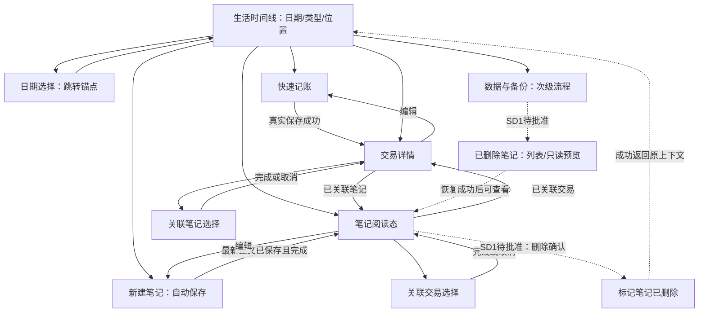

# Record 2.0 — 阶段 1B：产品边界与核心交互

- 日期：2026-10-22（Asia/Shanghai）。
- 状态：**最终收口修订稿，待用户最终确认；整体设计方向已获认可，D1–D5 已确认、Q6 已回答。新增 SD1 笔记软删除尚未批准；不是实施授权或最终技术选型。**
- 本轮产物：本文件中的决策清单、纸面线框、状态与导航、阶段 1C 对照实验计划。未制作可运行原型，未执行 Android PoC。
- 确认记录：2026-10-22，用户对集中列出的 D1–D5 回复“全部采用”，对必须继承的真实旧记录、附件或历史备份回复“没有”。确认范围仅为这五项方案与旧数据事实；P0/P1/P2 的其余范围、新增页面细节和阶段 1C 计划尚未整体批准。历史回答按来源保留，不将本次答复扩大为实施授权。
- 收口修订授权：用户已审阅并认可整体设计方向，要求保持 D1–D5/Q6，提出待批准的笔记软删除设计，并将“选型验证”与“正式日用验收”分开。本稿据此修订；本次指令不等于批准软删除细节、比较预算或执行 PoC。

## 1. 来源、适用范围与冲突处理

1. 当前阶段 1B 用户请求：路线 C、本地优先、隐私友好、财务与文字共用时间线、无强制在线账号、保护旧数据与历史；C1 只是优先实验方向。
2. [阶段 1 研究与决策草案](C:/Users/p3148/Downloads/record2-phase1-product-oss-selection-20261022.md)：重点采用 §1–3、§7–8 的问题与实验范围；其中建议仍是建议。来源 SHA-256：`a4dd416d38c6b8b34fef1520d3de4d0538cc53813032a8fd3be0b583695d7573`。
3. [旧访谈收口与交接](2026-10-22-record1-interview-closeout.md) §2–5，以及[原始回答](2026-10-21-record-redesign.md) R1–R12：仅提取已经回答的产品事实，不恢复路线 B 访谈。
4. [E0 环境证据](../engineering/evidence/2026-10-21-e0.md)和[验证策略](../engineering/testing-strategy.md)：沿用隔离环境及真实落盘取证纪律，不借用旧测试 PASS 为新行为背书。

旧 `docs/product/*`、`docs/experience/*`、领域/存储文档仍描述 Record 1.0，不在本轮改写。旧四 tab、Markdown、余额/转账、选日查询、EntityRef 和多代 Vault 与本草案不同；这是**新路线的待审设计**，不能据此修改旧实现。新的核心文档与必要技术决策同步，留在后续明确授权阶段处理；本轮不创建 ADR 或实施 Spec。

本地 HEAD 为 `b3710e81d2d9ec1ab439b8e40af7669ac3a558ca`；阶段 1 报告引用的远程 main 快照是 `0b9db7058e98e648e92f879b764498d435a58990`。本轮不拉取、不切分支，也不把二者混称。未重新核查外部项目当前版本或许可证；阶段 1 的技术调查仅作有日期的输入，复制上游代码前必须重新核验。

方法：使用仓库内 `skills/impeccable/SKILL.md` 的 shape/Operate 方法、`skills/prototype/SKILL.md` 的低成本状态推演、`skills/domain-modeling/SKILL.md` 的术语与边界分析、`skills/testing-setup/SKILL.md` 的风险测试分层。受当前请求约束，只画纸面线框，不执行 skill 中的建站、原型代码、数据库、测试框架安装、全局词汇表或 ADR 落盘步骤。Impeccable context 启动器未返回可用内容，改为直接读取现有项目文档。

## 2. 产品决策清单

### 2.1 不再重复询问的决定

| ID | 决定 | 证据与状态 |
|---|---|---|
| K1 | 路线 C，零基重新选型；C1 优先实验，C2 对照 | 当前请求 §一；已确认，不等于选型验收 |
| K2 | 生活记录、本地优先、隐私友好、无强制在线账号；记账和记事均可独立成立 | 当前请求；历史 H01–H04/R1、R11；已确认 |
| K3 | 首版收入/支出、仅 CNY；不承诺真实账户余额、不管理转账 | 历史 H05–H06/R3、R11；保留。新稿余额刷新叙述的冲突已由本次 D2 确认收口：账户仅作来源，不展示真实余额 |
| K4 | 分类可选，每笔最多一个，可稍后补 | 历史 H07/R4；已确认。用户旅程中的“选分类”不是必填授权 |
| K5 | 首版纯文本、保留换行，不解析 Markdown；新增图片延后 | 历史 H08–H09/R5–R6；已确认，不再询问纯文本还是 Markdown |
| K6 | 双向可选直接关联，允许跨日；财务和笔记均可无关联 | 历史 H10/R2；已确认。本次 D3 进一步确认多对多与“完成”统一提交 |
| K7 | 无待续编辑时默认今天；统一“全部／收支／笔记”，跨日分组连续浏览、较早记录分批加载 | 历史 H11–H13/R7–R9；已确认。“选日期”设计为跳转，不收缩成只能逐日浏览 |
| K8 | 两个直接入口“记账／记事”；记账页选择收入或支出 | 历史 H14/R10；已确认 |
| K9 | 笔记自动保存；记账点击“保存”才成为正式流水 | 历史 H15/R12；已确认。自动保存触发与异常处理仍是本轮设计 |
| K10 | 旧真实数据、附件、备份、仓库历史受保护；本轮只设计，不执行技术 PoC | 当前请求 §五–七；已确认 |

### 2.2 本次已确认的决策与事实

2026-10-22，用户对 D1–D5 的集中问题回复“全部采用”，对 Q6 回复“没有”。以下据此更新状态；表中曾比较的替代选择仅保留为取舍背景，不再作为待答问题。

| ID | 已确认方案／事实 | 主要代价／边界 | 当前状态 |
|---|---|---|---|
| D1 最低系统版本 | 首版 Android 14+（API 34），先本人日用验证 | 暂不覆盖 Android 10–13；本次用户选择确立产品门槛，不是从 AVD 推定。未授权修改旧工程 SDK 配置 | 已确认 |
| D2 首次账户/分类 | 自动创建一个**可见、可改名的“日常账户”**，CNY，仅作为收支来源；不展示真实余额，不引入开账/转账。默认“未分类”，可跳过，提供少量收支分类 | 零前置配置，但预置名称未必合习惯；这里的“账户”不是在线账号。具体分类名称示例仍属设计细节：支出为餐饮/出行/购物/居家/其他支出，收入为工资/其他收入 | 行为已确认；已解决与 K3 的冲突，具体分类清单未单独批准 |
| D3 关系数量/提交 | 跨日多对多；两侧同一套选择交互，批量勾选后点“完成”一次提交；取消不写 | 比即时切换多一步确认，但取消和失败含义明确；不引入通用实体关联 | 已确认 |
| D4 备份首版 | P0 手动完整逻辑 ZIP、可移植、完整校验、隔离预检后整体恢复；首版不加密，导出前明确提示 | 文件可被读取；校验和不能防止恶意篡改。不套用 MoneyBook 的 PIN 派生方式；精确格式与恢复实现仍待后续冻结 | 产品边界已确认；不是格式或实现批准 |
| D5 记账草稿 | 本地保留**一份**未提交的新建或编辑草稿，可跨进程继续；恢复时明确“继续／放弃”，不计入流水；笔记沿用自动保存 | 多一条恢复路径及测试；只有草稿持久化成功才能显示“草稿已保留”。具体写入时机和恢复细节仍属待审设计 | 本次已确认；不追溯为历史未回答题已获批准 |
| Q6 真实旧数据 | 用户回复“没有”：没有必须继承的真实旧记录、附件或历史备份 | 无需把旧数据兼容或迁移列为本轮前置条件；不等于不存在任何测试文件，也不授权删除旧仓库、设备内容或历史备份 | 已回答，无旧数据继承要求 |

整体设计方向已获认可，D1–D5/Q6 不再讨论。本次新增 **SD1：笔记软删除/恢复纳入 P0**，状态为**待批准设计**，见 §3.2；两道验收门槛按用户要求分开，具体实验计划和预算待最终确认。历史“全部采用”不扩大为批准全文、启动阶段 1C、选定 C1、批准建库/迁移或同意清理历史资料。

## 3. 最小可日用边界（整体方向认可；本修订待最终确认）

| 优先级 | 纳入 | 完成界线 |
|---|---|---|
| P0 记录闭环 | CNY 支出/收入、可选单分类、可选说明、发生日期时间、新建/编辑；按 D2 的账户来源；独立纯文本 Note 自动保存、重新打开编辑；按 D3 双向关联/解除；今天首页、日期跳转、类型筛选、跨日连续混排；**拟补 SD1 笔记软删除/恢复（待批准）** | 实际 Android Activity + 磁盘 Room + 可见交互验证；错误不假成功，重启不丢已提交事实 |
| P0 日用保障 | 草稿/Back/失败输入保护（按 D5）；金额精确、原子写、重复操作幂等；手动完整备份/恢复、损坏拒绝、失败保护 | **备份往返未通过前，不作为唯一真实记录工具。** 六步旅程只是 PoC 的一部分，不等于可日用版本完成 |
| P0 最小维护 | 默认账户可改名；预置分类可选；账目用编辑纠正，误建/误删笔记按 SD1 处理（待批准） | 不做多账户资产管理、分类管理中心、交易删除、通用回收站、永久删除或定期清理；笔记专用的恢复入口只服务 SD1 |
| P1 | 图片附件、系统分享、全局搜索、Markdown 预览、月度统计、CSV 导出、日历热力图、额外账户/自定义分类管理 | 每项由使用证据排序；Markdown 不得把历史纯文本符号直接改义；图片进入时备份必须完整包含内容和关系 |
| P2 | 项目、标签、多币种、分类分摊、复杂转账、循环记录、预算、提醒 | 不建占位界面、空模块或提前留完整数据层 |
| 近期不做 | 云同步、协作、AI/OCR、复杂加密云备份、多端、独立 Event 容器 | “生活事件”只是内容描述，不创建新实体 |

App Lock、应用内数据库加密未作为 P0 承诺；不强制联网、不含遥测、不自动上传或参加系统云备份/设备传输，列为候选隐私检查。手动备份由用户主动选择去向。若设备本地攻击防护是日用前提，需另收口该需求，不能用“隐私友好”代替已实现的加密声明。

### 3.1 领域词汇与不变量（行为草图，不批准 Schema）

| 词汇 | 本稿含义 |
|---|---|
| 收支记录 Transaction | 一笔收入或支出，正数金额 + 收支方向、CNY、发生时间、账户来源（D2）、可选单分类和说明；编辑同一条记录 |
| 账户 Account | D2 下的收支来源名称；不是在线身份、真实银行余额或复杂账户体系 |
| 笔记 Note | 可独立存在的非空纯文本与发生时间；无独立标题，列表摘要取正文首个非空行；换行和输入字符原样保存。SD1 拟补“正常/已删除”状态，保留原身份与内容，不新增另一种记录实体 |
| 关联 Link | 交易与笔记之间的一条直接关系；不复制正文或金额，不要求同日；解除只去掉关系 |
| 时间线 Timeline | 上述事实的混合展示；编辑金额/正文不会生成另一条记录或因修改时间置顶 |
| 草稿 Draft | 未成为正式账目的输入；与已经落盘的自动保存 Note 区分；不进入汇总、时间线或正式关联 |

- 金额直接转整数分，`58`/`58.00` 均为 `5800`；拒绝负数、零、超过两位小数、溢出、指数和分组分隔符。财务金额不经过 Float/Double；金额上限先以正 Long 分的可表示范围为技术边界，不捏造更低业务上限。
- 收支方向、金额、账户、分类、说明和发生时间一次提交；失败保持旧版本。若显示汇总，只能叫“记录的收入/支出”，不能称真实账户余额。
- 同一对关联只存在一次；多条新增/解除作为一次完整变更；失败不留半边或部分选中。新建/编辑/重试不得复制事实。
- 建议发生时间用真实时刻表达；在当前设备时区按本地日期分组，日界为 `[当日零点, 次日零点)`，不假定每天 24 小时。更换时区允许历史分组变化，并在日期选择处标出当前时区；保留原地日历日期的需求若出现另议。
- 新建在今天默认当前时刻；从历史日期入口新建，显示该日期和当前本地时刻供确认。允许补记；P0 暂不允许未来发生时间，避免混入提醒场景。遇 DST 不存在时刻提示重选，重复时刻显示并固定较早偏移；PoC 用显式时钟/时区夹具验证。
- 时间线日期/时刻倒序，同一时刻以稳定 ID 排序；编辑发生时间才改变所属日期/位置。正文允许空格和换行，但全空白不能成为新 Note；不静默裁剪用户文本。

### 3.2 SD1：笔记软删除与恢复（待批准设计）

自动保存会把试写内容变成正式 Note，因此 P0 需要可纠正误建且可恢复误删的出口。**以下是本轮提出的最小方案，尚未获用户批准，不授权实现或改变 Schema。**

| 场景 | 最小用户交互与结果 |
|---|---|
| 删除入口 | 仅在已保存笔记的阅读态“更多 → 删除笔记”；确认文案“笔记将从时间线及关联列表隐藏，可在已删除笔记中恢复”，提供取消/删除。编辑中的用户先完成保存回阅读态；保存失败不带着未落盘文本进入删除 |
| 删除成功 | 单次持久化把同一 Note 标为已删除并记录删除时刻；保留最后已保存正文、发生时间和全部原关系。成功后回 A 的原日期/筛选位置，提示“笔记已删除［撤销］”；短暂撤销只是恢复的快捷入口，入口过期不影响后续恢复 |
| 恢复误删 | A 的次级“数据与备份 → 已删除笔记”，按删除时间倒序，只列笔记摘要/原日期/删除时间；点开是只读预览和“恢复”。成功后同一身份回到正常状态，提供“查看笔记”，按原发生时间回时间线，不因恢复置顶；没有已删除项时显示专用空状态 |
| 时间线与关联 | 正常时间线、笔记筛选、交易详情的关联列表/计数、关联候选均隐藏已删除 Note。关系事实保留，恢复后原关联重新可见，交易和其他 Note 均不变；删除不是解除关联。正常状态不显示占位“幽灵笔记” |
| 备份与恢复 | 完整逻辑备份包含正常及已删除 Note、正文、发生时间、删除状态/删除时刻，以及包括隐藏关系在内的全部关系。整体恢复后保持同样可见性；已删除 Note 只能从专用入口恢复，不能导入后自动复活或丢掉关联。这里的“恢复笔记”与“从备份整体恢复数据”是两种不同操作 |
| 失败/重复/Back | 删除/恢复提交期间拦截 Back 与重复动作；真实提交后才提示成功。失败留在原阅读态或已删除预览，原状态/正文/关系不变，可重试；结果未知先重读同一身份，不执行状态切换式重试。重复删除已删除 Note 或重复恢复正常 Note 不改变正文、原时间或制造新身份 |
| 自动保存竞态 | 删除前确认编辑保存已结束，删除后旧编辑会话/迟到回执不能把 Note 写回正常状态；已删除状态不允许正文编辑或新建关系。若旧页面仍在栈中，重读后显示“笔记已删除”，提供返回及去恢复入口，不显示空编辑器 |

选择器只提交对**当前正常笔记**的关联增减，不能把因删除而不可见的旧关系当成取消勾选并抹掉。若目标在选择期间被删除，整次关联提交拒绝并提示重新加载，不部分提交、不隐式恢复笔记；其他隐藏关系保持原样。

边界：仅笔记生命周期与一个次级列表/预览，不新增顶层页面、通用删除实体、跨类型回收站、批量清空、保留期限或后台清理；不物理删除正文或关系。取消删除不写；空白新建仍不产生 Note，清空已存正文仍是校验错误，不能借清空正文绕过明确删除操作。

正式日用门槛必须验证 **SD-P1**：删除/撤销/恢复与重启，正文、身份、发生时间不变；**SD-P2**：多对多关系隐藏/恢复、选择器竞态和失败原子性；**SD-P3**：自动保存迟到回执不复活、重复操作和提交前后终止；**SD-P4**：BK1–BK5 覆盖删除状态及隐藏关系。SD1 未批准前不实施；批准后这些门槛不得遗漏。阶段 1C-A 仅评估设计可行性，不要求两候选实现 SD1。

## 4. 四页低保真交互

共同约束：以手机单列、系统字体、系统日期/时间选择为基础。主动作可在键盘打开时到达，避开 IME/系统栏；触控区至少 48dp，收支用文字和符号区分，错误就近且可被辅助功能读到，不只依赖颜色。纸面线框不代表已通过可访问性或 Android 验证。

### A. 生活时间线

```text
┌ 生活记录                 数据与备份 ┐
│ [2026-10-22 ▾] [回到今天]          │
│ [全部]  收支  笔记                  │
│ 10月22日 · 周四                     │
│ 20:10 笔记  和朋友吃晚饭……   关联1  >│
│ 12:30 支出  -¥58.00 餐饮           >│
│            日常账户 · 午饭          │
│ 10月21日                           │
│ 18:00 收入  +¥100.00 ……           >│
│              [加载更早记录]         │
│                                    │
│        [记账]      [记事]           │
└────────────────────────────────────┘
```

- **优先级**：P0 日期上下文、混合条目、两个创建入口；其次类型筛选、关联数、说明摘要；数据与备份为次级入口。不上四 tab、图表大盘或项目区。
- **操作/跳转**：点日期打开系统日期选择器，跳到该日锚点后可继续向前后日期浏览；无记录的选定日显示空锚点和“查看更早记录”，不伪造条目。点“回到今天”显式重置锚点；类型筛选保持日期。记录卡进入交易详情或笔记阅读态；点记账到 B，记事到 C。
- **空/加载/错误**：全库空提示“记录第一笔收支或一段文字”；筛选空提示“当天没有笔记/收支”并保留切换入口。首读显示占位与加载文案；更早分页只在尾部加载。首读失败不显示“暂无记录”；有旧数据时保留并标“未刷新”，重试失败页，不跳页或清空已有卡片。
- **保存反馈**：A 不直接写事实。B 保存成功先进入交易详情，详情 Back 才回 A 的原锚点并刷新；新记录日期不在当前窗口时提示“已保存到 ×月×日［查看］”。C/关联提交成功后即时从持久化结果刷新；失败保留旧条目且不发成功提示。
- **Back/重复/输入**：从详情返回保持日期、筛选、滚动位置；关闭日期弹层取消选择；A 的系统 Back 正常离开 App。重复进入创建有 D5 草稿时先询问继续/放弃，不覆盖草稿。后台回来不自动跳今天；冷启动无恢复上下文时回今天，有草稿则给恢复入口。
- **真实持久化验证**：A-P1：同一天混排并能打开两类详情；A-P2：前一日/跨午夜/时区与同刻顺序、连续分页不漏不重；A-P3：编辑后不复制条目，详情返回上下文不变，重启后重读一致。
- **SD1 补充（待批准）**：正常列表隐藏已删除 Note；“数据与备份”内提供笔记专用恢复入口。删除后保持原日期/筛选位置，恢复按原发生时间插回；完整行为与测试归 §3.2。

### B. 快速记账（新建与编辑复用布局）

```text
┌ ‹ 返回             记账      保存 ┐
│ [支出]  收入                       │
│ ¥ [58.00                  ]        │
│ 账户   日常账户                  > │
│ 分类   未分类（可跳过）          > │
│ 时间   10月22日 12:30            > │
│ 说明   [午饭，可不填            ]   │
│                                    │
│ 草稿已保留 / 正在保存 / 保存失败    │
└────────────────────────────────────┘
```

- **优先级**：金额和保存第一；收入/支出、来源账户、分类第二；日期时间、说明第三。新建默认支出、金额为空且聚焦数字键盘。编辑先完整读取已存版本，不把加载中的空值显示为可保存表单。
- **操作/跳转**：账户选择只展示有效来源，首版一个账户时可在小弹层改名；分类为同页弹层，默认可不选。切换收入/支出保留金额/说明/发生时间，不兼容分类重置为未分类并提示。保存成功打开**该笔交易详情**，显示金额、来源、分类、说明、时间及“关联笔记”；详情 Back 回 A。编辑成功回原详情再返回原 A。
- **空/加载/错误**：空金额时保存不可用；说明可空。无账户且初始化失败时显示“账户未准备好［重试］”，不暗建第二个账户。非法金额或未来时间就近解释；读取失败仅能重试/返回，不允许用默认值覆盖现存记录。
- **保存成功/失败**：单次提交中显示“正在保存”，禁重复保存；真实事务提交后才进入详情/显示成功。失败保留所有字段、焦点和可用草稿，旧交易不变，显示原因和重试。若提交结果未知，先重读同一稳定记录身份确认，再决定是否重试，不盲目新建第二笔。
- **Back/输入保留**：IME 打开时第一次 Back 只收键盘；表单未改直接返回。已改表单按 D5 提供“继续编辑／保留草稿并离开／放弃输入”；编辑草稿不改变已保存账目。保存中拦截 Back 等待结果，不把未结束写入叫取消。旋转/切到选择器保留输入。D5 草稿延迟约 500ms 写入，离开前补写；磁盘失败时不能显示“已保留”，明确提示并停留，只有用户显式放弃才退出。
- **跨进程边界**：恢复同一草稿时带原交易身份；编辑旧版本已变化则提示重读与重新确认。草稿最新一次写入尚未成功即被终止时，只保证恢复最近确认的草稿；UI 不声称最后一个按键已落盘。成功交易与草稿消费保持一致，防止重启后又恢复成待新增的同一笔。
- **真实持久化验证**：B-P1：`58.00 → 5800`，收入/支出、分类空值、正文不漂移；B-P2：双击、失败重试、提交后未跳转即强停均只一条；B-P3：编辑失败旧值不变；B-P4：已确认草稿跨进程恢复且不进入流水，初始化重复启动只一个默认账户/一套预置分类。

### C. 笔记编辑（含阅读态）

```text
┌ ‹ 返回              随记     完成 ┐
│ 10月22日 20:10                  > │
│ [和朋友吃晚饭，聊了最近的计划。    │
│  下次想再来这家。                 ]│
│                                    │
│ 已保存 / 正在保存 / 尚未保存        │
│ [保存失败，正文仍在此处。重试]      │
│ 关联收支 1                      > │
└────────────────────────────────────┘
```

- **优先级**：正文第一；真实保存状态第二；发生时间和关联入口第三。无需标题、Markdown 工具栏、图片占位。输入 `# 标题` 仍原样显示，不解析。
- **操作/跳转**：新建直接编辑；打开已有 Note 先阅读态，点“编辑”进入本页，阅读态展示完整正文及关联收支列表。正文停输约 500ms 自动保存，离开/点完成前立即补齐最新文本；“完成”只完成编辑，不代替已确认的自动保存。首次非空保存后即成为独立 Note，可进入 D 选择交易。
- **空/加载/错误**：全空白新建不创建事实，Back 退出；已有 Note 正文清空时显示“正文不能为空，原记录尚未改动”，不隐式删除或覆盖成空串。可继续输入或明确恢复上次已存正文。加载已有 Note 失败不显示空编辑器；自动保存失败继续保留输入，状态显式为失败，可点重试。
- **成功/失败/重复**：每个编辑会话使用同一个 Note 身份，输入变化按版本串行保存；较早保存回执不能覆盖较新文本或把较新未存内容标成已保存。只有屏幕当前版本持久化后才显示“已保存”。失败时可继续编辑并重试最新版本，不丢失败后的新输入。重复点完成不生成第二条 Note。
- **Back/输入保留**：第一次 Back 可先收键盘；随后如已保存立即回来源。若尚在保存，等待最新版本结果；失败时留在编辑，提供“继续编辑/重试”，另有明确“放弃未保存修改并离开”（会丢失未落盘输入）的退出选项。已有已保存正文不因退出而删除。配置重建保留文本；进程终止仅保证已保存文本，尚未持久化的最后输入不作恢复承诺。
- **关联前置**：首条非空正文成功保存且当前修改已落盘，才允许进入 D；未保存或失败先处理正文。进入 D 后返回保留正文、光标和滚动位置；关联提交与正文自动保存是不同操作，不能互相假报成功。
- **真实持久化验证**：C-P1：中文/换行/Markdown 符号原样保存并可重新打开编辑；C-P2：连续输入与迟到回执、失败重试均只一条且保存最新版本；C-P3：空白新建无事实、清空旧正文不改库；C-P4：显示“已保存”后强停重启，正文和发生时间一致。
- **SD1 补充（待批准）**：已保存阅读态的“更多”增加删除确认；删除/恢复及已删除只读预览按 §3.2。不在自动保存编辑器内增加隐式删除手势或用清空正文删除；正式日用执行 SD-P1–SD-P4。

### D. 关联选择（交易→笔记、笔记→交易）

```text
┌ 取消              关联笔记    完成 ┐
│ 支出 ¥58.00 · 午饭                  │
│ [已关联] [全部记录]    日期 ▾       │
│ ☑ 10/22 和朋友吃晚饭……             │
│ ☐ 10/20 这周的生活开销……           │
│ 已选 1 条 · 取消勾选可解除           │
└────────────────────────────────────┘
反向入口：笔记阅读态 → 关联收支 → 管理关联
反向候选行：☑ 10/22 支出 ¥58.00 · 午饭
```

- **优先级**：来源摘要、已关联对象、勾选状态和完成第一；全部记录/日期筛选第二。默认优先展示已关联对象；首次无关联展示全部候选并定位来源日期，允许跨日加载。P0 不借此引入全局搜索。
- **操作/跳转**：交易详情“关联笔记”进入此页；笔记阅读态点关联交易直接开交易详情，“管理关联”打开反向选择页。取消勾选即拟解除；完成才统一落盘。对端阅读可从候选的独立“查看”动作进入，返回保留未提交勾选；候选在此上下文只读，避免嵌套编辑和选择递归。
- **空/加载/错误**：没有笔记提示“先记一段文字，再回来关联”；没有交易同理，返回到来源后创建，不在选择器里开复合新建流。筛选为空可清除筛选；首读加载不可提交，分页失败保留已选项并可重试。来源不存在或已变更需重读，不把空候选当作取消所有关联。
- **成功/失败/重复**：未更改集合时完成只是返回，不写；有变化时一次提交全部增减，成功回来源显示最新数量和可跳转对象。失败保持原持久关系及当前勾选，提示重试。按“来源身份 + 目标集合”重复提交不会添加重复关系；关系端点在提交时验证存在。
- **Back/输入保留**：无变化直接回；有变化询问“继续选择／放弃本次更改”，不自动提交；保存中拦截 Back 与重复完成，等待单一结果。旋转保留未提交选择；进程死亡只恢复已提交关系，本页明确标出“更改尚未保存”。解除某一关系不删除交易、笔记或其他关系，也不修改它们的发生时间。
- **真实持久化验证**：D-P1：T1–N1、T1–N2、T2–N1 同时存在，允许跨日且双向读取一致；D-P2：取消/失败零变化，批量提交无部分关系；D-P3：解除 T1–N1 后两端均消失，T1–N2、T2–N1 和全部正文/金额保留，重启一致。
- **SD1 补充（待批准）**：候选和正常关联计数过滤已删除 Note，但保留其关系事实；保存可见集合不能覆盖隐藏关系。候选在提交前变为已删除时整次拒绝、保留可恢复选择并提示重读；执行 SD-P2。

## 5. 导航和状态转换



图中 D/E 是同一选择页的两种来源；T/N 是满足“进入详情”的最小阅读态，不增加顶层导航。所有 Back 返回**实际来源**；跨端查看不强制回首页，栈内来源上下文保持。

| 流程 | 状态与转移 | 不允许 |
|---|---|---|
| 读列表/详情 | 加载 → 内容/空；失败 → 重试；分页失败保留既有内容 | 把异常当空记录，或加载失败允许覆盖已有记录 |
| 记账 | 初始/草稿 → 校验 → 保存中 → 详情；失败 → 带原输入重试；结果未知 → 重读确认 | 保存中取消、重复提交、未成功先更新正式流水 |
| 笔记 | 空白 → 未保存 → 自动保存中 → 已保存；继续输入回未保存；失败 → 保留最新输入 → 重试 | 把旧回执当最新正文成功、失败清空编辑器 |
| 关联 | 读取原集合 → 本地勾选 → 完成提交 → 来源；取消 → 来源原集合；失败 → 保留勾选 | 勾一次写一次后又声称取消、批量部分成功 |
| 草稿恢复 | 冷启动发现已确认草稿 → 继续/放弃；继续还原字段，放弃经显式操作退出恢复 | 自动当正式记录、覆盖另一份草稿、恢复后重复新建已提交记录 |
| 笔记删除/恢复（SD1 待批准） | 正常阅读态 → 删除确认 → 提交 → 已删除；取消回原阅读态；已删除只读预览 → 恢复提交 → 正常；失败保持原状态 | 清空正文当删除、旧自动保存复活、删除关系事实、重复动作切换两次状态 |

首次启动在**一次真实成功的初始化**后展示 A：“已为你准备日常账户，可改名；分类可跳过”，不设欢迎问卷。账户/分类初始化失败先提示重试；重启幂等。这里描述 D2 对应的行为设计，不指定建表、依赖或实现结构。

## 6. 六步核心用户旅程（C1/C2 完全相同）

使用合成数据、固定测试时钟 `2026-10-22`、`Asia/Shanghai`；D2/D3/D5 已确认，具体夹具在阶段 1C 计划获批时冻结。交易 T1、笔记 N1 是证据别名，不要求实现使用这些字面 ID。

| 步骤 | 用户操作 | 应可观察的真实结果 |
|---|---|---|
| J1 新增支出 | A → 记账，输入 `58.00`，日常账户，餐饮，说明“午饭”，12:30，点保存 | 交易详情显示 ¥58.00；独立重读磁盘为支出 `5800` 分；只有 T1 一条 |
| J2 新增 Note | 回 A → 记事，输入“和朋友吃晚饭\n聊了最近的计划。 #原样文本”，20:10，等待“已保存”→完成 | N1 可独立重开，换行与符号原样；不是预览假数据 |
| J3 建立关联 | T1 详情 → 关联笔记，勾 N1 →完成 | T1 找到 N1，N1 找到 T1；同一关系一条；两侧可进入对端 |
| J4 同一天回看 | 回 A，选择 10/22，全部；再切收支/笔记并返回 | 两条同日混排，顺序正确；筛选不改日期，详情返回位置稳定。加前一天夹具验证连续浏览，不能只交单日截图 |
| J5 编辑支出 | T1 详情 →编辑，金额改 `60.50`、说明“午饭补记” →保存 | 同一 T1 为 `6050` 分，旧 5800 不重复保留；N1 正文与关联不变；A/两侧详情刷新 |
| J6 终止进程重启 | 所有状态确认已保存后，定向 force-stop 该候选包，再启动生产 Activity | 重读仍为 T1=6050、N1 原正文、一个双向关系；不能用重建 Activity 或重启 Composable 代替进程终止 |

J1–J6 保持原样。阶段 1C-A 的共同补充路径：一笔收入、编辑 Note 后重开、第二交易/第二 Note 的跨日多对多、取消/解除关联、错误金额、重复保存、已确认草稿重启，以及 §7.2 的一次真实提交前失败。两候选执行完全相同的最小集合。完整失败矩阵、提交后回执前终止、时区/分页边界和 SD1 删除恢复在阶段 1C-B 日用门槛执行，不能因 A 通过而免测。

## 7. 阶段 1C：选型验证与后续日用验收（只计划，不执行）

按用户要求分为 **A：两候选同题选型验证 → 负责人确定正式基座 → B：选定基座的完整日用验收**。A 不承担完整备份/恢复产品实现；B 保留全部 P0 和数据安全门槛。两道门槛的具体计划/预算待批准，本轮均不实施。

### 7.1 隔离与环境冻结

- C1：新精简 Kotlin/Compose/Room 实验；C2：MoneyBook 隔离 Fork 对照。**各自独立目录/仓库和独立 applicationId、私有数据目录、备份目录**；不在原 main 上试改。具体位置、版本与写入范围由下一轮授权记录，不能使用原 Record 包名。
- 使用 E0 已有 AVD `record-api34`，历史配置为 API34 Google APIs x86_64 revision14、Pixel6、2GiB RAM。历史 serial `emulator-5560` 仅作追溯，执行时必须重新确认，不能硬编码复用。
- 每次设备写入前验证 AVD 名、实际 API34、模拟器身份、启动完成和精确 serial，再核对候选包；显式 serial 安装/运行。Android CLI 能力和 SDK/ADB/Gradle runner 能力分别检查。不能保证唯一目标则停止设备写入。
- 禁止 wipe/reset AVD、`pm clear` 原 Record、卸载原包、碰真机或历史备份。新实验夹具只在批准的候选包与隔离库内；需要删除/重置任何文件也仍按红线先取得授权，可先保留产物避免清理。
- C2 在执行时固定实际 upstream commit、许可证与依赖声明，保留署名；去除或替换不合格能力的改动也计成本。未确认安全的既有备份不能因为能运行就被复用。两者都不能以额外联网、遥测换取测试成功。
- 不预引入 Navigation 3、Hilt、多模块或其他框架。对 C2 已有依赖记录继承原因与维护负担；不能为比较方便扩大 C1 架构。本文件不锁版本、不改 Gradle/CI/Schema。

### 7.2 两道门槛与证据归属

**所有技术实验均为 NOT RUN。** A 是 C1/C2 对照选型；B 在负责人正式确定基座后，仅对选定基座实施完整日用验收。A 通过的表述只能是“选型验证通过，可提交基座决策”，不能是“MVP 完成”“备份可用”或“可以作为唯一账本”。

#### A. 选型验证：两候选相同的最小硬门槛

| ID | 必须真实执行或审查的范围 | 最少原始证据 |
|---|---|---|
| A-AC1 核心旅程 | J1–J6 全部通过：真实入口 Activity、磁盘 Room、稳定身份、58.00→60.50、同日混排、真实进程终止重启 | 实际 UI 操作/断言、关键截图、精确 runner 选择器和原始输出、独立磁盘重读金额/正文/关系/计数 |
| A-AC2 补充业务 | 增加一笔收入；编辑 Note 后重开；T1–N1、T1–N2、T2–N1 跨日多对多；取消选择零变化、解除一条不影响其余事实；跨日连续浏览和日期/类型返回上下文基本路径 | 收入整数金额、正文最新值和双向关系集合的独立查询，UI 返回/取消/筛选断言；不要求本轮做完整边界矩阵 |
| A-AC3 最小保存安全 | 非法金额不写、重复保存只有一条；一份已确认记账草稿可跨进程恢复且不计流水；实施一次真实写入在提交前失败的代表性实验，旧事实不变、UI 不报成功、重试不重复 | 真实磁盘/事务边界的故障点、前后快照、恢复/重试输出。若一笔写涉及多步，在已写入但未提交处注入；单步写则验证提交前失败，不以入口 mock 报错代替 |
| A-AC4 离线/依赖/许可 | 离线完成业务；固定候选 commit/版本，检查 LICENSE、依赖及源码/merged/final APK 权限和备份策略；无强制账号、未授权联网/遥测或系统数据上传路径 | 版本/许可保留清单、直接/传递依赖和保留代码范围、打包后权限/规则、网络隔离运行记录；无法解释的隐私/许可问题阻塞候选 |
| A-AC5 安全设计可行性 | 对 D4 完整备份、隔离预检/切换/回退，以及 SD1（待批准）提出与候选真实读写路径对应的最小设计；标明上游必须替换之处、可能故障点及 B 阶段剩余工作 | 现有源码路径/事实读写边界、方案和失败点表、可行/有条件可行/受阻判断及依据。不在 A 实现或运行 BK1–BK5/SD1；未知项明示，不能把纸面可行当安全测试 PASS |
| A-AC6 可复现/隔离 | 两候选同 AVD、同夹具/操作/选择器、同预算；原 main/用户数据不变，包与文件互不干扰；所有失败原样留存 | 基线/产物摘要、AVD 实际身份、实际命令/退出码、测试 XML、runner 输出、工时和改动清单；无法唯一绑定目标则不写设备 |

A-AC5 验收的是**可行性审查证据完整且无未处置的明确阻断**；结论必须保留尚未实测的风险/条件及预计工作量。无法给出可信的无损恢复路径则该项受阻，不能用代码量或速度加分抵消。C2 上游备份未达到要求时，可在选型原型中不暴露该入口并提出具体替换方案，成本如实记录；不能调用不合格备份或把隐藏入口记成备份已修复。A 不建设完整备份 UI、软删除 UI、全部故障注入或正式性能基准；若需要增加 A 范围，必须两候选同时调整并重新批准预算。

#### B. 正式日用验收：基座确定后的完整硬门槛

下列原有完整验收保留为 B-AC1–B-AC8，补入待批准 SD1 的 B-AC9。**只有选定基座的全部适用 P0 行为、BK1–BK5 和故障矩阵通过，才能宣称正式日用就绪；A 结果不能抵扣未执行项目。**

| ID | 完整验收标准 | 最少原始证据 |
|---|---|---|
| B-AC1 真实闭环 | J1–J6、收入、Note 编辑及全部适用 P0 用户路径通过，真实 Activity/磁盘 Room/重启结果一致 | 完整 UI 断言、磁盘重读、身份和计数；以最终版本重跑核心旅程 |
| B-AC2 金额与原子性 | 5800→6050 精确；金额边界/溢出、非法输入、写失败均正确；保存中断/结果未知重试不重复，失败保持整笔旧值 | 金额边界/属性测试、真实故障矩阵、提交前后和回执前后终止的重启对比 |
| B-AC3 编辑/返回/草稿 | A/B/C 页的全部返回与保留契约，旋转、IME、草稿、初始化幂等、加载/保存失败及自动保存迟到回执正确 | B-P1–B-P4、C-P1–C-P4 的状态/故障/落盘断言与重启证据 |
| B-AC4 关系 | D 页全部多对多、跨日、跳转、取消、解除与批量失败原子性；无孤立/单边/重复关系 | D-P1–D-P3、真实故障前后集合和端点读取；SD1 获批时加隐藏关系竞态 |
| B-AC5 时间线 | A 页全部同日混排/连续分页/日期筛选/返回；同刻稳定、日期编辑移动、午夜/时区/DST、分页边界无漏重 | A-P1–A-P3、固定时钟/时区与边界夹具；不借旧单日性能结果 |
| B-AC6 备份安全 | §7.3 的 BK1–BK5 完整实现并自动验证，包括损坏拒绝、失败原库保护和中断恢复 | 实际包/清单/哈希、独立规范化状态对比、每个故障点的原始测试结果及重启观察 |
| B-AC7 隐私与许可 | A 的离线/隐私/许可要求在最终构建仍成立，新增的备份/恢复入口与系统策略完整验证 | 最终源码/merged/APK 权限及规则、依赖许可、网络隔离真实流程 |
| B-AC8 可复现与边界 | 完整日用门槛可重做，原 main/用户资料受保护，失败/未跑不得记 PASS | 最终版本、环境、命令/退出码、选择器、XML/runner 输出、保护检查与故障覆盖表 |
| B-AC9 笔记生命周期（SD1 待批准） | SD-P1–SD-P4，含删除/恢复、旧自动保存竞态、隐藏关系、备份往返、失败与进程终止 | 相同 Note 身份/正文/原时刻/删除状态/全部关系对比，正常与已删除视图断言 |

B 开工计划须把所有页面检查 A-P1–D-P3、SD-P1–SD-P4（SD1 获批后）、BK1–BK5 和保存/草稿/关联/删除/恢复各写入边界映射到具体故障点和测试选择器；无映射或未执行就不能收口。此处 A-P1 等是**页面检查编号**，与选型门槛 A-AC1 等不同。A 中已经通过的局部测试可复用测试代码，但必须在最终基座版本按 B 计划执行并留证。

两道门槛均要求实际 Android 行为与真实持久化证据；纯单元测试、内存 Room、截图或纸面设计只能补充。技术选型完成不代表 B 通过；B 预算不足、失败或受阻时，明确保持“未达正式日用门槛”。

### 7.3 B 阶段必须执行的隔离库备份实验

**候选格式细节（D4 产品边界已确认，具体格式未冻结）**：自描述的 Record 2.0 逻辑 ZIP，包含独立格式版本、货币/时间语义、数据文件清单、字节数、记录数、SHA-256。内容覆盖 P0 的全部正式事实：账户来源/名称、分类及其类型、全部收支字段、Note 正文/时间与全部关联，稳定 ID 保留；必要解释性偏好也保留。SD1 获批后，必须包含正常/已删除 Note、删除状态/删除时刻与隐藏关系，不能仅导出可见笔记。时间线投影不作权威备份数据，编辑草稿不当正式流水导出，导出前提示先保存/处理草稿。

这不是旧 `backup v1/v2` 的兼容承诺，也不是批准物理 Schema/新格式实现。纯文本 MVP 不生成新附件；Q6 已确认没有必须继承的旧数据，故不加入旧附件导入或格式兼容实验。若后续发现需继承的数据，另行明确范围，不静默丢弃。CSV 不是完整备份，不导出活跃 SQLite/WAL 文件冒充可移植包。格式确切字段、资源上限与恢复协议在 B 开工前冻结；A 仅审查候选是否存在可行实现路径，不要求先落实完整格式。

| 实验 | 安排 | 必须观察 |
|---|---|---|
| BK1 自动往返 | 合成源库 S 包含支出/收入、未分类与已分类、中文/换行/特殊符号、跨日与多对多；SD1 获批后加入已删除 Note 及隐藏关系；导出备份包；导入另一个全新隔离库 R；重开/重启 R | S 与 R 的规范化事实、稳定身份、整数金额、正文、时间、全部关系、来源/分类逐字段一致；SD1 的删除状态/删除时刻一致，正常视图隐藏而专用入口可恢复、恢复后原关联可见。由独立观察器比较，A 页重建后混排一致 |
| BK2 错误输入矩阵 | 分别制作截断 ZIP、字节/哈希或数量不符、缺失/多余数据项、重复 ID/关联、孤立端点、不支持版本、非法金额/时间、绝对/穿越/重复路径、超量条目/压缩炸弹夹具；SD1 获批后加入非法删除状态/时间 | 全部拒绝，无“跳过坏条继续成功”；有原库 O 的目标保持完整逻辑状态和受保护文件摘要不变，重启后仍可读；无源库或原目录写入。指向合法已删除 Note 的保留关系不能误判为孤立端点 |
| BK3 导出失败 | 在数据读取、打包及 SAF 写入/关闭阶段注入失败或取消 | 不报告备份成功；不把半包列成可恢复备份，明确失败残留。完整包写完并回读校验才成功；不静默漏记录或附件 |
| BK4 恢复失败/中断 | 先隔离预检再导入测试候选；在验证、导入、切换前后分别失败/终止；目标 O 带不同的哨兵记录，SD1 获批后同时包含正常与已删除笔记 | 不展示部分恢复；结果只能是完整 O 或完整已验证 S；报告成功时必须为 S。重启能确定唯一完整状态，删除状态与隐藏关系也不得混合；失败保留 O 或可验证恢复 O 的安全路径，不把混合库当成功 |
| BK5 用户确认/取消 | SAF 取消不写；校验完成后显示候选记录数和“将整体替换此隔离库”，再确认；选择文件变化后重新验证 | 确认前 O 不变，取消零变化；正式恢复必须有可回退的旧库保护。不支持合并恢复，不接入真实旧包 |

SHA-256 仅发现损坏/不一致，不提供加密或真实性保证。D4 无加密方案下导出前提示“此备份未加密，包含全部记录，请保存到可信位置”；SD1 获批后明确包含已删除笔记。不自动上传；本轮不重开已确认的加密边界。

B 实现前必须明确条目数/单项与总解压字节/压缩比限制、磁盘余量、字符编码、整数范围与版本拒绝规则，测试刚好到界和越界的夹具。数值未冻结前 BK2 不能验收；A 阶段的两候选按同一完整性目标审查可行性，不能把未实现的限额记为通过。本轮不把旧大型 Vault 上限照搬成新默认。

原库不变检查在无并发编辑的隔离夹具上进行：先建立静止基线，再比较规范化事实和约定受保护文件；候选/临时输出单独标识。不要把 SQLite 正常读取导致的共享内存或检查点变化误报成原记录损坏，也不能因此省掉事实与重启验证。

### 7.4 比较预算与评价规则（待负责人批准）

A 的首轮比较建议改为**每候选 8 个有效工程小时，共 16 小时**，替代原每候选 12 小时中含完整备份实现的混合预算。两候选采用同一分配：

| 工作 | 每候选预算 | 边界 |
|---|---|---|
| 准备、固定版本、许可初查 | 1h | 新基座搭建或 Fork 接入均计入，不能把 C2 适配或 C1 脚手架成本藏进公共项 |
| J1–J6 与共同补充业务 | 4h | 实际页面、磁盘持久化、双向关联、时间线、收入/编辑与进程重启 |
| 最小安全/草稿/失败验证 | 1h | A-AC3 的共同实验；不扩展为 B 的完整故障矩阵 |
| 依赖/复杂度/安全可行性审查 | 1h | 产物检查、现有备份替换方案、SD1 可行性及 B 的剩余工作清单 |
| 原始证据与成本整理 | 1h | 实际命令、结果、未知/失败和对照结论 |

这是**对称的探索上限建议，不是完成耗时承诺**。公共环境/夹具准备单列，建议另设最多 1h 的共用检查点；超过时先报告实际阻塞再申请调整。实际人工操作、Agent 工作、构建/下载/设备等待和总历时分别记录，并行重叠不重复算有效工时。不得将某候选专属工作挪入公共项降低其成本。

到预算仍未通过全部 A 门槛，记 INCOMPLETE；运行失败记 FAIL，缺能力/权限记 BLOCKED，未跑记 NOT RUN。保留剩余任务和已花成本，由负责人决定对称追加、只调查已证实的阻塞或停止，不用删验收换 PASS，也不把环境阻塞当选型结论。

**B 不占用 A 的 8h，也不沿用原 4h“备份/失败路径”额度。** 基座正式确定后，按完整 BK1–BK5、B-AC1–B-AC9 的适用项和故障点清单单独拆解、估算与批准预算；未估不等于零成本，预算不足不降低门槛。在 A 报告中，两候选均需给出 B 剩余成本的区间/依据/不确定性；没有证据就写未知，不以未实现功能加分。

| 比较维度 | 相同记录方式与裁决规则 |
|---|---|
| A 实测成本 | 新建、适配、去依赖/隔离不合格入口、测试/证据、返工分别记录；只对达到相同 A 范围的结果比较，未完成部分不算零 |
| 保留复杂度 | 全部继承并保留的生产文件/代码量、改动文件数、直接/传递依赖、后台/网络组件、无关功能负担；不只比净新增行数 |
| 修改局部性 | J5 编辑、Note 编辑和解除关联实际跨越哪些文件/层，是否牵动无关功能，故障是否容易定位 |
| 许可与数据安全可行性 | A-AC4/5 的阻断不能被速度加分抵消；已识别可修复条件逐一计入 B 工作，纸面可行性与实测通过分栏 |
| 达到日用的剩余成本 | 对两候选相同的 BK/P0/SD1 目标给出有依据的范围、风险和未知；完整安全证明仍必须由 B 提供 |

不预填分数、工时或性能，不预认任何候选获胜。C1 的“优先实验”只决定先试顺序，不给结果加分；两者达到相同 A 门槛后，综合实测成本、保留负担与 B 剩余风险形成建议，**负责人确认后才确定正式基座**。证据接近或不足时写“无法区分/需补证”，不自动判 C1 胜。只有一方通过时如实报告另一方 FAIL/BLOCKED/INCOMPLETE 和修补成本；都未通过则不选择。C3 不在范围内。

### 7.5 下一轮最小执行顺序（本轮不执行）

1. **冻结合同**：负责人批准本稿待审项及 A 的范围/预算，记录下一轮实验 spec/plan、隔离目录/包名、新实验 Schema 写入同意、版本/许可、API34 目标、具体测试选择器与证据路径。
2. **公共准备**：仅核实 E0 AVD/工具能力，冻结同一时钟、合成输入、预期金额/正文/关系、操作与证据模板；不重置现有 AVD，不接真实资料。
3. **顺序执行 C1/C2**：各自在隔离位置实现并跑 A-AC1–A-AC6；共用测试发现问题时修订公共夹具并对两者补齐，不能只给后跑者更宽松要求。预算到点记录实际状态。
4. **提交 A 对照报告并停止**：提交实际结果、成本/代码/依赖/许可、备份与 SD1 可行性、B 剩余风险和估算；所有 BK1–BK5 仍标 NOT RUN。只给选择建议。
5. **负责人确定基座**：明确选择/暂缓/补证，不从 A PASS 自动进入 B，不把候选可行当正式日用就绪。
6. **另批 B 再实施**：针对选定基座冻结备份格式/限额/无损切换回退、SD1 状态和故障映射，单独批准完整实现/验证计划与预算；全部适用 B 门槛通过后才可宣称可日用。

## 8. 待负责人批准的事项、阻塞项与停止条件

| 负责人（用户）需批准的事项 | 阻塞什么 | 本次修订中的状态 |
|---|---|---|
| 本稿最终设计：SD1 是否纳入 P0、删除/恢复/隐藏关联/备份状态语义，以及两道门槛的具体实验与评价计划 | 1B 正式确认收口；SD1 目前不能实施 | 最终稿待确认；D1–D5/Q6 不重问，四页/J1–J6 保留 |
| A 的实施授权和每候选 8h + 共用最多 1h 比较预算；实验 spec/plan、独立目录/包名、版本/许可、新实验 Schema 同意、API34 runner/选择器/证据位置 | 全部技术原型代码、安装、运行和数据库写入 | 下一轮明确授权；同意本设计不等于同意执行 |
| A 实证后的正式基座选择或补证决定 | B 的正式基座工作 | 尚无 PoC 证据；不预定赢家 |
| B 的完整实现/测试计划与单独预算、精确备份格式/限额/切换回退协议、P0 全部故障点映射 | BK1–BK5、完整故障矩阵及正式日用验收 | 基座确定后审批；不阻塞 A 的可行性审查，也不能被 A PASS 取代 |

D1 已确立首版 Android 14+；Q6 已回答没有必须继承的旧数据，两者不再列为未决阻塞。旧仓库、设备内容和备份的保护边界保持有效。

下一轮只按明确获批的 A 或 B 范围执行。原 Record Schema/迁移、个人数据、Gradle/CI/环境文件及公开发布继续不在本轮授权内；新实验目录的必要构建与建库权限也必须在下一轮合同中明确。需要删文件、重置夹具或做旧数据迁移时，另按红线说明理由和风险后取得明确同意。

**本轮只修改本阶段 1B 设计稿，完成一致性验证后停止，提交负责人最终确认。** 不自动执行 A/B、Android PoC、ADR、正式开发或旧访谈；不切换/修改原 main，不提交 Git commit 或对外发布。

## 9. 本轮文档验收与保护记录

### 9.1 前序交付与确认回写证据（保留）

- 文档验收标准：已确认/待确认明确分开；P0/P1/P2；A–D 四页均覆盖元素、操作、跳转、空/加载/错误、成功/失败、Back/重复/输入与落盘检查；导航/状态；J1–J6；C1/C2 同门槛；独立备份实验；成本与阻塞项齐全。
- 写入前工作区已有 `AGENTS.md`、`docs/engineering/agentic-workflow.md`、`docs/engineering/testing-strategy.md` 改动和未跟踪 discussion/evidence；保留原样，不提交、不清理。
- 写入前对现有受控文件、已有 discussion/evidence 及输入报告共 **905 个路径**取内容摘要；集合 SHA-256：`ad86051a8bb091e3c924d0f834f6d1ffaaab1a19d154fc9031918f38d5124c7b`。这是当前工作区内容，不是用 HEAD 清洁状态替代用户未提交修改。
- 实际验证：PowerShell here-string 经 `python -` 执行内联文档校验，退出码 0；重算上述 905 个路径的摘要与 HEAD，逐一检查 Markdown 本地链接、代码围栏、行尾空白、决策/验收编号及 A–D 页面契约字段。结果 **PASS**：摘要一致，HEAD/输入不变，5 个本地链接有效，4 页契约齐全。随后修改仅补充本文件说明并复查同一组检查。
- `git diff --check`：退出码 0；现有三份工程文档出现 LF/CRLF 提示，但没有 whitespace 错误，本轮未转换其内容或行尾。`git status --short` 核对既有脏状态保留，唯一新增交付文件是本文件；不把未跟踪文档漏过 Git 检查，因此另有上述 Python 内容检查。
- Android/Gradle、C1/C2、备份与设备测试：**NOT RUN（本轮未授权执行）**。E0 的 34 条历史测试不计入阶段 1C 结果。
- 确认回写（2026-10-22）：仅更新本文件的状态、D1–D5/Q6、关联叙述与阻塞项。用户原话“全部采用”只适用于集中问题中的五项，“没有”记为无必须继承数据；不扩大到未询问的分类名称、页面细节、完整分期、预算或实施权限。回写后复查文档和受保护文件摘要。

### 9.2 本次最终收口修订验证（2026-10-22）

- 唯一修改路径：本文件。写入前本文件 SHA-256 为 `dfb13679b9c2d7b425970757d8fdf4cd733c550aee5d7148584c89131f81c6d3`；其余 905 个保护路径的聚合摘要仍为前述 `ad86051a8bb091e3c924d0f834f6d1ffaaab1a19d154fc9031918f38d5124c7b`，HEAD 不变。
- 实际命令：PowerShell here-string 经 `python -` 读取快照并校验；`git rev-parse HEAD` 核对提交；`git diff --check` 检查 whitespace；`rg -n` 检查门槛/预算/删除状态等交叉引用。最终校验退出码均为 0。首次快照输出因 GBK 无法编码线框字符退出 1，改为 ASCII JSON 输出后重读成功，未修改环境或来源文件，不把失败算作通过。
- **PASS**：D1–D5/Q6 六行、J1–J6 六行、四个核心文字线框与修订前逐项相同；四页契约字段齐全；5 个本地链接有效；围栏/行尾检查通过。A-AC1–A-AC6、B-AC1–B-AC9、BK1–BK5 均完整；无旧的每候选 12h 混合验收要求或 C1 成本接近即优先获胜规则残留。
- 人工一致性核对：SD1 在状态、P0、领域词汇、A/C/D 页、导航/状态、备份夹具和 B 验收中均标为待批准；清空正文仍不当删除；隐藏关系保留且恢复可见。A 不要求 BK 实现，B 必须完整执行；格式/限额冻结移到 B 开工前。记账保存后去向统一为交易详情，Back 再回 A 原上下文。
- **NOT RUN**：A/B 技术实验、Android/Gradle、备份往返与故障测试。没有生产代码、Gradle、数据库、CI、原 Record main 或真实资料写入，没有创建 ADR、提交 commit、发布或删除文件。新增 SD1 和修订计划仍待负责人最终确认。
