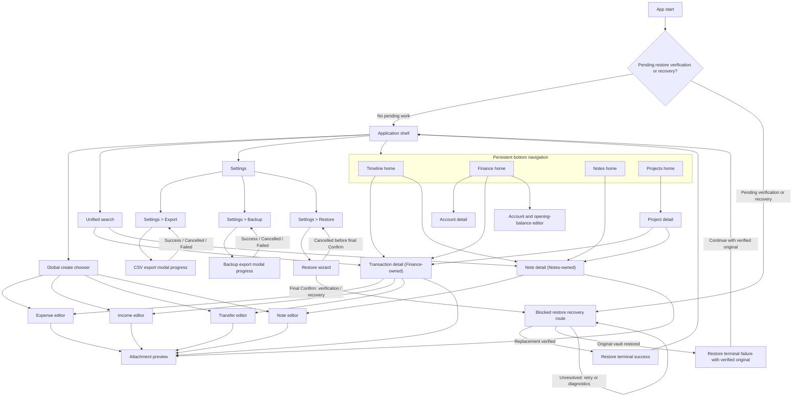

# Information architecture

This document is the source of truth for application destinations, screen ownership, navigation, and navigation-state retention. Observable journey outcomes remain owned by the [MVP requirements](../product/mvp-requirements.md); module boundaries remain owned by the [architecture overview](../architecture/overview.md); interaction state machines are defined in [interaction rules](interaction-rules.md).

## Platform and shell boundary

The MVP is a local-first, single-user native Android application with `minSdk 34`. Journeys 1–13 and every destination in this document must remain usable with Android network permission denied.

The application shell has four persistent bottom-navigation destinations in this exact order:

1. Timeline
2. Finance
3. Notes
4. Projects

These destinations are peer domains. Selecting one switches the active top-level back stack; it never scrolls vertically into another top-level domain. A screen that concatenates Timeline, Finance, Notes, and Projects into one vertically paged surface is non-conforming.

Every top-level app bar exposes the same application-level commands:

- global create (`+`), whose only MVP choices are Expense, Income, Transfer, and Note;
- global Search;
- global Settings.

The shell does not offer a generic **Entry**, **Record**, or **Create anything** destination. The shared timeline and search experience unifies reading and discovery, not the source entity or its write path.

## Destination ownership

| Destination or screen family | Owning feature | Responsibility and write boundary |
|---|---|---|
| Timeline | `:feature:timeline` | Default home and mixed day read model for transactions and notes. It reads projections and never writes source facts. |
| Finance | `:feature:finance` | Accounts, account history, transaction details and editors, categories, balances, monthly income/expense totals, and category statistics. |
| Notes | `:feature:notes` | Note list, Markdown note details and editor, confirmed note images, and note-side transaction linking. |
| Projects | `:feature:timeline` | Project list/detail and aggregation of transactions and notes by their one optional primary project. It is a context read surface, not a generic relation editor. |
| Unified Search | `:feature:timeline` | Rebuildable mixed result projection with transaction/note type filtering. It dispatches selection to the owning detail screen. |
| Global create and application navigation | `:app` | Dispatches the selected typed creation route; it does not implement finance or note writes. |
| Settings, export, backup, and restore entry | `:app`, delegating data work to `:core:data` | Owns application-level data controls and routes into typed progress or restore-wizard states. |
| Attachment preview | Owning editor/detail feature | Displays a selected or confirmed image without exposing its physical path. |

Finance and Notes own all edits to their facts. Timeline, Projects, and Search may display a transaction or note card, but selecting that card opens the source entity's Finance-owned transaction detail or Notes-owned note detail. Any subsequent edit starts from that owning detail screen.

## Navigation graph

The identifiers such as `TL_HOME` below are diagram node IDs only. Labels such as “Timeline home” are screen identities, while Compose navigation route keys are the typed keys in the route table after the diagram; none of the node IDs is a URI route string.

### Typed route contract

Typed route keys are stable screen contracts for future Compose implementation. Arguments use domain IDs, never Room entities or physical file paths.

| Route key | Required argument or launch state | Back destination |
|---|---|---|
| `TimelineHome` | Retained timeline tab state | Prior task or app exit from the root |
| `FinanceHome` | Retained finance tab state | Prior task or app exit from the root |
| `NotesHome` | Retained notes tab state | Prior task or app exit from the root |
| `ProjectsHome` | Retained projects tab state | Prior task or app exit from the root |
| `UnifiedSearch` | Query and type-filter state | The exact top-level destination that launched Search |
| `Settings` | Selected top-level destination as return context | The exact top-level destination that launched Settings |
| `TransactionDetail` | `transactionId` plus optional origin context | The exact originating Timeline, Finance, Project, or Search state |
| `NoteDetail` | `noteId` plus optional origin context | The exact originating Timeline, Notes, Project, or Search state |
| `AccountDetail` | `accountId` | Prior Finance state |
| `ProjectDetail` | `projectId` | Prior Projects state |
| `ExpenseEditor` / `IncomeEditor` / `TransferEditor` | New typed draft or an existing `transactionId` | Launching detail or top-level state |
| `NoteEditor` | New note draft or existing `noteId` | Launching detail or top-level state |
| `AccountOpeningEditor` | New account draft | Prior Finance state |
| `AttachmentPreview` | In-memory pending-media handle or persisted attachment ID | Owning editor/detail with its state intact |
| `SettingsExport` | Export operation kind and latest terminal result | Settings or the retained top-level launch context |
| `CsvExportProgress` | Confirmed CSV destination and modal progress state | No Back while Running/Cancelling; every confirmed terminal outcome returns to `SettingsExport` with Success, Cancelled, or Failed status |
| `SettingsBackup` | Backup prerequisites, destination selection, and latest terminal result | Settings or the retained top-level launch context |
| `BackupExportProgress` | Confirmed logical-backup destination and modal progress state | No Back while Running/Cancelling; every confirmed terminal outcome returns to `SettingsBackup` with Success, Cancelled, or Failed status |
| `SettingsRestore` | Restore candidate entry and latest pre-commit Cancelled/terminal result | Settings or the retained top-level launch context |
| `RestoreWizard` | No implicit candidate; the user selects one inside the wizard | Before final Confirm, Cancelled returns to `SettingsRestore`; after final Confirm there is no Back/Cancel route until terminal success/failure |
| `RestoreRecoveryRoute` | Architecture-verified pending restore/migration recovery status; no domain or file-path argument | No shell destination while unresolved; verified replacement goes to restore success, verified rollback goes to restore failure |
| `RestoreTerminalSuccess` | Complete replacement verified safe | Continue into Timeline using restored data |
| `RestoreTerminalFailure` | Restore failed and original vault verified safe | Continue into the original data or return to Settings; unresolved recovery never enters this route |

An origin context is navigation-only state needed to return to the previous scroll position, filter, query, or date. It is not persisted as a domain relation.

## Bottom-navigation visibility

| Route or context | Phase | Bottom navigation | App/system/predictive Back | Explicit Cancel and terminal route |
|---|---|---|---|---|
| Top-level homes and browse/details | Any stable browse phase | Visible | Normal route behavior | Not applicable |
| Unified Search, Settings, `SettingsExport`, `SettingsBackup`, `SettingsRestore` | Stable browse/result state | Visible | Returns to retained origin | Not applicable |
| Any transaction, note, account, tag, or project Editor; attachment preview | Any | Hidden | Draft/preview rule in [interaction rules](interaction-rules.md) | Editor `Phase.Saving` blocks Cancel/Discard until Completed or Failure |
| Saved Detail relationship/assignment subflow | Before `Phase.Saving` | Hidden | Returns to the same Detail without writing | Confirm enters locked `Phase.Saving`; terminal returns to same Detail |
| Editor relationship/assignment subflow | `Phase.Idle` | Hidden | Returns to the same parent draft without writing | Done updates only parent draft; parent Save owns visibility |
| `CsvExportProgress` | `Phase.Running` / `Phase.Cancelling` | Hidden or disabled | Blocked; cannot leave modal | Only explicit Cancel; terminal returns Success/Cancelled/Failed to `SettingsExport` |
| `BackupExportProgress` | `Phase.Running` / `Phase.Cancelling` | Hidden or disabled | Blocked; cannot leave modal | Only explicit Cancel; terminal returns Success/Cancelled/Failed to `SettingsBackup` |
| `RestoreWizard` candidate/confirmation | `Phase.Selecting` / `Phase.Idle` | Hidden | Exits only through the defined pre-commit cancellation result | Cancel → `Phase.Cancelled` → `SettingsRestore` |
| `RestoreWizard` preflight | `Phase.Checking` / `Phase.Cancelling` | Hidden | Blocked while checking/cancelling | Explicit Cancel waits for confirmation, then `Phase.Cancelled` → `SettingsRestore` |
| Restore after final Confirm | `Phase.Running` / `Phase.Recovering` | Hidden | Blocked until verified terminal outcome | Cancel unavailable; startup validation routes only to Completed or Failure/Rollback |
| `RestoreRecoveryRoute` | `Phase.Recovering` / `Phase.BlockingFailure` | Not constructed | Cannot enter shell | Safe Retry/diagnostics only until a complete vault is verified |

Hiding bottom navigation does not discard the selected tab or its back stack. Back or a terminal action restores the same shell context. System Back from a dirty editor follows the discard rule in [interaction rules](interaction-rules.md); it must not silently destroy a draft.

## Per-tab state retention

Each top-level destination owns an independent navigation back stack and a retained state bundle. Switching tabs and opening then closing a child screen must preserve that bundle.

| Tab | Retained scroll position | Retained filters | Retained date state |
|---|---|---|---|
| Timeline | Mixed-card list position and offset | Active timeline filters, if any | Selected day |
| Finance | Active account/statistics list position and offset | Selected account/category/type filters | Selected statistics month or transaction-history date range |
| Notes | Note-list position and offset | Active note/tag/project filters | Selected note-date filter or date anchor |
| Projects | Project-list or current project-feed position and offset | Active project/entity-type filters | Selected project-feed date filter or date anchor |

Retention is required for tab switching, source-detail round trips, Search round trips, and configuration recreation while the task remains in the running app. Unsaved-draft recovery after force-stop, OS process death, uninstall, or device loss is outside the MVP promise, consistent with the cross-cutting acceptance rule.

Compose implementation must hoist these values out of disposable list items and scope them to each top-level back-stack entry. Restoring one tab must not overwrite another tab's state. A tab reselect may expose an explicit “return to root” or “scroll to current date” action later, but reselecting a tab must not implicitly reset state in MVP.

## Cross-domain navigation rules

1. Timeline is the default launch destination and a read-only mixed projection.
2. A transaction card from Timeline, Projects, or Search opens `TransactionDetail`; a note card opens `NoteDetail`.
3. Back from the source detail returns to the exact origin with its scroll position, filters, query, and selected date intact.
4. Editing is dispatched by source type. Timeline, Projects, and Search never host a generic editor and never mutate a projection.
5. Transaction-to-note and note-to-transaction links open the linked source detail in the owning feature. Back returns to the originating detail.
6. A primary-project chip or assignment may open `ProjectDetail`; this navigation does not change the fact's assignment.
7. Missing or soft-deleted targets render an unavailable state and a safe Back action; they do not redirect to an unrelated record.
8. Successful creation of an Expense, Income, or Transfer opens its Finance-owned `TransactionDetail`; successful account creation opens `AccountDetail`. Back restores the exact retained launch context. Successful edit returns to its source detail. A relationship/assignment action launched from a saved Detail may save independently and returns to that Detail; the same action launched from any Editor only updates and returns to the parent draft. Image/picker subflows also return to the parent draft. None applies a top-level success route.
9. Search result and error updates are scoped to the current query/filter request revision. Clearing, closing, or leaving Search invalidates pending updates, except that opening a current result preserves the completed Search state for Back.
10. App startup must resolve the restore/migration recovery gate before the shell: replacement verification leads to terminal success, verified rollback leads to terminal failure with access to the original data, and unresolved recovery remains blocked with Retry/diagnostics only.

## Navigation acceptance checks

Future Compose navigation and UI tests must demonstrate:

- launch opens Timeline and the bottom-navigation order is Timeline, Finance, Notes, Projects when no restore/migration recovery is pending;
- all four tabs retain independent scroll position, filter, and date state across switching;
- top-level domains cannot be reached by vertically scrolling another domain;
- global `+` exposes exactly Expense, Income, Transfer, and Note;
- global Search and Settings are reachable from every top-level app bar;
- editors, attachment preview, and Restore Wizard hide bottom navigation and restore the prior context on return;
- cards from Timeline and Search dispatch to the correct source detail and Back restores origin state;
- new finance/account success routes and edit/subflow returns follow the deterministic destinations above;
- relationship and assignment subflows choose save behavior from saved Detail versus any Editor context; an existing-record Editor never uses the independent Detail save path;
- `CsvExportProgress` is modal full-screen: Running/Cancelling blocks bottom navigation and every Back path, explicit Cancel waits for acknowledgement, and Success/Cancelled/Failed returns to `SettingsExport` with the actual status;
- `BackupExportProgress` obeys the same modal lock and cancellation acknowledgement, returning Success/Cancelled/Failed to `SettingsBackup` with a deterministic Retry path;
- Restore preflight can reach Cancelled and return to `SettingsRestore`; final Confirm removes every Cancel/Back/bottom-navigation path until startup validation reaches complete success or failure/rollback;
- a pending app-start recovery shows `RestoreRecoveryRoute` before the shell and cannot be bypassed into ordinary navigation;
- stale or invalidated Search revisions cannot update visible results or errors;
- no screen, route key, button, or domain type named generic Entry is introduced.
