# Information architecture

This document is the source of truth for application destinations, screen ownership, navigation, and navigation-state retention. Observable journey outcomes remain owned by the [MVP requirements](../product/mvp-requirements.md); module boundaries remain owned by the [architecture overview](../architecture/overview.md); interaction state machines are defined in [interaction rules](interaction-rules.md).

## Platform and shell boundary

The MVP is a local-first, single-user native Android application with `minSdk 34`. Journeys 1–13 and every destination in this document must remain usable in airplane mode or an otherwise network-isolated environment.

The application shell has four persistent bottom-navigation destinations in this exact order:

1. Timeline
2. Finance
3. Notes
4. Projects

These destinations are peer domains. Selecting one switches the active top-level back stack; it never scrolls vertically into another top-level domain. A screen that concatenates Timeline, Finance, Notes, and Projects into one vertically paged surface is non-conforming.

Every top-level app bar exposes the same application-level commands:

- global create (`+`), whose only MVP choices are Expense, Income, Transfer, and Note;
- global Search;
- global Settings.

The shell does not offer a generic **Entry**, **Record**, or **Create anything** destination. The shared timeline and search experience unifies reading and discovery, not the source entity or its write path.

## Destination ownership

| Destination or screen family | Owning feature | Responsibility and write boundary |
|---|---|---|
| Timeline | `:feature:timeline` | Default home and mixed day read model for transactions and notes. It reads projections and never writes source facts. |
| Finance | `:feature:finance` | Accounts, account history, transaction details and editors, first-level Category catalog lifecycle, balances, monthly income/expense totals, and category statistics. |
| Notes | `:feature:notes` | Note list, Markdown note details and editor, confirmed note images, note-side transaction linking, and shared Tag catalog lifecycle. |
| Projects | `:feature:timeline` | Active/archived Project lists, Project create/rename/archive/restore, Project detail, and aggregation of transactions and notes by their one optional primary project. It never edits transaction/note facts or acts as a generic relation editor. |
| Unified Search | `:feature:timeline` | Rebuildable mixed result projection with transaction/note type filtering. It dispatches selection to the owning detail screen. |
| Global create and application navigation | `:app` | Dispatches the selected typed creation route; it does not implement finance or note writes. |
| Settings and data controls | `:app`, delegating domain/data work to the owning feature or `:core:data` | Owns application-level routing, including Settings → Categories, Settings → Tags, export, backup, and restore; it does not implement catalog or record writes. |
| Privacy & Security and App Lock | `:app` | Owns the setting, platform-authentication route, secure-window boundary, and shell access decision; it does not own database recovery. |
| Diagnostics and diagnostic export | `:app`, delegating the redacted ring buffer/export to `:core:data` | Shows only a non-sensitive envelope and routes an explicit export through a modal progress flow; it never opens or uploads user records. |
| Attachment preview | Owning editor/detail feature | Displays a selected or confirmed image without exposing its physical path. |

Finance and Notes own edits to their transaction/note facts and their Category/Tag catalogs. Projects owns only Project catalog lifecycle and Project aggregation/detail. Timeline, Projects, and Search may display a transaction or note card, but selecting that card opens the source entity's Finance-owned transaction detail or Notes-owned note detail. Any subsequent transaction/note edit starts from that owning detail screen.

## Navigation graph

The identifiers such as `TL_HOME` below are diagram node IDs only. Labels such as “Timeline home” are screen identities, while Compose navigation route keys are the typed keys in the route table after the diagram; none of the node IDs is a URI route string.

```mermaid
flowchart TD
    APP_START["App start"]
    RECOVERY_GATE{"Pending restore verification or recovery?"}
    ACCESS_GATE{"App Lock enabled and authenticated?"}
    RECOVERY_ACCESS_GATE{"Recovery detail access authenticated?"}
    APP_LOCK["App Lock route"]
    LOCKED_RECOVERY["Generic locked recovery surface"]
    RESTORE_RECOVERY["Blocked restore recovery route"]
    RESTORE_SUCCESS["Restore terminal success"]
    RESTORE_FAILURE["Restore terminal failure with verified original"]
    SHELL["Application shell"]
    CREATE["Global create chooser"]
    SEARCH["Unified search"]
    SETTINGS["Settings"]
    SETTINGS_EXPORT["Settings > Export"]
    SETTINGS_BACKUP["Settings > Backup"]
    SETTINGS_RESTORE["Settings > Restore"]
    SETTINGS_CATEGORIES["Settings > Categories"]
    SETTINGS_TAGS["Settings > Tags"]
    SETTINGS_PRIVACY["Settings > Privacy & Security"]
    SETTINGS_DIAGNOSTICS["Settings > Diagnostics"]
    DIAGNOSTIC_PROGRESS["Diagnostic export modal progress"]

    subgraph TOP["Persistent bottom navigation"]
        TL_HOME["Timeline home"]
        FI_HOME["Finance home"]
        NO_HOME["Notes home"]
        PR_HOME["Projects home"]
    end

    TX_DETAIL["Transaction detail (Finance-owned)"]
    NOTE_DETAIL["Note detail (Notes-owned)"]
    ACCOUNT_DETAIL["Account detail"]
    PROJECT_DETAIL["Project detail"]

    EXPENSE_EDIT["Expense editor"]
    INCOME_EDIT["Income editor"]
    TRANSFER_EDIT["Transfer editor"]
    NOTE_EDIT["Note editor"]
    ACCOUNT_EDIT["Account and opening-balance editor"]
    CATEGORY_PICKER["Category picker"]
    TAG_PICKER["Tag picker"]
    PROJECT_PICKER["Project picker"]
    CATEGORY_EDITOR["Category catalog editor"]
    TAG_EDITOR["Tag catalog editor"]
    PROJECT_EDITOR["Project catalog editor"]
    CATALOG_ARCHIVE["Catalog archive confirmation"]
    ATTACHMENT_PREVIEW["Attachment preview"]
    CSV_PROGRESS["CSV export modal progress"]
    BACKUP_PROGRESS["Backup export modal progress"]
    RESTORE["Restore wizard"]

    APP_START --> RECOVERY_GATE
    RECOVERY_GATE -- "No pending work" --> ACCESS_GATE
    ACCESS_GATE -- "Lock off or authenticated" --> SHELL
    ACCESS_GATE -- "Lock enabled, unauthenticated" --> APP_LOCK
    APP_LOCK -- "Authenticated; no pending recovery" --> SHELL
    RECOVERY_GATE -- "Pending verification or recovery" --> RECOVERY_ACCESS_GATE
    RECOVERY_ACCESS_GATE -- "Lock off or authenticated" --> RESTORE_RECOVERY
    RECOVERY_ACCESS_GATE -- "Lock enabled, unauthenticated" --> LOCKED_RECOVERY
    LOCKED_RECOVERY --> APP_LOCK
    APP_LOCK -- "Authenticated; recovery pending" --> RESTORE_RECOVERY
    RESTORE_RECOVERY -- "Replacement verified" --> RESTORE_SUCCESS
    RESTORE_RECOVERY -- "Original vault restored" --> RESTORE_FAILURE
    RESTORE_RECOVERY -- "Unresolved: retry or diagnostics" --> RESTORE_RECOVERY
    RESTORE_SUCCESS --> SHELL
    RESTORE_FAILURE -- "Continue with verified original" --> SHELL

    SHELL --> TOP
    SHELL --> CREATE
    SHELL --> SEARCH
    SHELL --> SETTINGS

    CREATE --> EXPENSE_EDIT
    CREATE --> INCOME_EDIT
    CREATE --> TRANSFER_EDIT
    CREATE --> NOTE_EDIT

    TL_HOME --> TX_DETAIL
    TL_HOME --> NOTE_DETAIL
    SEARCH --> TX_DETAIL
    SEARCH --> NOTE_DETAIL
    FI_HOME --> ACCOUNT_DETAIL
    FI_HOME --> TX_DETAIL
    FI_HOME --> ACCOUNT_EDIT
    NO_HOME --> NOTE_DETAIL
    PR_HOME --> PROJECT_DETAIL
    PR_HOME --> PROJECT_EDITOR
    PR_HOME --> CATALOG_ARCHIVE
    PROJECT_DETAIL --> TX_DETAIL
    PROJECT_DETAIL --> NOTE_DETAIL
    PROJECT_DETAIL --> PROJECT_EDITOR
    PROJECT_DETAIL --> CATALOG_ARCHIVE

    TX_DETAIL --> EXPENSE_EDIT
    TX_DETAIL --> INCOME_EDIT
    TX_DETAIL --> TRANSFER_EDIT
    NOTE_DETAIL --> NOTE_EDIT
    TX_DETAIL --> ATTACHMENT_PREVIEW
    NOTE_DETAIL --> ATTACHMENT_PREVIEW
    EXPENSE_EDIT --> ATTACHMENT_PREVIEW
    INCOME_EDIT --> ATTACHMENT_PREVIEW
    TRANSFER_EDIT --> ATTACHMENT_PREVIEW
    NOTE_EDIT --> ATTACHMENT_PREVIEW
    EXPENSE_EDIT --> CATEGORY_PICKER
    INCOME_EDIT --> CATEGORY_PICKER
    EXPENSE_EDIT --> TAG_PICKER
    INCOME_EDIT --> TAG_PICKER
    TRANSFER_EDIT --> TAG_PICKER
    NOTE_EDIT --> TAG_PICKER
    EXPENSE_EDIT --> PROJECT_PICKER
    INCOME_EDIT --> PROJECT_PICKER
    TRANSFER_EDIT --> PROJECT_PICKER
    NOTE_EDIT --> PROJECT_PICKER
    CATEGORY_PICKER --> CATEGORY_EDITOR
    TAG_PICKER --> TAG_EDITOR
    PROJECT_PICKER --> PROJECT_EDITOR

    SETTINGS --> SETTINGS_EXPORT
    SETTINGS_EXPORT --> CSV_PROGRESS
    CSV_PROGRESS -- "Success / Cancelled / Failed" --> SETTINGS_EXPORT
    SETTINGS --> SETTINGS_BACKUP
    SETTINGS_BACKUP --> BACKUP_PROGRESS
    BACKUP_PROGRESS -- "Success / Cancelled / Failed" --> SETTINGS_BACKUP
    SETTINGS --> SETTINGS_RESTORE
    SETTINGS_RESTORE --> RESTORE
    SETTINGS --> SETTINGS_CATEGORIES
    SETTINGS --> SETTINGS_TAGS
    SETTINGS_CATEGORIES --> CATEGORY_EDITOR
    SETTINGS_CATEGORIES --> CATALOG_ARCHIVE
    SETTINGS_TAGS --> TAG_EDITOR
    SETTINGS_TAGS --> CATALOG_ARCHIVE
    SETTINGS --> SETTINGS_PRIVACY
    SETTINGS --> SETTINGS_DIAGNOSTICS
    SETTINGS_DIAGNOSTICS --> DIAGNOSTIC_PROGRESS
    DIAGNOSTIC_PROGRESS -- "Success / Cancelled / Failed" --> SETTINGS_DIAGNOSTICS
    RESTORE -- "Cancelled before final Confirm" --> SETTINGS_RESTORE
    RESTORE -- "Final Confirm: verification / recovery" --> RESTORE_RECOVERY
```

### Typed route contract

Typed route keys are stable screen contracts for future Compose implementation. Arguments use domain IDs, never Room entities or physical file paths.

| Route key | Required argument or launch state | Back destination |
|---|---|---|
| `TimelineHome` | Retained timeline tab state | Prior task or app exit from the root |
| `FinanceHome` | Retained finance tab state | Prior task or app exit from the root |
| `NotesHome` | Retained notes tab state | Prior task or app exit from the root |
| `ProjectsHome` | Retained projects tab state | Prior task or app exit from the root |
| `UnifiedSearch` | Query and type-filter state | The exact top-level destination that launched Search |
| `Settings` | Selected top-level destination as return context | The exact top-level destination that launched Settings |
| `PrivacySecuritySettings` | Current App Lock enabled state and platform-authentication capability status | Settings |
| `AppLockRoute` | No user data; launch reason is cold start or foreground return, plus only a boolean that generic recovery is pending | Back backgrounds/exits the app; success continues to the recovery route or shell selected by the startup gate |
| `LockedRecoverySurface` | Generic recovery-in-progress/blocked status with no user data, diagnostics, terminal details, counts, or paths | Cannot enter shell; authentication opens the detailed recovery route, while Back only backgrounds/exits the app |
| `DiagnosticsSettings` | Redacted envelope containing time range, event count, estimated size, and latest terminal export result | Settings |
| `DiagnosticExportProgress` | Confirmed SAF destination and modal progress state; no diagnostic event payload is a route argument | No Back while Running/Cancelling; terminal Success/Cancelled/Failed returns to `DiagnosticsSettings` |
| `CategoryCatalog` | Active/archived mode, list position, and latest lifecycle result | Settings |
| `TagCatalog` | Active/archived mode, list position, and latest lifecycle result | Settings |
| `CategoryPicker` | Parent Expense/Income draft identity plus its current allocations | Same parent editor with every field retained |
| `TagPicker` | Parent Transaction/Note draft or saved-Detail context plus current tag selection | Same parent editor/detail with its state retained |
| `ProjectPicker` | Parent Transaction/Note draft or saved-Detail context plus current primary-project selection | Same parent editor/detail with its state retained |
| `CategoryEditor` / `TagEditor` | Catalog type, create-or-rename mode, and item ID only for rename | Launching catalog, or the same picker for inline create |
| `ProjectEditor` | Create-or-rename mode and item ID only for rename | Projects retained list/detail, or the same picker for inline create |
| `CatalogArchiveConfirm` | Catalog type, item ID, and exact launching context; current name/state and impact summary are loaded rather than trusted as route arguments | Launching Category/Tag catalog or Projects state |
| `TransactionDetail` | `transactionId` plus optional origin context | The exact originating Timeline, Finance, Project, or Search state |
| `NoteDetail` | `noteId` plus optional origin context | The exact originating Timeline, Notes, Project, or Search state |
| `AccountDetail` | `accountId` | Prior Finance state |
| `ProjectDetail` | `projectId` plus origin-derived read-only or Projects-management mode; an archived historical target remains resolvable | Exact originating Transaction/Note detail or retained Projects state |
| `ExpenseEditor` / `IncomeEditor` / `TransferEditor` | New typed draft or an existing `transactionId` | Launching detail or top-level state |
| `NoteEditor` | New note draft or existing `noteId` | Launching detail or top-level state |
| `AccountOpeningEditor` | New account draft | Prior Finance state |
| `AttachmentPreview` | In-memory pending-media handle or persisted attachment ID | Owning editor/detail with its state intact |
| `SettingsExport` | Export operation kind and latest terminal result | Settings or the retained top-level launch context |
| `CsvExportProgress` | Confirmed CSV destination and modal progress state | No Back while Running/Cancelling; every confirmed terminal outcome returns to `SettingsExport` with Success, Cancelled, or Failed status |
| `SettingsBackup` | Backup prerequisites, destination selection, and latest terminal result | Settings or the retained top-level launch context |
| `BackupExportProgress` | Confirmed logical-backup destination and modal progress state | No Back while Running/Cancelling; every confirmed terminal outcome returns to `SettingsBackup` with Success, Cancelled, or Failed status |
| `SettingsRestore` | Restore candidate entry and latest pre-commit Cancelled/terminal result | Settings or the retained top-level launch context |
| `RestoreWizard` | No implicit candidate; the user selects one inside the wizard | Before final Confirm, Cancelled returns to `SettingsRestore`; after final Confirm there is no Back/Cancel route until terminal success/failure |
| `RestoreRecoveryRoute` | Architecture-verified pending restore/migration recovery status; no domain or file-path argument | No shell destination while unresolved; verified replacement goes to restore success, verified rollback goes to restore failure |
| `RestoreTerminalSuccess` | Complete replacement verified safe | Continue into Timeline using restored data |
| `RestoreTerminalFailure` | Restore failed and original vault verified safe | Continue into the original data or return to Settings; unresolved recovery never enters this route |

An origin context is navigation-only state needed to return to the previous scroll position, filter, query, or date. It is not persisted as a domain relation.

## Bottom-navigation visibility

| Route or context | Phase | Bottom navigation | App/system/predictive Back | Explicit Cancel and terminal route |
|---|---|---|---|---|
| Top-level homes and browse/details, including active/archived `ProjectsHome` | Any stable browse phase | Visible | Normal route behavior | Project lifecycle actions launch the modal routes below |
| Unified Search, Settings, `CategoryCatalog`, `TagCatalog`, `SettingsExport`, `SettingsBackup`, `SettingsRestore` | Stable browse/result state | Visible | Returns to retained origin | Catalog lists retain active/archived mode and list position |
| `PrivacySecuritySettings`, `DiagnosticsSettings` | Stable browse/result state | Visible | Returns to Settings | Authentication prompts and export selection follow [interaction rules](interaction-rules.md) |
| `AppLockRoute`, `LockedRecoverySurface` | `Phase.Checking`, `Phase.RecoverableFailure`, `Phase.BlockingFailure`, or transient `Phase.Completed` | Not constructed | Cannot enter the shell before Completed routing; Back only backgrounds/exits the app | Authentication success routes according to the already-evaluated recovery gate; failure/cancel remains locked |
| Any transaction, note, account, Category, Tag, or Project Editor; catalog archive confirmation; attachment preview | Any | Hidden | Draft/confirmation/preview rule in [interaction rules](interaction-rules.md) | Editor or lifecycle `Phase.Saving` blocks Cancel/Discard until Completed or Failure |
| `CategoryPicker`, `TagPicker`, `ProjectPicker` | `Phase.Idle` or selection failure | Hidden | Returns to the same parent without writing | Inline create returns here only after durable success and auto-selects the new item |
| Saved Detail relationship/assignment subflow | Before `Phase.Saving` | Hidden | Returns to the same Detail without writing | Confirm enters locked `Phase.Saving`; terminal returns to same Detail |
| Editor relationship/assignment subflow | `Phase.Idle` | Hidden | Returns to the same parent draft without writing | Done updates only parent draft; parent Save owns visibility |
| `CsvExportProgress` | `Phase.Running` / `Phase.Cancelling` | Hidden or disabled | Blocked; cannot leave modal | Only explicit Cancel; terminal returns Success/Cancelled/Failed to `SettingsExport` |
| `BackupExportProgress` | `Phase.Running` / `Phase.Cancelling` | Hidden or disabled | Blocked; cannot leave modal | Only explicit Cancel; terminal returns Success/Cancelled/Failed to `SettingsBackup` |
| `DiagnosticExportProgress` | `Phase.Running` / `Phase.Cancelling` | Hidden or disabled | Blocked; cannot leave modal | Only explicit Cancel; terminal returns Success/Cancelled/Failed to `DiagnosticsSettings` |
| `RestoreWizard` candidate/confirmation | `Phase.Selecting` / `Phase.Idle` | Hidden | Exits only through the defined pre-commit cancellation result | Cancel → `Phase.Cancelled` → `SettingsRestore` |
| `RestoreWizard` preflight | `Phase.Checking` / `Phase.Cancelling` | Hidden | Blocked while checking/cancelling | Explicit Cancel waits for confirmation, then `Phase.Cancelled` → `SettingsRestore` |
| Restore after final Confirm | `Phase.Running` / `Phase.Recovering` | Hidden | Blocked until verified terminal outcome | Cancel unavailable; startup validation routes only to Completed or Failure/Rollback |
| `RestoreRecoveryRoute` | `Phase.Recovering` / `Phase.BlockingFailure` | Not constructed | Cannot enter shell | Safe Retry/diagnostics only until a complete vault is verified |

Hiding bottom navigation does not discard the selected tab or its back stack. Back or a terminal action restores the same shell context. System Back from a dirty editor follows the discard rule in [interaction rules](interaction-rules.md); it must not silently destroy a draft.

## Per-tab state retention

Each top-level destination owns an independent navigation back stack and a retained state bundle. Switching tabs and opening then closing a child screen must preserve that bundle.

| Tab | Retained scroll position | Retained filters | Retained date state |
|---|---|---|---|
| Timeline | Mixed-card list position and offset | Active timeline filters, if any | Selected day |
| Finance | Active account/statistics list position and offset | Selected account/category/type filters | Selected statistics month or transaction-history date range |
| Notes | Note-list position and offset | Active note/tag/project filters | Selected note-date filter or date anchor |
| Projects | Project-list or current project-feed position and offset | Active/archived list mode plus project/entity-type filters | Selected project-feed date filter or date anchor |

Timeline derives its default selected day from an injected `Clock` plus the device `ZoneId`. On first install, a user cold start with no restorable session state, or any other launch with no legal restorable Timeline UI state, the initial selected day is the current local date. Configuration or process recreation restores a legal saved selected day, filter, and scroll position; tab switching and child round trips preserve the same values. If the local date changes while the app remains foregrounded, Timeline does not move automatically or overwrite the date the user is viewing.

Timeline exposes an explicit **Today** action. Invoking it reads the current local date again from the injected time sources, selects that day, preserves applicable filters, and scrolls the mixed Timeline to the top. It is the only in-session action that changes a retained selected day merely because “today” has changed; tab reselect and foreground midnight do not.

Retention is required for tab switching, source-detail round trips, Search round trips, and configuration or eligible process recreation. Unsaved-draft recovery after force-stop, OS process death, uninstall, or device loss is outside the MVP promise, consistent with the cross-cutting acceptance rule; this does not prevent restoring a valid saved read-only Timeline UI state when Android supplies one.

Compose implementation must hoist these values out of disposable list items and scope them to each top-level back-stack entry. Restoring one tab must not overwrite another tab's state. Reselecting a tab must not implicitly reset state in MVP; only the explicit Today action selects the current local date and returns Timeline to the top.

## Cross-domain navigation rules

1. Timeline is the default launch destination and a read-only mixed projection.
2. A transaction card from Timeline, Projects, or Search opens `TransactionDetail`; a note card opens `NoteDetail`.
3. Back from the source detail returns to the exact origin with its scroll position, filters, query, and selected date intact.
4. Editing is dispatched by source type. Timeline and Search never host a generic editor and never mutate a projection. Projects may create, rename, archive, or restore Project facts, but it never edits transaction/note facts or writes an aggregation projection.
5. Transaction-to-note and note-to-transaction links open the linked source detail in the owning feature. Back returns to the originating detail.
6. An active primary-project chip or an archived historical primary-project reference opens the matching `ProjectDetail`; navigation alone never changes the assignment. An archived Project detail is read-only when opened from Transaction/Note history and clearly marks the archived state. Restore is the only permitted mutation and is exposed only in an authorized Projects-management context after normal shell access is allowed; restoring does not create a new assignment.
7. A missing target, or a soft-deleted Transaction/Note target, renders an unavailable state with safe Back and never redirects to an unrelated record. A soft-deleted Project is the user-facing archived state, so an existing historical reference resolves to the read-only archived `ProjectDetail` instead of the unavailable state. Archived Projects remain excluded from every new-assignment selector.
8. Successful creation of an Expense, Income, or Transfer opens its Finance-owned `TransactionDetail`; successful account creation opens `AccountDetail`. Back restores the exact retained launch context. Successful edit returns to its source detail. A relationship/assignment action launched from a saved Detail may save independently and returns to that Detail; the same action launched from any Editor only updates and returns to the parent draft. Image/picker subflows also return to the parent draft. None applies a top-level success route.
9. Search result and error updates are scoped to the current query/filter request revision. Clearing, closing, or leaving Search invalidates pending updates, except that opening a current result preserves the completed Search state for Back.
10. App startup evaluates the restore/migration recovery gate before Room and before the shell. When App Lock is enabled and authentication has not succeeded, pending recovery may show only `LockedRecoverySurface`; detailed status, diagnostics, terminal outcomes, counts, and user data remain hidden. Authentication then routes to the detailed recovery state. Replacement verification leads to terminal success, verified rollback leads to terminal failure with access to the original data, and unresolved recovery never enters the shell.
11. App Lock is immediate on every cold start and background-to-foreground transition when enabled. The secure-window boundary prevents recent-task previews and pre-authentication frames from revealing the prior screen.
12. Diagnostic export is reachable only after shell authentication or an authenticated detailed recovery route. It never becomes a route around App Lock or unresolved recovery.
13. Category, Tag, and Project selectors show only active items for new selection, while an existing archived historical reference remains visibly marked. Inline Create opens the typed catalog editor; durable success returns to the same picker, auto-selects the new item, and preserves every other parent-draft field.
14. Settings → Categories and Settings → Tags own active/archived catalog browsing and lifecycle entry. Projects owns the equivalent active/archived list and lifecycle entry for Project. Archive confirmation and all catalog editors are modal; Cancel/Back changes no catalog fact.

## Navigation acceptance checks

Future Compose navigation and UI tests must demonstrate:

- launch opens Timeline and the bottom-navigation order is Timeline, Finance, Notes, Projects when no restore/migration recovery is pending;
- all four tabs retain independent scroll position, filter, and date state across switching;
- top-level domains cannot be reached by vertically scrolling another domain;
- global `+` exposes exactly Expense, Income, Transfer, and Note;
- global Search and Settings are reachable from every top-level app bar;
- editors, attachment preview, and Restore Wizard hide bottom navigation and restore the prior context on return;
- cards from Timeline and Search dispatch to the correct source detail and Back restores origin state;
- missing or soft-deleted Transaction/Note targets show unavailable, while a historical reference to an archived Project opens its marked read-only detail; only Projects-management context may expose Restore, and archived Projects never appear as new assignment choices;
- new finance/account success routes and edit/subflow returns follow the deterministic destinations above;
- relationship and assignment subflows choose save behavior from saved Detail versus any Editor context; an existing-record Editor never uses the independent Detail save path;
- empty Category/Tag/Project lists expose type-appropriate Create, inline create returns to the same picker with the new item selected, and the parent draft otherwise remains byte-for-byte equivalent at the UI-state boundary;
- Settings → Categories and Settings → Tags retain active/archived list state; Projects defaults to active, can switch to archived, and Restore returns the item to active selection without changing existing historical references;
- Category/Tag/Project editors and archive confirmation hide bottom navigation, preserve their form on failure, and return to the exact catalog or picker context on Cancel, Back, or durable completion;
- `CsvExportProgress` is modal full-screen: Running/Cancelling blocks bottom navigation and every Back path, explicit Cancel waits for acknowledgement, and Success/Cancelled/Failed returns to `SettingsExport` with the actual status;
- `BackupExportProgress` obeys the same modal lock and cancellation acknowledgement, returning Success/Cancelled/Failed to `SettingsBackup` with a deterministic Retry path;
- Restore preflight can reach Cancelled and return to `SettingsRestore`; final Confirm removes every Cancel/Back/bottom-navigation path until startup validation reaches complete success or failure/rollback;
- a pending app-start recovery shows authenticated `RestoreRecoveryRoute` or unauthenticated `LockedRecoverySurface` before the shell and cannot be bypassed into ordinary navigation;
- App Lock defaults off; when enabled, cold start and every background-to-foreground transition show a secure lock route before any prior user-data frame, and only platform authentication can continue;
- pending recovery is evaluated before Room, but an unauthenticated user sees only the generic locked recovery surface; recovery details, diagnostics, and terminal results remain inaccessible until authentication, and unresolved recovery remains unable to open the shell;
- Privacy & Security exposes the App Lock setting, while Diagnostics exposes only time range, event count, estimated size, and a user-initiated export;
- `DiagnosticExportProgress` uses the same modal navigation lock and cancellation acknowledgement as the other exports and returns only Success/Cancelled/Failed to Diagnostics;
- stale or invalidated Search revisions cannot update visible results or errors;
- no screen, route key, button, or domain type named generic Entry is introduced.
