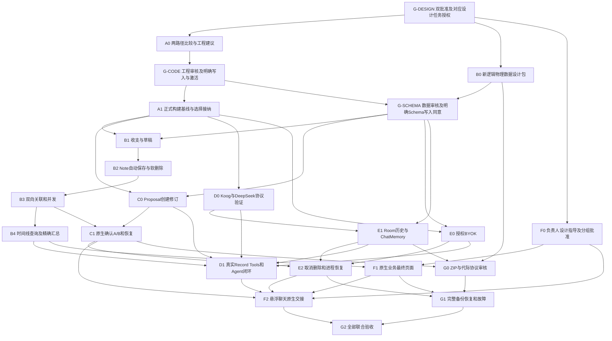

# Record 2.0 V1 Implementation Plan — R1

- **Status:** `in-progress`；revision `R1`；2026-10-24（Asia/Shanghai）。**Execution:** 目录重构/A1及G3本批隔离见§17，B0审查见§19，Schema v1交付见§20，B1业务内核及真实故障结果见§21，E0非视觉授权/凭据接缝见§23；本批未启动其他产品任务。
- **Spec approved / Plan approved:** 均于2026-10-23获负责人正式批准，原话及范围见§13；**Schema / migration consent:** 仅§20初始Schema获批，B1沿用Schema v1；迁移/恢复未授权；**Active spec:** R2 V1，B1业务内核及E0非视觉授权/凭据接缝已交付，非完整M1/V1。
- **行为与验收来源：** [spec.md](spec.md)与[自包含来源基线](../../../product/record2-v1-decision-baseline.md)；Spec E01～E12保留调查历史和外部C1核实边界。本文只拥有任务、依赖、范围、测试接缝和门禁，不形成另一份行为Spec。
- **产品执行授权：** G3/A0及已完成的目录重构/A1见§15–17，B0设计见§19，初始Schema见§20，B1服务/构建/专用设备合成库及强停验证见§21，E0非视觉授权/Keystore及专用AVD合成测试见§23；F0及其他代码/设备/API/数据库/发布仍按具体授权执行。§11–12保留草案编制历史，产品批准见§13，治理流程修订见§14；文档纳管和治理生效不授权额外产品任务。
- **设计权限：** `DESIGN-OWNER：待负责人指导与确认`。负责人提供方向 → 候选方案 → 负责人审查调整 → 明确批准 → Codex 实现；未经批准不冻结视觉/交互，不以默认 Material 页面通过最终验收。

## 1. 工程判断与实施入口

正式工程目前是 Record 1.0 M1 应用壳与 P0–P6 底座，正式 UI 没有真实 finance/Note 写入闭环。C1 是已批准的技术基座：外部六表原型在最终提交完成 A-AC1～6，但没有业务 version、SD1、完整备份或 AI。正确接纳单位是经过审查的行为、金额逻辑、事务模式和测试；不能用原型替换正式根目录，也不能把旧 Repository/P5 或 C1 的 PASS 合并成正式 V1 PASS。

**工程原则：Clean Rebuild First, Selective Reuse When Justified。** 优先评估干净R2工程；现有七模块、Repository/DAO/EntityRef、旧Schema/余额/转账、Navigation/AppContainer、UI/主题、Vault/备份格式和不适用测试不构成默认继承义务。C1是技术基座与已验证成果，不冻结其单模块原型组织或源码。选择只依据完整V1的实现质量、总工作量、风险与维护成本，不以投入时间、已有代码量/文件数决定。

**当前采用结构：** A0审查及后续布局修订见§16：保留现有单Git仓库，R1受控整理至`record1/`，R2使用`record2/`独立Gradle根、单`:app`、按业务职责分包；docs/保留，shared/按真实复用收益再定。两根互不include，不把R2接入旧根，不继承旧七模块。目录移动及A1执行范围另见§17，当前未执行；最终UI仍由F0设计批准。

旧资产可以不进入R2，但原始源码、数据库、测试/实验、文档、Commit和用户修改都保留；不清理、不覆盖、不自动迁移、不destructive migration。A0提出两代文档适用范围及必要ADR/路由同步，由后续明确授权执行；新工程不必迁就旧业务约定，也不能靠放宽旧测试声称R2验收。旧根约束继续保护旧工程，本轮不改它们。

### 1.1 G-ENTRY：分层准入，按任务与动作核准

| 层级/门禁 | 启动条件及允许行为 | 不能据此推得的权限 |
|---|---|---|
| 第一层 G-DESIGN | Spec/Plan分别获负责人明确批准，记录版本/日期/context，并有对应设计任务与文档写范围授权；A0/B0/F0及必要只读调查可并行开始 | 不要求A0工程/身份、B0最终Schema、F0设计已批准；不要求先激活功能阶段。不能写源码/工程/Schema或运行实验 |
| 第二层 G-CODE | A0推荐方案经负责人审核，相关文档/ADR适用范围已获准同步；明确源码/构建/依赖/接线写范围；执行前本Major的in-progress状态及写入/契约/资源协调就绪 | Spec/Plan或A0报告完成都不自动批准所有代码；不默认旧七模块/导航/库。只获得某类写入，不代表其他任务获得权限 |
| 第二层 G-SCHEMA（附加） | B0设计包完成，结合A0的工程/数据身份审核通过；G-CODE就绪；正式新建/变更Schema有明确对象/版本/路径/回退与单独同意 | B0先做设计，不依赖自身Schema批准；Schema源码写入许可不自动等于数据库初始化/迁移/恢复执行许可 |
| 第三层 G-EXEC（逐任务/逐动作） | 实际对象与风险匹配的授权：构建/依赖/缓存/SDK写入；精确AVD/真机及包安装；库初始化/迁移；真实DeepSeek及费用/Provider；Key配置；用户数据读取/恢复；CI/签名/发布分别记录 | 不存在一份笼统“所有外部操作已批”。某项测试写在Plan里不授权执行；生产发布、环境/秘密/CI、文件或历史删除仍单独红线审批 |

设计批准不等于功能激活；A0/B0/F0设计按对应任务授权开始，不要求先激活。进入功能实现前核对本Major的批准/执行状态和权限；其他独立Major可在无冲突时并行，不要求路由维护唯一活动指针。旧M2批准历史保留。设计依赖和执行权限分开记录：下图实线表示产物/审核依赖，G-EXEC不是要求所有外部授权一次齐全的总节点，而在各任务触发对应动作前检查。

| 任务/动作 | 具体准入，避免隐藏前置 |
|---|---|
| A0/B0/F0设计 | 仅G-DESIGN和各自设计/只读范围；可使用待定身份假设并标待收口，不等待最终工程或Schema批准 |
| A1工程/构建 | G-CODE+A0工程方案批准；解析/构建触发G-EXEC的依赖/缓存/SDK等写入同意；不在A1默认开库/装设备 |
| B1–B4/C0/C1/E0/E1/E2及工具/UI实现 | G-CODE；涉及物理Schema另需G-SCHEMA；实际库/设备/凭据/API动作再核对应G-EXEC。仍必须满足各业务依赖及视觉设计批准 |
| D0/D1/F1/F2/G1/G2运行 | 技术前置齐备之外，逐项获得实际设备/包/合成数据/Provider费用/凭据/恢复范围许可；没有则只停止依赖该动作的部分 |
| G0后续恢复设计 | 保留B0/C1/E1事实依赖；设计可读已批准契约，真正Schema/恢复写入及运行仍分别授权 |

证据接纳按Spec §2.4及A0的任务依赖清单办理，不让未接纳资料被当正式基线；也不把完成该清单要求倒置为A0设计启动前提。

## 2. 工作流、里程碑与依赖

任务按可验证业务结果拆分。跨层垂直闭环优先；物理数据契约/工具链是明确基础任务，不能伪称用户功能已完成。以下所有未来任务初始 **pending / NOT RUN**，没有被派发。



| 里程碑 | 结果与出口 | 仍不代表什么 |
|---|---|---|
| M0 准入与正式基线 | A0/B0设计审查、G-CODE/G-SCHEMA及A1相应授权范围内的构建原证据；明确正式身份和证据接纳 | 设计任务在M0收口前即可开始，不代表业务/Agent/设备全获批 |
| M1 真实原生业务闭环完成 | B1–B4正式能力 + F1正式原生UI全部接受 + 对应负责人设计批准；真实Android页面、Room磁盘和进程重启证据齐全 | 只有B1–B4时仅称“原生业务内核完成”，不能宣布M1；缺Agent/完整BK仍不是完整V1 |
| M2 受控 Agent 与原生交接 | C0/C1/D0/D1/E0/E1/E2/F2；真实模型完整工具、提案确认与会话 | 备份/联合验收未过，不能称正式 V1 |
| M3 完整 V1 联合验收候选 | G0/G1/G2，全部 Spec 验收 PASS 和负责人最终设计确认 | 不自动部署/公开发布，发布仍另行授权 |

M1/M2是依赖收口标签，不是AI延期或中间正式发布。F0与A0/B0从G-DESIGN并行；图中F0→F1/F2指对应设计组批准，不要求先完成所有组。关键路径族：`G-DESIGN→A0→G-CODE→A1`与`G-DESIGN→B0→G-SCHEMA（还需G-CODE）`会合进入B1→B2→B3，再经C0/C1/E2/F2/G2或B4/D1/F1/F2/G2；恢复分支C1/E1→G0→G1→G2，版本协议分支A1→D0→E1/D1。G-EXEC在各动作前核权限，不增加反向设计依赖。没有任务时长证据不能声称唯一最长路径，不以旧投入或C1原生粗估推算完整V1工期。

### 2.1 并行与串行规则

- G-DESIGN后A0工程调查、B0数据设计、F0负责人视觉/交互指导和必要版本只读分析可并行；B0字段可先用逻辑身份，最终审核结合A0身份方案收口。实现/构建仍等各自设计批准和写入授权。
- A1及对应数据审核/写同意后，提案规则、凭据/授权、模型协议工作在各自依赖/权限齐备且不共写时可并行；B4/C0/E0/E1/D0后工具与已批准原生UI可并行；G0后备份和AI UI同理。
- 新工程同一数据模型/DAO/公共DTO、构建目录、composition root/导航Host、同一AVD/包/fixture或verification共写必须串行；不要求其名称/文件与旧工程相同。
- B1→B2→B3→B4保留当前计划的业务/测试接纳顺序，避免改动未稳定的公共写边界；不是强制共享旧Repository/Schema。可控并发由测试交错证明，不靠多个代理同时写库。
- C1 依赖 B1–B3 的正式业务 CAS 和 C0，不需要等待时间线/汇总 B4；两分支若共写 Repository/DAO 仍须串行。D1 可在 C1 前验证 prepare，但 F2 的确认路径必须等 C1。
- 前置产物及其必要验证证据满足完成门禁后才开始下游；责任Agent直接检查并承担集成，不另设worker完成/主代理接受两套普通状态。G2最终组合检查串行；主Agent可端到端完成，委派按Policy、用户和运行环境要求选择。

## 3. Workstream A：正式工程基线

### A0 — 干净重建与受控改造两路径比较、正式工程设计审核

- **目标/依赖：** 仅G-DESIGN，不依赖尚待本任务给出的工程/身份批准。优先评估方案A干净R2，方案B受控改造为对照；两者都继承冻结R1，不重选C1/Koog。输出可审查推荐，不创建工程或接纳代码。
- **范围：** 只读现有主工程/C1/依赖声明/测试与资料；仅写获准设计报告/必要文档提案。不得为“比较”写Gradle、Schema、源码或运行构建实验；需实证执行时另提交具体范围申请，未知成本如实标明。
- **验收/测试：** 按§3.2十项逐项给来源、改动/耦合影响、完整V1工作量区间或未知及风险；§3.3八项交付完整，证据分类/接纳按Spec §2.4。代码量/历史投入只作资产定位，不作选优得分。校验报告链接、来源可得性/摘要、历史保护和比较结论可追溯。
- **风险/回退：** 不能因旧工程存在就默认B，也不能因A优先就无证据断言最省。没有充分证据支持B明显更优则推荐A，未核实的工具链/工时不伪填。方案未批只修订文档，不覆盖/删除旧源或改历史。
- **完成门禁：** 主代理接受比较/证据清单和审查包，任务设计交付完成；负责人对工程/身份/资产接纳和后续写范围的明确审核是G-CODE，独立于A0设计启动。B0/F0不等待此审核才开始设计。

### A1 — 正式构建兼容与最小资产接纳

- **目标/依赖：** A0推荐方案获负责人审核且G-CODE就绪；在获批正式结构上建立构建基线，选择性接纳审查通过的C1/旧资产，不预设七模块。解析/构建前有对应G-EXEC环境/依赖写入同意。
- **范围：** A0选定的新工程构建根/应用模块及必要包，或经举证批准的旧工程改造范围；精确build scripts/wrapper/依赖和接纳文件在任务合同列明。旧根默认只读；无自动CI/环境/签名文件改动、源码清理或整个原型覆盖。
- **验收/测试：** 正式结构下host金额边界/往返、应用/API边界检查与assemble app/test，最小Koog/Tools/ChatMemory编译接缝；检查实际依赖/许可和merged/finalAPK组件/权限/备份规则，并执行G3的V1–V8。按A1实际交付配置/变体验证，后续产品/最终发布项目逐项保留NOT RUN及其owner，不要求提前通过全部V1发布验收。兼容、安全且来源清楚时可共享正常Gradle依赖下载缓存/JDK/Android SDK，不强制隔离全部工具缓存。A1出口不要求开库/安装；API34真运行归D0及后续业务任务，在其具体设备/Schema/初始化许可下验证。
- **风险/回退：** ABI/metadata、KSP、AGP内置Kotlin、Compose编译器、Room生成、HTTP引擎及D8/R8；失败保留原错误，不用metadata skip/manifest override/强制旧stdlib绕过。旧构建入口原样保留，不纳入新依赖；回退只处理本任务获准变更，不回滚用户工作或删除新旧资料。
- **完成门禁：** 正式构建根/模块清单、版本/制品hash/依赖许可/host原证据接受，且旧根/资产保护通过；没有把B0最终Schema/设备许可倒挂为A1前置。真实Android和Provider仍由D0/下游独立证明，不能用编译通过代替。

### 3.2 A0必须完成的十项比较

本轮静态建议如下，A0须补实际依赖/变更面/成本依据再审核；不是已执行A0或已经冻结目录。

| 维度 | A：干净R2（优先评估） | B：受控改造旧工程（对照）/A0取证要求 |
|---|---|---|
| 1 R1符合度 | 直接围绕CNY/纯文本/Agent/完整备份组织，不继承旧领域 | 逐一证明旧EntityRef/余额/附件等不会进入新路径；两者都核完整验收 |
| 2 新业务模型 | 可直接设计version/CAS、Proposal/Session；新实现与验证成本非零 | 列旧DTO/DAO到新事实的差异与重写范围，不能把旧方法存在算完成 |
| 3 技术债/耦合 | 新边界可避免旧源/构建检查耦合，须控制新增结构 | 追踪Repository/启动/备份/模块检查的调用链与回归面，计适配维护成本 |
| 4 Room自由度 | 从V1设计新库，不需要旧Schema迁移/兼容层 | 证明改造也能隔离新模型/旧库，不能以复用牺牲约束或主动迁旧数据 |
| 5 Koog集成 | 从最小Android依赖/轻量Coordinator接入，仍待真协议验证 | 计旧composition root/依赖冲突的改动；不得把现有手工接线当必须继承 |
| 6 工具链 | 可独立选择经验证组合，不影响旧根；需新构建授权与成本 | 计AGP/Kotlin/Gradle/Compose/Room/KSP联动及旧构建回归，版本均未实证 |
| 7 Application Services | 原生/工具共用确定性服务，Koog留边界 | 证明旧Repository能降低完整写入/CAS/恢复成本，否则舍弃；不建通用引擎 |
| 8 原生与全局AI UI | 新Host/导航合同可直接满足交接；最终设计仍归负责人 | 计旧四tab/占位/导航/主题解绑工作，不能当成已批准UI |
| 9 Android测试/恢复 | 选取JUnit/Room/Compose/独立观察方法重建正式夹具 | 计旧apiGuard/fixture/Vault依赖适配，所有有效行为均须正式重验 |
| 10 总工作量/风险/维护 | 计脚手架、全部业务/AI/备份/测试/文档成本，不把从零当免费 | 同口径计迁就旧模型、回归与长期双语义负担；无法证明明显更优则选A，数值未知就写未知 |

现有事实支持优先建议A：旧Note缺正文、业务DTO不表达R2字段，旧Schema/恢复与新语义差异大；C1已证明无需旧七模块也能完成基本闭环。它们不证明新工程已兼容Koog或已完成V1，A0/A1仍分别补设计审核和授权构建证据。

### 3.3 A0审查包与资产取舍建议

| 交付 | 本轮建议/后续必须补齐 |
|---|---|
| 两路径实际比较、推荐理由 | 覆盖§3.2十项、真实源码/构建依赖及同口径成本/未知；优先A，无证据不声称B更省 |
| 工程结构决定 | 候选为仓库内独立构建根+单Android应用模块、按业务包拆分；不保留七模块为默认，不增通用框架。核目录占用/嵌套构建/仓库规则，再由负责人批准 |
| 正式身份 | 独立applicationId/namespace、私有数据库名/代际标识、ZIP格式/应用身份建议；具体值和debug/release/测试区分待审，不复用旧生产库或C1实验包作为正式身份 |
| C1选择性接纳 | Money解析/格式化、stableID在提交前持久化、短Room事务/草稿消费思路、ContractDriver/DiskObserver和故障测试方法逐项审查；去固定时钟/run绑定/硬编码路径，正式重跑。Note无CAS、局部关系覆盖、扩大LIMIT/实验Schema/UI不逐字复制 |
| 值得复用的Record1资产 | 金额边界/事务all-or-none的测试oracle、故障注入/独立磁盘/宿主进程验证方法、合适的JUnit/AndroidX/工具链经验；代码仅经许可/依赖/成本审查后进入新根，无默认接纳 |
| 不进入新产品的旧资产 | 旧七模块组织、Repository/EntityRef/AccountEntry及余额转账、旧Schema/备份格式/Vault、旧导航/AppContainer/主题UI及绑定旧业务的测试默认舍弃，理由是语义不符或适配负担。此处“舍弃”仅是不纳入新产品，原文件/库/历史全部保留 |
| 历史与证据保护 | 旧根/数据库/未提交内容原样；新根默认不include旧project/源码、不打开旧库；Spec E01–E12按§2.4逐依赖接纳，需保留C1精确源码/许可/测试及原证据的获批可取渠道，不自动复制敏感资料 |
| 负责人A0后批准 | 选A/B及具体构建根/模块边界、正式身份/旧资产隔离、接纳/不接纳清单、文档/ADR适用范围、下一任务精确写入范围；Schema/设备/凭据/API/恢复/删除/CI/发布另按对应层级授权 |

即使选A也不删除旧源码/模块/历史或清理工作区；即使选B也不默认迁库。A0只交设计审查包，实际工程创建/代码接纳从G-CODE之后的A1或对应任务开始。

### 3.1 R0只读版本调查（2026-10-23，R1仅保留参考）

| 组件 | 旧Record1根（不默认继承） | C1 实验 | Koog 接入影响，尚非冻结升级方案 |
|---|---|---|---|
| JDK / Gradle | wrapper 9.5.0；本轮未运行 JDK/Gradle | 历史 JDK17 / 8.9 | Koog quickstart 给 JDK17+、Gradle8+；必须测实际 consumer 组合，不能等同支持全部组合 |
| AGP / Kotlin | catalog 9.3.0 / 2.2.10；AGP9 内置 Kotlin 与外部插件需分别看 | 8.5.2 / 1.9.24 | C1 Kotlin 低于当前 Koog 文档 2.2+；不能原样继承。Koog 1.3.0 源 catalog 自用 Kotlin2.3.10/AGP8.12.3，不是应用必须复制它的 AGP 版本 |
| Compose | BOM2026.06.00，Compose plugin2.2.10 | BOM2024.06.00 / compiler1.5.14 | C1 升 Kotlin2 后需同步 Compose compiler plugin；Compose UI BOM 是另一条兼容维度，不以 Koog 为由全量更新 UI |
| Room / KSP | 2.8.4 / 2.3.9 | 2.6.1 / 1.9.24-1.0.20 | C1 KSP 绑定旧 Kotlin，须联动验证生成代码/Schema；Koog 不直接证明需要升级 Room |
| SDK | min/target34、compile36 | min/target/compile34 | Koog1.3.0 convention source min23/compile36，说明 API34 有验证路径；需查实际 AAR/传递 AAR metadata/manifest，不据源码保证所有制品可用。不得提高 min34 或偷偷改变 target |
| 序列化/协程/HTTP | serialization1.9.0；正式无 Koog | coroutines1.8.1；无模型客户端 | Koog1.3.0 自用 serialization1.10.0、coroutines1.10.2、Ktor3.3.3；正式需解析冲突并最小选依赖，不引入遥测/通用工具/不需要的 provider |

R0查阅的公开依据：[Koog quickstart](https://docs.koog.ai/quickstart/)、[1.3.0 catalog](https://raw.githubusercontent.com/JetBrains/koog/1.3.0/gradle/libs.versions.toml)、[Android convention](https://raw.githubusercontent.com/JetBrains/koog/1.3.0/convention-plugin-ai/src/main/kotlin/ai.kotlin.multiplatform.gradle.kts)。1.3.0只是当时可核对候选，不是批准pin；R1没有重新联网核验、构建或安装。A1在获批新工程独立验证，不为继承任一旧组合牺牲兼容性。

[Kotlin 官方兼容矩阵](https://kotlinlang.org/docs/gradle-configure-project.html) 的R0查阅结果中，普通KGP2.2.10的fully supported上限低于旧根声明，C1旧组合也不能仅据矩阵保证完全支持；历史通过不等于完整兼容承诺。旧根使用AGP9内置Kotlin，不能只凭catalog判失败；新根不继承该组合，A1记录实际解析插件/编译器。[Compose 官方配置](https://developer.android.com/develop/ui/compose/setup-compose-dependencies-and-compiler) 的Kotlin2编译器插件要求也须纳入验证，不预设只升级Kotlin或必须全栈升级。

## 4. Workstream B：业务数据与 Application Services

下列A–G范围均为业务职责，实际目录/模块由A0获批结构和任务合同绑定；不隐含旧`:core:data`/feature/app目录或旧Repository继承。B0只设计，后续源码/Schema/设备/数据动作分别遵守G-CODE/G-SCHEMA/G-EXEC；视觉实现还需对应F0批准。

### B0 — 从完整V1设计新逻辑/物理数据方案（设计任务）

- **目标/依赖：** 仅G-DESIGN，可与A0/F0并行，不等待最终Schema批准。由Spec §4/6完整V1需求设计新的字段/约束/版本向量、单Run/Proposal/Operation、代际/恢复标记与测试oracle，不默认演进旧Schema或兼容旧数据。
- **范围：** 仅获准R2数据设计文档/必要ADR提案；不写Room注解、Schema JSON、SQL或数据库。工程/身份尚待A0时明确假设和待对齐项，不为设计调查建库。
- **验收/测试：** 设计级逐项trace金额/正文/时间/隐藏关系/CAS、Session删除保Operation、完整备份；列owner/合法状态/拒绝方式/物理约束/验证接缝。新逻辑模型不带旧EntityRef/余额/附件义务，所有假设可供审查。
- **风险/回退：** 不因无旧个人数据继承需求主动建复杂兼容层；旧库与个人数据持续保护，任何覆盖/迁移/删除另批。若未来已有R2真实数据则设计非破坏演进与恢复，不destructive fallback。
- **完成门禁：** 主代理接受设计包，提交负责人结合A0工程/身份结论审核；审核和明确Schema写入同意形成G-SCHEMA，正式约束测试随B1/C0/E1等获准写入任务执行。B0设计完成不宣称物理实现或数据库初始化已批准。

### B1 — 原生收支保存、编辑与独立草稿

- **目标/依赖：** A1+G-SCHEMA（含B0设计审核）；实际初始化/设备运行另核G-EXEC。统一服务完成默认来源幂等初始化、精确收支新建/编辑、stable ID、version CAS、一次原生草稿保留/恢复/消费。支持B-AC1～3、B-P1～4。
- **范围：** 正式R2金额/日期/DTO/Room/Application Services、收支状态/草稿交互及测试；绑定A0获批目录，视觉实现等F0/F1，业务合同可先用测试驱动。
- **验收/测试：** Host 边界/属性；真实磁盘 5800→6050、收入10000、null分类、账户改名/重启；非法输入零写；双击/首次插入失败/更新失败/提交后回执丢失同 ID 不重复；草稿失败不能显示已保留，进程恢复只承诺已确认 revision，成功原子消费。
- **风险/回退：** 旧 DTO 不能表达 R2 字段；不得把 AccountEntry 余额/转账混入新模型。业务失败回滚旧值、保留草稿与身份，未知结果查相同 identity，不自动重新分配 ID。
- **完成门禁：** 独立观察的正式事实/草稿前后快照、失败与强停重启通过；不以 ViewModel fake 或编译作为保存成功证据。

### B2 — Note 自动保存、CAS 与软删除闭环

- **目标/依赖：** B1；独立纯文本 Note 创建/编辑，输入 revision 与业务 version 区分；原生删除/撤销/恢复同身份、拒绝迟到写。支持 C-P1～4、SD-P1/3、TP-06 基础。
- **范围：** 正式Note服务/查询/获准Schema、笔记状态与测试；不依赖旧Note实体/Repository，不引入Markdown/附件。
- **验收/测试：** Host 时序测试 + 磁盘两个编辑会话 CAS；约500ms 自动保存/离开 flush、空白新建无事实、清空旧正文拒绝、失败保留最新输入；自动保存与删除/恢复交错，旧回执不显示新文本已保存，旧写不能复活。提交前/后与回执前强停，恢复原正文/时间/ID。
- **风险/回退：** C1 回执检查不能代替数据库 CAS；冲突保留本地输入并重读，不最后写覆盖，不自动套最新expectedVersion重试；B0 §4.1的编辑缓冲保留规则由B2验证、F0 D-NOTE落实反馈。软删除失败原状态不变，重试是目标状态而非 toggle。AI 预览不得复用自动保存 owner。
- **完成门禁：** 每个竞态的预期/实际版本、正文摘要/删除状态和重复重启原证据通过，才开放关联/AI 更新接入。

### B3 — 双向关联、隐藏关系与版本并发

- **目标/依赖：** B2；统一增量 add/remove 服务，原生批量选择“完成”调用相同服务；两端/关系版本、可见性与唯一配对检查。覆盖 D-P1～3、SD-P2、TP-05。
- **范围：** 正式关系服务/DAO/查询/事务，收支/笔记来源状态、选择适配与测试；不用旧EntityRef通用关联引擎。
- **验收/测试：** T1–N1/T1–N2/T2–N1 跨日双向同库；取消/未变化完成零写，批量真实中途失败零变化；解除一条保留其他；删除 Note 后普通列表/计数/候选隐藏，恢复原关系；选择期间删目标、另页改关系后旧选择整次拒绝、隐藏关系不被误删。
- **风险/回退：** 用局部可见 selected 全覆盖会丢隐藏关系；提交基于读基线的增量且 CAS。失效端点不隐式恢复，失败保留当前勾选并要求重载。
- **完成门禁：** 事务前后完整关系集合/端点版本/双向结果独立比较通过，才接 C1/Tools 的 LINK/UNLINK。

### B4 — 连续时间线、真实检索与确定性汇总

- **目标/依赖：** B3；原生与工具共用可见性/日期/类型/关键词查询，稳定分页与详情/关联读取；本地精确收入/支出汇总。不是 P1 搜索中心或仪表盘。
- **范围：** 正式查询/SQL/DTO、时间线状态/锚点/返回适配、精确汇总及测试；索引若需Schema改动先取批准，不接旧搜索中心/投影事实。
- **验收/测试：** 独立 oracle 对比中文/换行/关键词、同刻 stable ID、分页首尾/空页/重复时间、日期编辑移动、时区变更/DST/午夜、旧请求迟到；可见性覆盖全部入口。Long 累加溢出、分类可空、跨日半开区间和无记录统计准确。固定高量合成库测查询/首屏/滚动/汇总，不借旧 P4/P6 PASS。
- **风险/回退：** C1 的扩大 LIMIT/固定日期不能作为完整分页；性能优化不得先建 FTS/向量服务或改变结果语义。失败保留已有可读页、返回安全错误，不显示空成功。
- **完成门禁：** 正确性/分页/汇总及获批预算通过，才注册 aggregate_finances；统计工具不得假设未来 dashboard 已存在。

## 5. Workstream C：提案、原生确认与 CommitOperation

### C0 — 六类 Proposal 的稳定创建与 Revision CAS

- **目标/依赖：** A1+G-SCHEMA（含B0设计审核）；以正式服务提供六类封闭操作的解析、规范化、localRef/依赖、稳定创建请求幂等、单Session活跃提案、revision CAS、冻结后拒绝修订。支持AI-AC2/3/6、TP-01/02。
- **范围：** 正式提案值/服务/状态/持久约束及tests，轻量Coordinator调用契约；不要求旧模块，不引Koog类型到业务层。Rejected/NEEDS_REVIEW重新审核与Pending同ID核查的区别按[B0 §5.1](../../../architecture/record2-b0-data-model-design.md#51-创建身份修订与规范化)，与E1正常Run启动联调。
- **验收/测试：** Host parser/状态测试和真实 Room 并发；重复 creationRequestId 同内容只一份，不同内容拒绝；rev3/rev4、旧 Run/取消/跨代际晚到、两个活跃 Proposal 竞争；localRef 缺失/循环/类型错误及非法金额时间/身份全部拒绝，未确认零业务事实。
- **风险/回退：** tool_call_id 不作业务幂等；模型重答不能另造请求身份回避约束。失败保持最后有效 revision，不自动删除原生草稿；失效提案重新审核。
- **完成门禁：** 完整原始并发结果、唯一性约束与零业务写快照通过；实际原生确认继续等 C1/F2。

### C1 — 用户确认冻结、Transaction A/B 与未知结果恢复

- **目标/依赖：** C0+B1–B3；原生确认指定展示版本→A 锁定 Pending→B 全业务原子提交/Applied；保持不可变 payload、稳定新 ID、operationId 幂等和用户主动恢复。支持 AI-AC4/8/9 与 TP-01～08。
- **范围：** 正式Application Services/Room/Operation/恢复协调、原生确认状态及tests；不继承旧Repository写模型，不提供Agent commit工具，不把LLM放进事务。[B0 §5.2](../../../architecture/record2-b0-data-model-design.md#52-transaction-a)全状态重复确认矩阵必须覆盖Pending/Applied/两类Rejected、异revision/摘要拒绝、回执丢失与父会话删除后的核查；返回旧Pending不自动执行B。
- **验收/测试：** Host 规范化 payload/依赖测试；Room 独立连接观察组合交易+Note+关系 all-or-none；确认和修订竞争；同 Operation 双执行/双击；A 前/中/后、B 开始/每个业务变更后/Applied 写前后/事务提交后回执前分别异常、取消、进程终止。RejectedConflict/Invalid 零业务修改，异常必须回滚不吞；Applied 重读同结果，Pending 不自动重放。
- **风险/回退：** A 成功 B 失败不能解锁后偷偷改 payload；保留同 Operation 核查。冲突需新审核确认，跨代际旧 Pending 无资格，关闭 AI/删 Session 不丢 operation/result。B 未提交保护旧事实，B 已提交通过持久结果消除未知，不能“回滚”已生效业务为重试创造重复。
- **完成门禁：** TP 全矩阵在真实磁盘/宿主强停与重启中证明；每个故障点记录操作状态、完整事实/版本/ID映射和无假成功。无此证据不得验收 F2 的确认。

## 6. Workstream D/E：Koog、工具、会话与安全

### D0 — Koog Android / DeepSeek 真协议接缝

- **目标/依赖：** A1；获准隔离验证中使用 Basic Agent，真实模型完成一次工具调用/多轮工具/跨 Run；确认取消、错误、Thinking/Tool Calling 协议及预算接缝，不重新对照 Runtime。
- **范围：** app 的最小 Koog/client 适配和授权的合成集成测试，依赖清单；不实现自研 Loop/通用 Gateway 平台。
- **验收/测试：** API34 上真实 DeepSeek，不只 JVM sample；普通和 Thinking 路径、连续 Tool Call/Result、协议缺字段/未知工具/畸形参数、超时/429/服务失败、取消、预算耗尽、无进展检索；不删除当前 Run 必要 reasoning_content 或工具配对。核对实际 SDK 制品、provider/model ID 和最小所需依赖，日志不带 Key/隐藏推理。
- **风险/回退：** [Koog Basic Agent](https://docs.koog.ai/agents/basic-agents/) 的 maxIterations 是运行步数，不当精确模型轮数；[DeepSeek Thinking](https://api-docs.deepseek.com/guides/thinking_mode/) 与 [Tool Calls](https://api-docs.deepseek.com/guides/tool_calls/) 的协议随模型变化。失败保持基座、记录协议阻塞并修订适配/pin；不换 Runtime、不暗降 AI 范围、不安装未批准版本。
- **完成门禁：** 固定模型/协议、合成输入和原始安全请求元数据/断言，真实 Android 多轮 PASS；maxIterations、总超时、Token、费用和重复无进展阈值经实测审核后定数，未冻结不开放无限运行。真实 Key 仅用用户授权的安全配置流程，不在命令行/文件日志中传递。

### E0 — Provider 持续授权与 BYOK/Keystore

- **目标/依赖：** A1+G-SCHEMA（含B0安全状态设计审核）；无AI/完整AI两态、接收方告知/授权、独立凭据、Key认证加密和排除备份；实际凭据配置/设备/网络另核G-EXEC。支持CTX-01/04/07/10、SES-05～07。
- **范围：** 正式授权/认证/私有凭据接缝、必要安全状态接口、系统备份policy和安全测试；具体设置等F0，CI/真实秘密文件不在默认写范围。
- **验收/测试：** Host 状态测试，API34/获批真机 Keystore 加密解密/不同 IV/损坏密文/密钥失效；未授权/无 AI 的原话/历史/工具结果零外发，重授接收方；APK/Room/日志/ZIP/提取规则秘密哨兵扫描，网络/服务失败保留 Key。真实秘密不写证据。
- **风险/回退：** 不把开关、凭据和授权合一；解密失败要求重配不删除历史；撤销先失效授权代次和后续发送，不能保证收回已发送内容。拒绝不安全认证，原生业务继续。
- **完成门禁：** 授权/凭据状态矩阵及备份三层排除证据通过，D1 才能连接真实业务数据；D0 如使用独立合成测试凭据，需另有相同安全范围的明确授权，不能先借真实业务 Key 绕过 E0。

### E1 — Room 权威历史与 ChatHistoryProvider

- **目标/依赖：** G-SCHEMA+A1+D0；原子保存user+Running、固定已完成历史边界、当前输入一次、最终回复+终态同事务，Koog ChatMemory可重建。支持SES-01/02/04/10～12/15；库/设备/Provider实际运行逐项核G-EXEC。
- **范围：** 正式Session/Message/Run服务/持久约束、ChatHistoryProvider/Coordinator与测试；不依赖旧会话/数据模块，不建第二权威历史库。正常Run启动须支持[B0 §5.1](../../../architecture/record2-b0-data-model-design.md#51-创建身份修订与规范化)规定的用户主动重新审核入口，生成新的Run/创建身份，不复用Rejected原Run。
- **验收/测试：** Host 可控调度 + 磁盘事务/故障；同 Session 两 Run 竞争、跨 Session 隔离、长历史窗口裁剪/过滤，UI 全历史仍可读；用户消息落盘后、Koog load/store 前后、最终回复事务前/中/后终止，当前输入不重复、不出现缓存幽灵回复、未完成工具序列不进入下一 Run。真实 Koog/DeepSeek 连续多轮和恢复后新 Run 验证。
- **风险/回退：** [ChatMemory 官方示例](https://docs.koog.ai/features/chat-memory/) 的 load/store 直接存消息不能照搬为用户历史双写；store 的窗口可能已裁剪。缓存版本/Provider/会话/代际不一致就废弃重建，不能反向覆盖 Room；隐藏推理不进用户历史/备份。
- **完成门禁：** 所有故障时窗的权威消息/Run 状态独立比对和真实跨 Run 协议证据通过；接口只暴露必要历史 DTO，不做独立 Memory 平台。

### E2 — Run 失效、取消、会话删除及进程恢复

- **目标/依赖：** E0+E1+C1；应用级 owner 保持页面变化期间运行，进程遗留标 Interrupted；取消/撤销/换 Provider/删除 Session 阻止迟到写，Pending 独立核查。支持 SES-03/04/08/13/16。
- **范围：** 正式Coordinator/应用生命周期、恢复/删除协议、必要状态与tests；不继承旧AppContainer/启动引擎，无后台常驻服务。
- **验收/测试：** Activity 重建/页面跳转/面板关闭 Run 不被误取消；宿主真正终止进程、冷启动无自动模型/工具调用；取消与 prepare/最终回复/Operation 核查交错；删除含活动 Run/未确认 Proposal/Pending/Applied 的 Session，消息不复活、事实/核查映射保留，不安全删除拒绝。新 Run 重验焦点和关联。
- **风险/回退：** UI scope 取消和 HTTP 取消均不足以保证迟到安全，持久/应用身份检查必须成立；未知 Operation 不级联删。失败进入可重读恢复入口，AI 可关闭而已确认核查仍有效。
- **完成门禁：** 原始 PID/冷启动/请求计数和磁盘结果、会话删除引用完整性、AI 关闭后的 Operation 幂等证据通过。

### D1 — 真实 Record Tools 与完整 Agent 行为

- **目标/依赖：** B4+C0+D0+E0+E1；四工具严格委托真实服务，模型完成创建/修改/检索/全文/关联/精确汇总/归纳，输出合法原生交接结果。
- **范围：** 正式工具参数/Registry/结果适配、Coordinator与业务服务必要合同调整/测试；不向工具暴露DAO/commit，不默认旧数据模块。
- **验收/测试：** 可控工具参数与 injection 测试 + 真 DeepSeek 端到端；工具只注册四个指定能力，aggregate 在 B4 后才开放；六类 prepare、错误 localRef/版本/记录、分页/长正文/范围与费用限制、检索无进展、授权撤销前后、恶意 Note、伪 tool/name、跨 Provider 失效；返回真实 ID/版本/覆盖范围，无数据不编造结论。
- **风险/回退：** 模型选错分类/日期必须澄清或校验拒绝，不能自动扩词表/权限；失败只留可审核提案或安全错误，正式业务未确认零写。已有模型成功回答不抵扣工具与原生验证。
- **完成门禁：** Spec AI-AC/CTX 的对应断言、真实业务读快照、受控网络数据范围与预算证据通过；C1/F2 另外完成真正确认提交，工具不能宣称自己提交成功。

## 7. Workstream F：负责人设计与原生 UI

### F0 — 设计指导、候选与明确批准（贯穿里程碑）

- **目标/依赖：** G-DESIGN后可与A0/B0并行；负责人可立即指导总体视觉、布局、图标资源、角色/面板、交互动画，不等工程结构结论。只在负责人指导下组织候选，不把线框/Material/旧主题/C1页当批准；本轮不产视觉稿/图标/原型。
- **范围：** 后续经授权的设计材料/确认记录/资源；任何最终布局、组件外观、色彩/字体/间距、图标插画、角色表情、动效、反馈、未确认交互均由负责人决定。
- **验收/测试：** 每组记录设计方向→候选→调整→明确批准的版本/范围/日期，覆盖空/加载/错误/冲突/失败/恢复和可访问性；技术可读性检查不能取代负责人设计接受。
- **风险/回退：** 先写默认 UI 容易把临时方案冻结；无批准就停该视觉实现/最终 UI 验收，继续非视觉服务/状态/导航合同测试，不减功能。变更按负责人反馈调整，不删用户素材。
- **完成门禁：** 下表相应 D 组批准后才能实现对应设计；所有 D 组最终批准及实现对齐后 G2 才可收口。

| 设计组 | 已冻结功能 / 可规划 UI 技术 | 待负责人指导事项 | 最晚确认点 / 可并行工作 |
|---|---|---|---|
| D-FIN | CNY 新建/编辑、可选分类、D5/Back/保存状态；Compose 单向状态、IME/系统栏、可访问语义 | DESIGN-OWNER：待负责人指导与确认；记账页布局/层级、输入及账户分类选择表现、草稿选择与保存反馈 | F1 finance 视觉实现前，M1 前；B1/C0/D0 可并行 |
| D-NOTE | 纯文本自动保存、阅读/编辑、软删除/撤销/专用恢复；状态 CAS 和输入保留，冲突反馈遵守B0 §4.1 | DESIGN-OWNER：待负责人指导与确认；编辑/阅读/删除/恢复页面、保存反馈与未确认交互 | F1 Note 视觉实现前，M1 前；B2/C1/E0 可并行 |
| D-TIME | 混排/日期跳转/类型/分页/详情返回、双向关联；强类型导航合同和状态保留，具体导航实现由A0审核 | DESIGN-OWNER：待负责人指导与确认；首页/导航组织、卡片、关联选择/详情信息层级及空错态 | F1 timeline/links 视觉实现前，M1 前；B3/B4/C0 可并行 |
| D-AI | 全局角色隐藏/移动/贴边、Bottom Sheet、四种输出、草稿冲突/原生确认；应用级 owner/Overlay/导航/Proposal 状态 | DESIGN-OWNER：待负责人指导与确认；角色形象/表情、聊天面板、Proposal 确认/编辑、导航与冲突表现、动画/转场/反馈 | F2 视觉实现前，M2 前；C/D/E 全部非视觉工作可并行 |
| D-SAFE | 两 AI 模式、授权/BYOK、历史/删除、完整 ZIP/恢复确认；SAF/Keystore/可恢复状态；会话删除披露遵守B0 §8 | DESIGN-OWNER：待负责人指导与确认；设置/授权告知、历史管理、备份进度/取消/恢复回退表现及具体交互 | F2 设置/历史和 G1 恢复 UI 实现前；E0/E2/G0 算法可并行 |
| D-SYS | 触控/文字缩放/IME避让/屏幕阅读器/状态公告；测试语义与共享组件技术接口 | DESIGN-OWNER：待负责人指导与确认；整体风格、主题/字体/间距/组件/图标系统和跨页动效规范 | 首项 F1/F2 视觉编码前，随候选完善；所有业务/Agent/数据任务可并行 |

设计尚未完成不改变完整 V1 功能目标。负责人可以按组批准，不必等全部视觉确定才做非 UI 工作；共享设计规则变更须重新检查已实现页面。

### F1 — 正式原生业务页面纵向闭环

- **目标/依赖：** B1–B4 及对应 F0 设计批准；从生产入口完整执行记账/Note/关联/时间线/D5/SD1。可按 D-FIN→D-NOTE→D-TIME 小片顺序实现，各片依赖对应已接受服务，不等无关设计。
- **范围：** 正式收支/笔记/时间线/关联UI与状态、新应用导航Host/入口/返回、获批共享组件和tests/resources；不默认旧导航/主题/组件，不生成P1占位产品页。
- **验收/测试：** API34 Compose/真实入口/同一磁盘库，逐项 A-P1～D-P3/SD-P1～3；加载/空/错误、校验、提交中锁定、失败保留、双击/Back、旋转/IME/光标/滚动、重启和真实结果；字体缩放/辅助功能/系统栏与最终设计逐组核对。不能以 preview、截图或 injected Cards 代替。
- **风险/回退：** 旧四 tab/Transfer/Projects/Search Availability 不因保留源码自动成为新入口；按批准导航接线并保留旧历史/数据。错误保留编辑及选中，冲突重读，不用空编辑器覆盖旧记录。
- **完成门禁：** F1全原生UI在负责人已批设计下的真实页面/磁盘/进程重启、可访问性与视觉对齐证据接受；与B1–B4联合后才称M1完成。仅业务内核通过不宣布M1，M1也不抵扣完整Agent/BK。

### F2 — 全局 AI、聊天与 Proposal 原生交接

- **目标/依赖：** F1+C1+D1+E2 及相应 F0；角色/Bottom Sheet/聊天历史/两模式设置、四结果类型、真实导航、草稿冲突、原生提案编辑/确认；组合保存正确反馈 Applied。
- **范围：** 正式AI Host/Coordinator/导航交接/设置历史、与收支笔记共用已批R2输入组件及状态接缝；不默认旧UI/导航资源，不为接纳创建额外通用框架。
- **验收/测试：** 真实 Koog/DeepSeek/API34 +获批真机；AI-AC1～11，全部 proposal 编辑、D5 并存、Note 预览零保存、取消/关闭页不提交、重复确认同 Operation、屏幕返回上下文；角色跨全部正常业务页/IME/旋转/敏感提交避让；活动 Run 关闭面板继续，撤销授权/删除会话后无迟到结果。
- **风险/回退：** 原生保存必须确认展示 revision，不另藏聊天确认；模型导航仅稳定 identity，不执行 route 字符串。记录失效显示安全冲突，保留提案不复活 Note；未批准视觉不接受最终 UI。
- **完成门禁：** Spec 所有 AI 原生交接与设计组接受、持久结果/请求边界证据通过，才进入最终联合验收；不以模型一句“已完成”当成功。

## 8. Workstream G：完整备份、恢复与联合验收

### G0 — 正式逻辑 ZIP/代际协议设计审核

- **目标/依赖：** B0+C1+E1；冻结完整逻辑数据清单、快照边界、格式/资源限制、草稿处理、Operation 历史/代际资格、原子恢复/回退/启动门禁。设计可与 UI 并行，但恢复代码前审核。
- **范围：** 获准存储/安全/恢复设计/必要ADR、格式/fault map及正式备份/启动契约；G0只设计，不实现旧格式兼容或复制整套旧Vault。
- **验收/测试：** 数据清单涵盖全部正式业务、隐藏关系、聊天可见历史、Applied映射/不可执行Pending/提案草稿，明确排除凭据/缓存/Trace。每种引用与合法历史有 oracle；全部数值资源阈值、字符编码、整数/版本拒绝规则和候选字节绑定经审查，BK2 边界矩阵完整。
- **风险/回退：** 完整快照可能与 Run/提交竞态；决定独占/快照及切换前停止/失效方式。A0/B0/O4 未定不写恢复；原子事务导入还是物理切换必须形成单一获批协议，不并建两个实现。不因旧 P5 存在就自动迁入多代框架。
- **完成门禁：** 格式/限额/恢复协议/故障点和涉及 Schema 的同意齐全；无门禁不能跑“先导出看看”的数据实验。

### G1 — BK1～5 + AI 历史完整恢复

- **目标/依赖：** G0+E2+B1–B4+F1；涉及最终备份 UI 等 D-SAFE 批准；完成真实手动导出、SAF、隔离预检/确认/恢复与回退，含跨代际 AI 安全。
- **范围：** 正式snapshot/ZIP/SAF/restore/recovery、启动/恢复UI、Android extraction policy和测试；不依赖旧Vault/备份格式，不修改CI/密钥，包设备范围另获授权。
- **验收/测试：** BK1～5 原始完整矩阵，S/R/O 独立规范化比较；跨设备/新代际聊天可读、旧 Pending 不执行、Applied ID映射与事实一致、提案需重审、授权/Key重建、缓存失效。导出每数据段/manifest/SAF create/write/flush/close/回读；恢复预检/候选导入/确认/切换/完成标记/首次重开前后分别失败/重复故障/进程终止；冷启动仅完整 O 或 S。
- **风险/回退：** 未读全/关闭失败的包不报成功，半包保持明确 incomplete；失败 O 不变或经验证可回退 O，不能混库；新代际到来后旧 autosave、Run、工具、Operation 均无写资格。清理残留/删除 fixture 必须符合已批准具体范围，不把 cleanup 当自动删文件许可。
- **完成门禁：** 全部 BK/SD-P4/SES-09/14、source→merged→finalAPK 的云备份/设备迁移/密文排除，以及获批真机真实 SAF/Keystore 结果通过；实际 round-trip 自动化未过则备份功能未完成。

### G2 — 完整 V1 联合验收与审查收口

- **目标/依赖：** 所有任务完成门禁通过、F0 全设计批准；用最终版本联合完成 Spec B/BK/SD/AI/TP/CTX/SES 和 J-E2E1～6，补齐真实设备、性能/依赖/安全检查，供负责人验收。
- **范围：** 正式测试/合成 fixture、verification 及必要获准缺陷修复；缺陷回原任务记录原因/修复；真实重试按需编号，重跑受影响集合与联合旅程。无自动公开发布。
- **验收/测试：** §9 证据全量对齐；API34真实持久/故障为主，API36需要时补平台，获批真机跑最终六条联合旅程及真实 Provider/SAF/Keystore；最终源码、merged/final APK/许可和机密哨兵检查；B4/启动/恢复/AI资源预算无 ANR/OOM/假成功。必要独立架构/安全/验收审查按R2 Policy选择，责任Agent仍检查原证据。
- **风险/回退：** 缺来源、未跑、失败、blocked、设计未批或不可复现均阻止收口，不能互相抵扣；环境问题只阻塞依赖它的门禁。候选保留所有旧数据保护与可恢复路径；不能以剩余预算不足削减 V1。
- **完成门禁：** 全验收 PASS、每个功能/设计批准有证据、owning 文档/ADR 同步、运行与保护报告齐全，负责人审阅后才能按授权生命周期完成。正式发布/生产部署仍须独立同意。

## 9. 测试接缝、命令模板与故障选择器门禁

验证层级按R2 Policy T0～T4及本任务风险选择；相同构建/fixture/原证据可覆盖多个验收，但每项断言和下列故障/预算要求保留。优先采用适合新工程的host JUnit、Room instrumentation、Compose、宿主定向重启/独立磁盘观察方法；工具代码与依赖逐项审查，不为测试新增Hilt/Robolectric/截图框架。C1 ContractDriver/DiskObserver仅审查并去实验绑定后接纳；旧apiGuard/七模块检查只留在旧根，不因保留历史而强加新构建。新工程按批准边界设置必要检查，不注释错误或放宽数据不变量。

### 9.1 按风险确定执行记录和测试对象

普通Simple/Feature任务记录目标/范围、相关设计/权限、验证结果及下一步或阻塞；并行补唯一write owner，真实重试才编号。不要求每项新建Spec/Plan/Verification或完整Attempt Ledger。V1的联合结果在获准的 `verification.md` 汇总，当前未创建该文件。

高风险持久/安全/恢复及设备执行须在运行前明确：前置产物与原证据、确切host tasks或完整instrumentation class#method、fixture/seed/clock/zone、批准serial/包/库/代际、预期方法、故障点、日志与红线；真实失败/重试保留可区分记录。测试selector在实际存在后登记，未明确对象/权限不进入设备执行或声称下游门禁通过。业务Operation/版本/代际身份不因记录简化而省略。

A1须在获批构建根冻结实际wrapper、任务名和边界检查。旧`:core:*`/feature任务不再作为R2默认命令；若A0批准独立根+单应用模块，下列仅为待核实的候选形状：

```powershell
# 仅获准后执行；构建根、wrapper、模块/任务名、缓存范围均由A0/A1确认，本轮未运行。
Push-Location $r2BuildRoot
try {
    & $r2Gradle :app:testDebugUnitTest :app:assembleDebug :app:assembleDebugAndroidTest
} finally {
    Pop-Location
}
```

受影响任务选择足量集合，必须先核对任务仍存在；编译不替代 instrumentation。Runner 如不能保证唯一目标，host 先构建，再使用已核实绝对 ADB 路径/明确 serial 安装获准 App/test APK，不能裸跑 connectedDebugAndroidTest 部署到所有设备：

```powershell
# $r2Adb/$r2Serial/$r2TestPackage/$r2Selector 从已批准本次合同读取，禁止盲用历史serial。
& $r2Adb -s $r2Serial shell getprop ro.build.version.sdk
& $r2Adb -s $r2Serial shell getprop sys.boot_completed
& $r2Adb -s $r2Serial shell am instrument -w -r -e class $r2Selector "$r2TestPackage/androidx.test.runner.AndroidJUnitRunner"
```

每次设备写前验证 AVD/API/qemu/boot/serial/包签名/实际库归属；CLI 操作、SDK/ADB/AVD、Gradle runner、真机 profile 分开预检。缺 CLI 只阻相应 CLI，不替代 SDK 能力判断。宿主真正 force-stop→PID消失→启动正式 Activity→新PID/前台→同库只读校验；不能仅 ActivityScenario.recreate。需从合同取得明确设备写入授权，不清其他包/真机/历史备份。

### 9.2 必须枚举的故障矩阵

| 测试缝/任务 | 必须冻结的故障点/并发点 | 独立 oracle |
|---|---|---|
| B1 草稿/保存 | 草稿落盘前后、业务写后事务提交前、提交后回执前、双击、保存中返回 | 草稿revision/stable ID、交易全部字段/数量、原值/新值及无假成功 |
| B2/B3 | Note自动保存提交/回执、删除/恢复、批量链接每个变更后、两端版本变化、隐藏目标 | 原文/发生时间/删除状态、完整关系集合、版本、正常与恢复视图 |
| C0/C1 | prepare重复/迟到、rev CAS、A提交前后、B各业务写后/Applied前后、提交后回执、同ID双执行、跨代际 | Proposal锁定revision、不可变payload、Operation状态、全部事实和ID映射，同步独立连接无部分可见 |
| E0/E1/E2/D1 | 用户输入原子落盘、load、store、最终回复终态事务、关闭/取消/删除/换Provider、结果外发前 | Room权威历史、当前输入计数、Run owner/终态、网络请求数与字段哨兵、零迟到写 |
| G1 | 每数据流/manifest首中尾/flush/close、SAF create/copy/verify、预检/导入/切换/完成标记/重开 | S/R/O完整规范化事实、受保护摘要、恢复状态/代际、旧Pending不可执行、Key/授权排除 |

每个关键持久故障至少覆盖 fail-once+restart、持续失败不绕门禁、完成后重复处理幂等；原始失败/工具修复使用不同 attempt 留存。事务异常/取消不能用入口 mock 代替，独立观察器必须读真实生产连接对应的磁盘事实，verify 阶段不能补种或创建缺失库。

性能/预算在相应实现前冻结：B4 的典型/高量数据及查询/首屏/滚动/汇总预算，E2/G1 启动/恢复，D0 的步骤/Token/超时/费用/无进展限制。用可复现 baseline/参考设备提出数值供审核，批准后验收；不能用“感觉快”或旧单日60ms/旧P4结果强套新产品。硬件性能仍按获批真机条件取证，不凭模拟器给物理结论。

## 10. 高风险验证及最终门禁

| 风险 | 最早验证 / 下游阻塞 | 最小通过证据 |
|---|---|---|
| C1接纳与两代契约混用 | A0/A1；阻全部正式功能 | 源commit/选中代码/许可/调用者测试和正式包库保护，旧资产原样；不能整包覆盖 |
| Koog构建/Android/API34 | A1/D0；阻E1/D1 | 实际pin、AAR metadata/manifest、KSP/Compose/Room生成、APK/API34真运行和最小依赖 |
| A/B中断/幂等/CAS | C0/C1；阻E2/F2/G0 | TP-01～08真实事务故障/强停和独立全事实/结果比较 |
| ChatMemory双写 | E1；阻E2/D1/F2/G1 | load当前输入一次、store不裁权威、最终回复原子、缓存先成功后崩溃不幽灵；真实多轮 |
| DeepSeek Thinking/工具协议 | D0/E1；阻D1/G2 | 固定真实模型、多工具/跨Run/reasoning_content、裁剪/取消/恢复后新Run |
| 会话删除与Pending | E2；阻F2/G1 | 不级联删核查、不复活Session、无AI仍可核查，必要时明确阻止不安全删除 |
| 完整备份扩展 | G0/G1；阻G2 | BK1～5全量+会话/Applied/Pending/代际/授权Key排除，含并发快照与故障回退 |
| UI设计授权 | F0对应组；阻视觉实现与最终UI验收 | 明确方向、候选、调整、批准和最终实现对齐；原生/Agent非视觉任务继续 |

G2 最终统一门禁：Spec B-AC1～9、BK1～5、SD-P1～4、AI-AC1～11、TP-01～08、CTX-01～10、SES-01～16 逐项 PASS，页面 A-P1～D-P3 无遗漏；J-E2E1～6 在最终版本真实 Android/磁盘/Koog/DeepSeek 联合通过，批准的真机验证完成；全部预算/故障/许可/安全/设计证据齐全。CTX-11 按 ARCH-04 R2 已取消，不复活受限模式。

每条证据记录 exact command/selector/arguments、commit/variant、JDK/wrapper/依赖、AVD型号/API build/ABI/CPU/RAM/host、真机型号/OS/Provider或模型、fixture版本/时钟、预期/实际/原始报告hash、退出码/方法数/fail/error/skip及剩余风险。正常测试/故障/真实费用分别记；缺环境写 BLOCKED、未跑写 NOT RUN，不以报告摘要或 shell exit0 代替 runner 完成/磁盘结果。

## 11. 待负责人审阅的决定及本轮验收

### 11.1 只保留真正影响实现的未决项目

Spec O1–O5为清单：A0两路径/独立工程结构与身份、资产/证据选择和历史保护；B0新数据设计/单独Schema同意；兼容pin/模型预算；ZIP/限额/草稿/Pending恢复表示及单一恢复协议；负责人逐组UI设计。**不重问** C1、Koog、BYOK、两AI模式、A/B、安全确认或完整Agent是否属于V1。

文档审阅重点：接受/调整工程接纳建议与任务依赖；确认完整范围和验收语义继承；为F0提供设计方向及分组批准安排。当前不要求负责人替 Agent 运行自动校验，也不要求在本轮批准未知物理Schema/构建版本。

### 11.2 R0编制轮工作区基线（历史，不是R1写前状态）

- branch：`codex/preserve-2026-10-21`；HEAD：`57e1b68b309b0459aed1765778b7da4cdfff6f6b`，与架构commit相符。
- 暂存区为空。初始已修改：`AGENTS.md`、`docs/engineering/agentic-workflow.md`、`docs/engineering/testing-strategy.md`、`docs/index.md`。
- 初始未跟踪目录：`docs/discussions/`（3文件）、`docs/engineering/evidence/`（1文件）、`docs/specs/record2/phase1c-a/`（Spec/Plan/Verification 3文件）；它们都是本轮只读材料，不自动stage。
- 初始唯一活动：none；旧 P0–P6/M1 completed，M2 approved，1C-A completed（Verification 内早期 in-progress 叙述是历史执行记录，不能误判当前活动）。目标 v1/spec.md 和 plan.md 均不存在，无覆盖。
- 首次写入前对 `git ls-files -co --exclude-standard -z` 返回的受控与未跟踪现有文件共909路径取SHA-256；按路径排序JSON字典（Python默认ASCII转义与分隔格式）再SHA-256，集合摘要 `bca99e0d4c618d37c3af7067294ae8095830a314ebf340e3cfa7af7f254a5377`。包含现有未提交内容，不是HEAD版本。
- C1 受控/未跟踪输入共28文件的同法摘要 `ef176f2727adae94096e1846fff7970369e610a48ddf4cf3e5575fe1b15878d4`；HEAD `4b4b18af2fd4f3ea0410e394952bdebd4911d679`，status为空。外部证据/附件只读，没有迁入、复制覆盖或重跑。

### 11.3 R0文档工作任务记录（历史）

| task_id / revision / attempt | owner / 范围 | 状态与接受依据 |
|---|---|---|
| DOC-R0-INVESTIGATE / R0 / 1 | main；全部工程/输入只读 | done：工作区/架构hash/实际源码/外部C1 commit/原始runner/host XML/分轮验收来源已核实；公开链接web与浏览器超时，公开HTTP200读取成功，原文附件经聊天给出的名称路由找到 |
| DOC-R0-SPEC / R0 / 1 | main；仅新增spec.md | done：完整功能/边界/不变量/差距/验收/设计权限；初写Status/围栏/行尾检查PASS |
| DOC-R0-PLAN / R0 / 1 | main；仅新增plan.md | done：A–G任务/依赖/串并行/门禁/设计权限/恢复与测试；组合文档与保护校验记录如下 |

实施任务 A0～G2 仍 pending，所有正式功能验收 NOT RUN。此表是获准无活动Spec的文档工作记录，不是实施Execution pointer，也没有创建verification.md。

### 11.4 R0文档验证记录（历史，R1验证见§12）

环境：Windows PowerShell、`D:/record`、上述branch/HEAD；2026-10-23（Asia/Shanghai）。本轮仅文档和只读调查，没有运行Gradle、ADB、APK、数据库或真实DeepSeek，不安装依赖；历史实验结果不当本轮运行。

| 实际命令/检查 | 结果与原始输出要点 |
|---|---|
| `git branch --show-current`、`git rev-parse HEAD`、`git status --porcelain=v1`、`git diff --cached --stat` | PASS：分支/HEAD如§11.2；暂存区为空，初始4个修改文件和7个未跟踪文件已记录；目标两文件原先均不存在 |
| `Get-FileHash docs/architecture/record2-v1-unified-architecture.md -Algorithm SHA256` | PASS：与给定`5de8670f…cefa`完整摘要相符，未改冻结文档 |
| PowerShell here-string → `python -`；用`git ls-files -co --exclude-standard -z`读现有路径、逐文件SHA-256及排序JSON聚合 | PASS：排除本轮两新文件后仍909路径，摘要仍`bca99e0d…a5377`；涵盖既有未提交修改和未跟踪材料。C1仍28输入路径、`ef176f27…78d4`，外部HEAD/status和本地AI原稿摘要一致 |
| 同一内联Python检查两文档Status、Markdown链接/围栏/行尾、验收编号、每任务字段及依赖DAG | PASS：37个本地链接存在；63条验收各恰一映射行，6条J-E2E；20任务各具备目标/依赖/范围/验收/测试/风险回退/门禁；图21节点（含ENTRY）无环并覆盖全部任务 |
| 扫描`docs/specs/**/spec.md`的权威Status行，而非历史正文 | PASS：9 completed / 1 approved / 1 draft / 0 in-progress；活动仍none，index/AGENTS未写入。两新文档均draft，未创建verification |
| `git diff --check` | PASS，exit0；既有workflow/testing-strategy出现LF→CRLF提示，无whitespace错误。本轮未转换它们的行尾 |
| 对每个新文件执行`git diff --no-index -- /dev/null <file>`及`git diff --no-index --check -- /dev/null <file>`，Python另查未跟踪文件 | PASS：实际diff仅两份完整新增文档，零既有文件修改/删除；no-index返回1表示有新增差异，check正文输出为空，无空白错误（有LF→CRLF提示）。没有用普通git diff漏掉未跟踪新文件 |

实际diff的归属：普通`git diff --stat`仍仅显示原有4文件、85 insertions/4 deletions；这些是进入本轮前就存在的改动，不列为本轮成果。新Spec/Plan保持未跟踪、未stage；其完整内容就是从`/dev/null`到新文件的新增diff。没有自动把1B/1C-A或讨论材料纳入Git。

验证工具失败也保留说明：首次试图把909路径完整JSON回传时工具输出被截断，JSON解析失败，随后改为只输出计数/聚合摘要，未写文件。探索`rg --files scripts tools`中scripts不存在返回非零，实际tools已读取，未创建scripts。网页工具/浏览器读取共享聊天超时，公开HTTP只读200及附件路由补齐原文；无运行聊天命令。首次no-index检查助手错误地要求exit0，将正常“存在新增差异”的exit1误判为断言失败；纠正为检查exit与空whitespace输出后组合校验PASS，未因此改文档内容或放过真实空白错误。

限制：本轮PASS只覆盖文档结构、编号/依赖/保护与来源核对；未来构建兼容、数据库/迁移、联网/硬件/UI和全部正式功能门禁均NOT RUN。没有以文档验证证明产品安全或可日用。

完成后停止，等待负责人审阅本Spec/Plan，不自动激活、实施、stage、commit或push。

## 12. Draft R0 → R1修订、完整性与工作区报告

### 12.1 逐项修订与工程建议

| 修订 | Spec变更位置 | Plan变更位置与结果 |
|---|---|---|
| R1-01 工程重建/选择复用 | §1.3、§3、O1/O2取消旧七模块等默认继承；保留冻结逻辑职责 | §1、A0/A1/B0、§3.2十项比较/§3.3八项交付、A–G范围及§9命令：优先建议独立构建根+单Android应用模块；旧改造只作需证明明显优势的对照。未冻结目录/模块/身份，不创建工程、不迁入代码 |
| R1-02 分层准入/消除循环 | §2.3按设计、代码/Schema、外部执行分层 | §1.1、DAG、任务依赖和B0：G-DESIGN可同时进入A0/B0/F0；A0产出后经负责人审核进入G-CODE；B0设计不等待Schema批准，结合A0结论审核后才有G-SCHEMA；G-EXEC逐动作，不把全部外部授权倒挂为设计前提 |
| R1-03 证据可携带性 | E01–E12逐项分类；§2.4定义接纳/可取/重验/敏感资料排除；O1及末尾限制同步 | A0接纳清单/完成门禁与§1.1按依赖接纳；工作区未跟踪资料、外部C1/Downloads/聊天均不宣称干净克隆可得。只读复核必要hash，不复制、纳管或提交来源 |
| R1-04 M1/UI权限 | §9明定M1含原生业务+正式UI/批准/真实验证，原UI权限完整保留 | M1改为真实原生闭环：B1–B4+F1+对应设计批准+真实页面/Room磁盘/进程重启；只有业务内核不称M1。F0与A0/B0并行，D-FIN/D-NOTE/D-TIME/D-AI/D-SAFE/D-SYS及全部DESIGN-OWNER保留 |

工程方案答复集中在§3.2–3.3：推荐干净构建，不默认保留七模块；复用适用算法/测试方法而非旧领域/工程骨架。旧Repository/Schema/EntityRef/余额转账/导航UI/Vault及不适用测试不进入新产品的建议不等于删除原资产。C1按金额/稳定ID/短事务/测试工具逐项审查，适配并正式重验；历史源、库、文档、Git和用户修改全部保留。A0后仍需负责人批准选路、实际构建结构/身份、接纳清单、边界文档及具体后续写范围，Schema/外部执行另批。

### 12.2 精确Diff的基线与交付方式

两文件在Git中仍未跟踪，普通`git diff`不能产生R0→R1内容差异；不能将从`/dev/null`全量新增冒充本轮修订。本轮在写前只读保存两份R0内存快照，并按原始UTF-8字节SHA-256校准：

- R0 Spec：`cb0df66d7806eb5a7196c262e1dc66b79fea24c7d9dfc0ff48fa128b4e191d83`。
- R0 Plan：`86be94a899473d5fa30897d821f12a1556649c4ed9734e5444db6721f2ac41d5`。

以校准快照和最终R1生成标准unified diff，逐文件原样展示在本轮工具输出；按文本行对齐，文件字节摘要另核，不以显示层CRLF差异伪造内容修改。没有为diff另写第三个文件、临时快照或Git对象/commit；本节是新增修订报告，其自身新增也包含在最终diff中。

### 12.3 R1写前状态及保护范围

branch仍`codex/preserve-2026-10-21`；HEAD仍`57e1b68b309b0459aed1765778b7da4cdfff6f6b`，暂存区为空。两目标文档已存在且为未跟踪Draft R0；本轮获准修订它们，不覆盖其他资料。`D:/record/record2`只读存在性检查为False，不据此创建或批准该候选目录。

原有4个修改文件（AGENTS/workflow/testing-strategy/index）和其余7个未跟踪文件（3 discussion、1 evidence、3 phase1c-a）完整保留。排除两获准文档后，909路径聚合SHA-256仍以`bca99e0d4c618d37c3af7067294ae8095830a314ebf340e3cfa7af7f254a5377`为写前基线；包含用户未提交内容。C1受控/未跟踪28输入路径以`ef176f2727adae94096e1846fff7970369e610a48ddf4cf3e5575fe1b15878d4`核对，实验HEAD/dirty状态与既有资料只读。

### 12.4 R1文档校验与限制

实际校验使用只读Git/PowerShell、内联Python，以及内存快照的Node/Python差异比较；没有写校验脚本/第三文件。最终执行并复核下列检查：

| 命令/校验 | 接受标准与本轮结果 |
|---|---|
| `git branch --show-current`、`git rev-parse HEAD`、`git diff --cached --name-only`、`git status --porcelain=v1 --untracked-files=all` | PASS：分支/HEAD/暂存区/路径状态与R1写前相同，只有两获准文档内容变化，既有修改和未跟踪路径保留 |
| `git ls-files -co --exclude-standard -z`+逐文件SHA-256/排序JSON聚合；冻结R1 `Get-FileHash` | PASS：其余909路径和冻结架构哈希相符；C1输入/HEAD/status及已读取外部证据hash保持；没有改历史文件 |
| R0校准快照对比Spec §1.1–1.2及§4–7全文 | PASS：按规范化行尾逐字相同；完整产品范围、业务不变量、六操作、安全协议、63条验收映射和六联合旅程没有删减/改义，历史PASS未转正式PASS |
| 内联文档链接/围栏/行尾/Status、任务七要素、Mermaid拓扑/前置核验 | PASS：两文档R1/draft，20主要任务完整；DAG无环，A0/B0/F0只有设计入口，A1经过工程批准，Schema写入经过数据批准；六UI设计组/对应批准及M1定义齐全 |
| `git diff --check`及两目标独立文本空白检查 | PASS：无whitespace错误；既有工程文档的LF→CRLF提示不代表本轮改写。两文件仍未stage，活动Spec仍none |

工具限制如实记录：首次将两份R0全文放入Windows命令参数触发长度限制，未启动该命令；改用内存传递。一次合并快照工具输入超过64000-byte自动检查上限被拒绝，按单文件分次只读处理成功。比较器最初未统一行尾/Windows stdin编码产生假差异；明确UTF-8并规范化行尾后逐字检查通过，未为此更改冻结内容或放宽验收。

本轮只完成R1文档修订；没有额外文件写入，没有新建Android工程、删除/改动旧模块、迁入C1、Schema/数据库/依赖/构建/设备/DeepSeek/签名/CI/发布操作，没有激活、Commit或Push。正式功能验证仍全NOT RUN；工程建议、物理细节和工具链兼容尚待A0及后续独立批准/实证。

Draft R1完成后停止，等待负责人重新审查；不自动进入正式开发。

## 13. R1正式批准记录（2026-10-23）

- **负责人原话：** “Spec R1 和 Plan R1 均可正式批准；下一轮进入实施设计任务授权”。日期为2026-10-23（Asia/Shanghai），来源为本次负责人对话。
- **批准对象：** Record 2.0 V1 Implementation Spec R1和Plan R1。两者状态由`draft`变为`approved`，revision仍为R1；不修改其范围、架构、安全契约、验收或任务依赖。
- **分层准入结果：** G-DESIGN的Spec/Plan双批准条件已满足；具体设计任务及文档写范围授权留到下一轮。A0/B0/F0仍pending，其余实施任务也未启动；本次不创建执行记录或设计产物。
- **仍未获得：** A0工程候选的最终选路/结构/身份批准、F0各组最终设计批准、G-CODE/G-SCHEMA及各项G-EXEC授权。Schema初建/变更、数据库初始化/迁移、设备、凭据、真实API和发布等不因双批准自动获准。
- **生命周期与保护：** 当前活动Spec仍none，未设置in-progress；AGENTS/index/架构/历史材料与用户既有修改保持原样。index中“未创建或批准”的旧路由文字本次不回写，后续在获准路由同步范围内处理；它不否定本条明确批准事实，也不自动激活实施。
- **本次校验：** 两文档均approved/R1，批准原话/日期/范围一致，Execution未启动；其余909路径摘要仍为`bca99e0d4c618d37c3af7067294ae8095830a314ebf340e3cfa7af7f254a5377`，Branch/HEAD、暂存区和既有路径状态不变；链接/围栏/行尾及`git diff --check`通过。只记录批准，无源码/Schema/构建/设备/API、Commit或Push操作。

完成批准记录后停止，等待下一轮实施设计任务授权。

## 14. G2/G4治理流程修订与切换边界

2026-10-23。产品Spec/Plan R1仍approved、Execution未启动；§13原批准保留。此次只修订§1的Major活动语义、§2.1协作和依赖证据、§9的风险记录/审查方式及必需来源入口。根规则与唯一R2 Policy拥有执行方法，不另建治理层级。

治理核心原则的批准来源：2026-10-23负责人对话原话：“批准治理方案的核心原则，不再增加新的治理层级；下一步让 Codex 按明确范围修改实际规则，把这次改革真正落实到仓库中。”该批准覆盖核心原则；最终采用Diff、Git/Commit和规则生效仍以对应明确授权为准。

- 本V1仍沿正式Spec/Plan及对应设计、任务和对象授权实施。Simple/Feature使用必要记录，多个独立Major按真实冲突协调；没有任务授权不激活。
- 23节点44边的DAG、B1→B2→B3→B4、各任务产物/验收、M1含F1正式UI、六设计组批准、63条映射和六旅程保留。降低记录成本不降低高风险故障/原证据要求。
- [来源基线](../../../product/record2-v1-decision-baseline.md)保存已确认产品/验收、批准与C1身份；Spec E01～E12及本Plan §11–12只保留调查/交付历史，不作当前Git状态或固定工具前置。
- 外部C1没有已核实跨环境获取渠道；不依赖其源码时可按冻结方向重建，代码复用前仍需取得/许可/正式重验。文档可携带不等于C1可重取。

统一切换按Policy §7执行：负责人另批最终采用Diff及明确Git路径/Commit/生效范围；实际提交对象可重建最小资料；产品与保护检查通过后一次记录。部分编辑/提交不分别生效，也不要求提交SHA写入自身。Git身份和执行授权由实际对话/日志/交付记录证明，不以本段预先宣称授权。

本次治理切换不运行旧检查、不修改旧源码/Gradle/Schema/数据库，不自动启动A0/B0/F0、G3机器约束隔离或G5开发，不含Push/发布。G2/G4治理阶段与本Plan工作项G0/G1/G2的同名缩写含义不同，后者仍pending / NOT RUN。

## 15. G3：旧工程机器约束隔离

2026-10-23负责人本轮授权仅限静态隔离审计与方案：旧代码、Gradle、测试、脚本和工具入口只读，交付精确到文件/任务/构建入口的隔离方案及可验证清单；不新增 Spec/Plan/治理阶段，不创建工程，不启动 A0/B0/F0/A1。调查和清单见 [G3 静态隔离报告](../../../engineering/record2-g3-machine-isolation.md)。

| G3 验收部分 | 当前结果与后续条件 |
|---|---|
| 静态隔离审计与方案 | **负责人审查通过，阶段收口**；审查含约束触发链、隔离策略和A1 V1–V8清单设计。未冻结 `record2/`、模块/版本/身份，未改旧机器约束；通过的是静态方案，不是运行验证 |
| 真实工程隔离验证 | **PASS，限A1实际交付的CLI构建与变体/配置**。V1–V8的命令、原证据及未覆盖项见§17.2；不代表IDE真运行、设备/Provider或最终V1发布验收通过 |

审查来源：2026-10-23负责人本轮原话：“G3 静态审计与隔离方案通过，可以结束本阶段，下一步进入 A0 工程结构设计。”负责人说明未独立读取本地Gradle或复核§15差异，接受的是提交的静态审查包及Codex检查回执。两项执行解释已纳入报告§5及A1：允许正常工具缓存/JDK/SDK共享，V5/V6以A1实际交付变体为范围；不新增审查轮次，不将未执行项标PASS。真实隔离仍留A1，A0具体授权及交付见§16；B0/F0未启动。

## 16. A0：工程结构设计授权与交付

2026-10-23负责人在G3审查结论中明确“下一步进入 A0 工程结构设计”，并指定比较独立干净重建与受控改造、推荐构建结构/身份/模块/必要资产接纳。该授权仅覆盖A0只读调查、工程设计报告及相关文档状态/路由同步；不创建工程、不写源码/构建/Schema、不运行构建实验，不启动B0/F0/A1或功能实施。G3审查批准及范围只记录在§15。

- **设计交付：** [A0工程设计审查包](../../../architecture/record2-a0-engineering-design.md)，覆盖§3.2十项比较与§3.3八项交付；推荐`record2/`独立根、单`:app`、按业务包组织，包含身份建议/资产取舍、来源取得限制及A1精确范围建议。
- **当前状态：** **负责人A0技术审查通过，三项工程决定采纳**；后续布局修订为同一Git仓库下record1/record2双工程，不需重做十项比较。A0审查不自动授权实施；后续目录重构/A1的明确授权与实际执行由§17拥有，B0/F0未启动。
- **验证：** 仅T0文档/来源/保护检查；命令和实际结果在A0报告§8。本轮无Gradle、Android、数据库、Provider或C1重放证据，G3真实隔离及全部正式产品验收仍NOT RUN。
- **审查来源与三项决定：** 2026-10-23负责人原话：“A0 设计通过，三项推荐决定均可采纳，不需要重新提交 A0。”接受独立record2根/单app/强类型Navigation Compose（非UI设计批准）；namespace/release为`com.paherdin.record2`、debug为`.debug`、androidTest为`.debug.test`（A1核实际包）；`record2.db`为B0可细化的默认值、`record2.logical`仅G0格式命名候选、R2独立数据代际由B0/G0设计；默认重建业务，旧代码不自动接纳、方法选择性参考且正式重验。A1创建工程明确尚未授权。
- **同机C1解释：** 负责人明确个人项目不必建立远程实验仓库/跨机器归档；同机可读时直接核本地commit、源码、依赖许可与对应测试，实际接纳代码由正式R2提交维护。未审原型不复制，历史PASS不抵扣新验收；当前未重新访问或接纳C1。详细取得条件由来源基线§5拥有。
- **布局修订来源：** 后续负责人决定“一个Record仓库，两个独立Android工程，共享资源按需提取”，将旧工程原位保留调整为完整整理至record1，其余已审R2架构/身份/边界不变；docs/不大规模移动、shared/无真实需求不创建。布局批准不等于已批准具体文件移动/环境修改或构建运行。
- **下一步：** §17整批执行已获授权，先验证R1，再进入A1最小基线/G3验证，无需再审A0。允许正常缓存/JDK/SDK共享，按实际交付变体记录结果；最终产品/发布未执行项明确owner/条件，不提前要求全部V1发布验收。

## 17. 单仓双工程目录重构与A1：授权及执行

这是目录重构任务，不是新的治理阶段或架构研究。2026-10-23负责人针对下列整批范围明确回复“授权”：覆盖旧工程/本地工程配置移动、入口/链接/忽略规则、R1构建及原门禁验证，成功后直接创建最小R2并执行A1/G3 V1–V8；对应新根依赖解析/正常缓存/SDK位置配置已包含。G-CODE与本范围构建G-EXEC就绪，本Major进入in-progress；Schema/数据库/设备/真实Key/API/CI/发布/删除/Commit等排除项不变。执行中，不逐文件/复测申请；遇超范围动作才停止相应部分。

| 顺序 | 已授权操作及精确边界 | 验证/保护条件 |
|---|---|---|
| 1 保护和预检 | 记录HEAD、已有修改/未跟踪/忽略资产；确认源绝对路径及目标record1/record2都在`D:/record/`内且目标不覆盖现有内容 | 当前HEAD为`ba6472ef6f89f90629b4892e427e80a20b98a838`；record1/record2/shared均不存在。运行前重查状态/并发变更，保留所有已有成果 |
| 2 忽略规则先行 | 在根`.gitignore`补record1下Benchmark原始证据及必要本地生成状态的忽略路径；保留旧忽略条目，不删除资料 | 当前`benchmark/p6-frozen/`有129文件、7,679,963,872字节，未读内容；新路径必须继续被忽略，不进源码/日志/Commit |
| 3 R1完整移动 | `app/`、`core/`、`feature/`、`benchmark/`、`gradle/`、R1专属`tools/`及`build.gradle.kts`、`settings.gradle.kts`、`gradle.properties`、`gradlew`、`gradlew.bat`移入record1；包含目录内已有本地输出和证据 | 共277个纳管文件，源码/测试/Schema内容原样；文件移动前后核相对映射和内容摘要，必要路径修正另列diff。绝不git reset/clean、删文件或改历史 |
| 4 本地工程状态 | 原样移动旧根`local.properties`、`.idea/`、`.gradle/`、`.kotlin/`、`build/`到record1；必要时仅修IDE项目根引用，不改SDK/JDK安装、代理或秘密配置，不打印内容 | 此项包含环境/IDE文件移动，须本次具体同意；目标已存在/发生冲突则停止，不覆盖。根`.git`、agents/skills/worktrees/会话材料、hprof和共享docs留原处；不作缓存/heap dump清理 |
| 5 入口和链接 | 修根AGENTS/README/文档路由与R1局部入口，保留根`AGENTS.record1.md`及docs；必要时加record1的轻量规则路由。修实际代码/脚本/IDE路径输入与资料链接，不改业务/数据/门禁语义 | 当前发现4份文档中82个指向待移路径的Markdown链接，含未跟踪资料；仅修改必要链接目标，保留原文/已改内容及历史实际命令/结果语义。不重写冻结产品行为、旧PASS或大批移动文档 |
| 6 R1真实验证 | 在record1显式指定cwd/`-p`运行projects/tasks、check任务图，实际check（含七模块/API boundary/签名单测等原有host门禁）及M1制品所需app debug/release/benchmark、androidTest、benchmark-tool assemble；运行record1专属M1 verifier并传record1根 | 用正常兼容JDK/SDK/Gradle下载缓存，允许构建/依赖解析及对应生成写入，必要任务`--rerun-tasks`排除旧输出充当新证据；不跑clean/设备/迁移/模型请求。根不残留混合settings/wrapper，旧门禁不放宽；真实失败如实记录 |
| 7 成功后进入A1 | 按A0报告§7在record2创建自有settings/wrapper/catalog、唯一app、已审包身份、必要金额边界测试及最小Koog/Tools/ChatMemory编译接缝，选择/记录兼容依赖并构建；逐项执行G3 V1–V8 | 仅最小技术基线，不预生成所有业务包/接口/表，不实现未经F0批准的UI；核实际交付Debug/Release/AndroidTest包、任务/依赖/输入/Manifest/APK/host测试与两根保护。未交付最终配置NOT RUN并归后续owner |

本批不含Schema源码/JSON/SQL更改或数据库初始化/迁移/恢复、设备安装/清包/测试、真实Key/Keystore操作/DeepSeek费用调用、全局工具升级、CI/签名配置、公开发布、文件删除、Git暂存/Commit/Push；不创建shared。R2若需要新的local.properties环境文件，只允许在获批SDK位置范围内配置且不打印内容；否则保留为明确依赖，不能借本任务修改真实凭据或其他环境。

失败处理：保留原错误和全部文件/证据，仅修本范围内路径/构建问题，不借搬迁升级旧依赖或修不相干产品问题，不关闭测试或改门禁换PASS；R1搬迁未验证成功就不进入A1。需要回退时只按既定映射原路移动本任务文件且目标无冲突，不删除新增资料或覆盖已有修改。成果在本Plan记录实际命令/结果/未执行项，不另建一套审核文档。

本次T0：Python内联核查87个相对链接、已批准设计/待授权执行语义、旧源/规则无新增diff、两份已有脏文档摘要不变、冻结统一架构及Spec业务/AC正文未改、HEAD不变且record1/record2/shared未创建，全部PASS；`git diff --check`退出0（仅现有换行提示）。初次链接解析器未处理README尖括号内带括号文件名，修正解析后核查通过，未修改该历史链接。R1搬迁构建、A1及G3真实隔离保持NOT RUN。

### 17.1 实际执行记录（2026-10-23）

以下更新当前结果，上段T0及原清单的不存在/未执行描述保留为授权前快照。

- **移动保护 PASS：** 在`D:/record/`内预检16个绝对源/目标，无链接根/覆盖冲突，PowerShell原生Move-Item受控移动至record1；277个纳管文件及129份冻结Benchmark证据等共420个受保护文件前后大小/SHA-256全部一致。既有证据继续被忽略；.git/共享资料/用户修改/堆转储未移动或清理。
- **入口/引用：** 修复4份资料82个Markdown目标，只改目标不改正文；保留历史命令。根规则指明双构建根，record1局部入口引用原R1合同，README同步实际进度。未改R1业务/Schema/门禁源码。
- **构建入口 PASS：** record1内显式`-p D:/record/record1 projects tasks --all`成功；`check :app:assembleDebug :app:assembleRelease :app:assembleBenchmark :app:assembleDebugAndroidTest :benchmark:assembleBenchmark --dry-run`成功且任务图未包含设备/clean动作。
- **环境根因与重跑：** 原系统Java8不能作Gradle9.5运行环境；JDK25首次实际构建在`:core:model:compileKotlin`失败（Java target25与旧Kotlin最高target24不一致），未关闭检查或改旧依赖。改用本机已有Temurin17.0.20+8、仅设置该进程JAVA_HOME，执行同一任务组`--rerun-tasks --console=plain`，12分03秒后BUILD SUCCESSFUL，668项actionable任务全部实际执行。七模块检查、apiBoundaryCheck（5正向/26负向）、原host/lint及全部请求APK构建PASS；41份JUnit suite共399测试，fail/error/skip均0。
- **R1制品验证 PASS：** `record1/tools/verify-m1-artifacts.ps1 -ProjectRoot D:/record/record1`退出0，原九族90项检查全部PASS；未改变原权限/身份/版本/签名白名单。构建后277个原纳管源/配置及两份既有脏文档摘要仍一致。
- **A1进入与版本：** R1上述结果接受后才创建record2。选择独立Gradle8.13、AGP8.12.3、Kotlin/Compose compiler2.3.10、Koog1.3.0，JDK17、compileSdk36/build-tools36.0.0、min/target34；不继承旧AGP9根或旧业务。选型依据为[Kotlin兼容矩阵](https://kotlinlang.org/docs/gradle-configure-project.html)、[AGP8.12官方要求](https://developer.android.com/build/releases/agp-8-12-0-release-notes)与[Koog1.3.0源码版本](https://raw.githubusercontent.com/JetBrains/koog/1.3.0/gradle/libs.versions.toml)，实际构建结果仍待记录，不以文档代替PASS。
- **发行包获取与诊断：** 标准wrapper由已有Gradle9.5的wrapper任务生成；8.13官方包首次Java下载超时，官方直连下载偏慢。PowerShell获取相同官方包并验证SHA-256 `20f1b1176237254a6fc204d8434196fa11a4cfb387567519c61556e8710aed78`后放入正常wrapper缓存，再由wrapper校验/使用；未采用第三方镜像、关闭校验或删除原partial文件。首次配置较慢时线程采样显示Gradle在解压/hash JAR，非网络socket或跨进程锁阻塞；未改代理/全局环境。
- **证据位置：** 本机任务临时目录`C:/Users/p3148/AppData/Local/Temp/record-layout-510f627a716f4cf7837c652fd9bca5dd`保留移动清单/摘要、入口/任务图及两次构建日志；不含Key/真实数据库。最终结果待此处继续记录，不把执行中标PASS。

### 17.2 完成交付：A1与G3实际隔离结果

目录重构及A1完成，未启动B0/F0或后续业务任务。R2主源只有空内容技术Host与纯金额实现；Koog/Tools/ChatMemory、Navigation及Room接缝放在androidTest作真实Android编译验证，不创建executor、凭据、历史库或数据库，不代表已实现产品AI/UI。

| G3项 | 实际结果与证据范围 |
|---|---|
| V1 根/Wrapper/工具来源 | **PASS**。显式cwd/`-p`为record2，标准wrapper及官方8.13包SHA校验，JDK17/AGP8.12.3/Kotlin2.3.10实际配置成功。正常共享SDK/JDK/下载缓存；本机Gradle user home未见init.gradle(.kts)/init.d脚本或全局gradle.properties，任务无-I及JAVA_OPTS/GRADLE_OPTS/JAVA_TOOL_OPTIONS注入。未更改全局配置 |
| V2 项目图 | **PASS**。`projects tasks --all`和实际验证均只有根`record2`与`:app`，无included builds、旧模块或projectDir映射 |
| V3 任务链 | **PASS**。对`check :app:assembleDebug :app:assembleRelease :app:assembleDebugAndroidTest --dry-run`及实际任务图核查，无旧七模块/API白名单/报告/Benchmark任务、M1脚本或设备/clean任务；按真实project/build归属验证，不仅比较名称 |
| V4 输入/源码/依赖 | **PASS**。`verifyBuildIsolation`接入check，检查所有实际source set/配置的输入及生产包依赖，含原生/资源/Manifest/ML/baseline profile等输入路径；八组compile/runtime classpath均无R1 artifact或外部project。六个正/负源码边界断言实际通过。此检查为词法依赖保护，不宣称单模块具备编译级权限隔离；真实业务能力约束仍由对应业务任务证明 |
| V5 构建/host测试 | **PASS**。上述实际任务组在新根BUILD SUCCESSFUL，首次127项actionable任务全部执行；Debug/Release各3个金额JUnit测试共6项，fail/error/skip均0，覆盖已知数值/非法与溢出/1000种子样本对独立BigDecimal oracle。Koog1.3的Basic Agent工厂/封闭测试ToolRegistry/ChatMemory Provider安装及强类型导航、Room平台类型编译成功；未执行模型/设备测试 |
| V6 Manifest/APK | **PASS**。源、两variant merged/packaged共5份文本Manifest及Debug/Release/AndroidTest三个最终APK独立核验。实际包分别为`com.paherdin.record2.debug`、`com.paherdin.record2`、`com.paherdin.record2.debug.test`，test target为debug；min/target34、INTERNET保留、禁明文HTTP、备份关闭且两层实际备份资源排除私有域、导出组件受控、无旧类/benchmark marker，编译探针只在test APK。Release资源按实际Manifest资源ID→资源表解析，未关闭优化或固定旧资源名 |
| V7 工具入口 | **PASS，限已交付CLI/当前配置**。仓库根无Gradle入口；各根规则/README显式选wrapper与-p，R1 IDE元数据原样随根移动、项目路径宏仍指向record1。本轮未启动/导入IDE，不声称IDE运行验收；没有为不存在的CI或外部自动化制造配置或PASS |
| V8 资产保护 | **PASS**。最终再次对420份保护清单逐项核大小/SHA-256，包括全部277个原纳管文件、129份冻结证据和原本地配置；两份已有脏文档摘要不变，原未跟踪资料保留（指定资料仅修链接目标）。HEAD/index未变，无暂存/Commit/Push；原证据/环境/生成输出仍被忽略。仅文件保护证明，不声称设备用户数据库完整性 |

构建与校验记录：

- R1命令和原回执在[layout-20261023](../../../../record1/build/layout-20261023/)；JDK25失败与JDK17重跑均保留，399个host测试/原九族90项通过。R1没有源码/版本/Schema/门禁语义变更。
- R2使用自身wrapper：`projects tasks --all`；`check :app:assembleDebug :app:assembleRelease :app:assembleDebugAndroidTest --dry-run`；同组实际构建（均显式`-p D:/record/record2 --console=plain`，进程JAVA_HOME为已有JDK17）。初次校验代码的AGP目录读取接口、Android测试多artifact变体选择错误已从根因修正，未放宽检查；原失败诊断仍在任务临时目录。最终校验代码的新增输入覆盖已再跑同组检查。
- 新源：[构建及边界检查](../../../../record2/build.gradle.kts)、[应用配置](../../../../record2/app/build.gradle.kts)、[版本目录](../../../../record2/gradle/libs.versions.toml)、[金额](../../../../record2/app/src/main/kotlin/com/paherdin/record2/records/Money.kt)、[host边界测试](../../../../record2/app/src/test/kotlin/com/paherdin/record2/records/MoneyTest.kt)、[Android编译合同](../../../../record2/app/src/androidTest/kotlin/com/paherdin/record2/KoogCompilationContract.kt)。未接纳C1原型源、未建空业务包/shared或新通用框架。
- 可复查本机产物：[构建输入/任务图](../../../../record2/build/a1/build-isolation.json)、[host结果](../../../../record2/build/a1/host-test-summary.json)、[APK校验及SHA-256](../../../../record2/build/a1/apk-verification.json)、[依赖许可清单](../../../../record2/build/a1/dependency-licenses.json)、[最终保护](../../../../record2/build/a1/protection-verification.json)、[构建日志](../../../../record2/build/a1/logs/)、[APK校验runner](../../../../record2/build/a1/verify_r2_apks.py)。runner在record2 cwd运行，按真实资源表解析最终打包资源；typed/URI属性与布尔/整数、优化资源名的自检通过。133个release runtime组件的POM/继承许可均已核对（Apache-2.0/MIT/CC0），无缺项；最终开源告知/分发义务归后续产品发布任务，不把POM盘点当源代码安全审计。这些本机构建证据被忽略、不自动进入Git，需重建/复查时按实际命令及本机runner执行，不承诺跨机器原证据归档。

**未执行/不抵扣：** AndroidTest仅assemble/编译，没有设备安装或测试；IDE真运行、Room物理Schema/KSP生成/开库/迁移/恢复、真实Provider/Key/网络授权控制、F0最终UI、产品63条AC/六旅程与正式签名/优化发布均NOT RUN或留相应owner。Release本次为未签名基础变体，不代表最终发布配置全部完成。Gradle8.13有弃用提示，未隐藏；未来升Gradle9需对应兼容性验证，不借本任务改R1。V1 Major仍in-progress，当前授权工程任务已交付，其余任务等待各自授权。

**最终收口检查 PASS：** 最后一次同组Gradle检查15秒成功（2项执行、125项up-to-date，新增输入覆盖校验实际重跑）；最终任务图/八classpath/所有源输入再次核对，三个APK的SHA-256与校验回执一致。11份受影响资料/入口的223个本地链接有效，新源空白检查及`git diff --check`通过，冻结统一架构和Spec业务/AC正文未改。无需负责人重复本轮可自动化验收；原文件移动在未暂存Git状态中会显示旧路径删除/新目录未跟踪，实际文件与历史均保留，未因此执行git add或Commit。

## 18. 当前工作区提交并集成main

2026-10-23负责人明确要求“现在把目前的工作区合并到main吧，已经要进入正式开发了”，覆盖本工作区现有工程、设计/讨论资料和已有文档修改的Git纳管、提交与本地main集成。该授权取代§17对本批暂存/Commit的历史排除，不包含Push、其他worktree的工作、历史改写或分支删除，也不自动启动B0/F0或扩大功能/数据/设备权限。

集成前确认main是当前`codex/preserve-2026-10-21`的祖先，无分叉，可快进；保留已有三次提交及本批新提交。精确暂存清单覆盖277项R1路径搬迁、R2最小基线和当前文档资料；SDK本地配置、构建产物、原始Benchmark证据、堆转储与其他忽略文件保持本机且不纳管。315份当前提交候选和现有分支新增的568份文件完成敏感路径/常见凭据模式检查，无候选命中；此检查不冒称全面安全审计。

本次仅做Git集成与文档记录，沿用§17已通过的实际工程验证，不重复无代码变化的Android构建。提交前检查暂存差异/277份原文件对象与模式及纳管范围，快进后核对main/工作区一致与源文件保护；提交身份和最终集成结果由Git日志及交付回执证明，不在文档中预填SHA或自引用提交。

暂存核对：277项R100重命名的Git blob和文件模式与旧HEAD完全一致，另含29份新增资料/基线文件及9份已有修改。普通源/资料空白检查通过；历史治理方案内嵌diff的17个单空格上下文前缀经结构断言确认为必要语法，原样保留，不以清理格式破坏原提案。

## 19. B0：数据模型设计授权与交付

2026-10-23负责人明确要求“正式进入 B0：Record 2.0 数据模型设计”。按§4 B0及G-DESIGN执行，覆盖冻结合同/现有R2基线只读调查、数据设计审查包、必要Proposed ADR和文档状态/路由同步；不含源码、Room注解/Schema JSON/SQL、数据库初始化/迁移/恢复、构建/设备/真实Key/API、F0设计实施、删除、CI、发布或Git提交。

- **设计交付：** [B0数据模型审查包](../../../architecture/record2-b0-data-model-design.md)及[Proposed ADR 0018](../../../architecture/decisions/0018-record2-data-concurrency-and-history.md)。14张候选表覆盖业务事实/原生草稿/提案与Operation/权威历史/本机授权；说明字段类型、外键/唯一索引、服务约束、统一version、A/B、Session删除、代际/备份与独立oracle。
- **当前状态：** B0有条件审核通过后的指定修订已完成并获接受，ADR Accepted及Schema v1具体实施同意由§20拥有；设计任务收口。A0已批工程/身份直接沿用，不重新设计工程、不默认接纳R1/C1模型，不启动B1或F0。下列验证和§19.1保留设计交付/修订当时结果。
- **自查：** 主Agent设计自查，无独立Agent审查。检查了隐藏关系、每个端点CAS、原生草稿消费、重复创建/修订、单Run/Proposal、会话删除保留Operation、当前输入一次/最终回复事务、旧Pending与授权隔离；数据库物理约束与服务约束明确区分。
- **验证：** T0 PASS：Python内联断言检查6份变更资料的97个相对链接、UTF-8/围栏、14表及关键状态/引用字段、ADR Proposed与精确变更路径；对比HEAD确认冻结架构全文及Spec §4–7正文未变，R1/R2源码和Git index未变。`git diff --check`退出0，仅提示Plan/Spec未来Git写入会转CRLF。核读SQLite UNIQUE/null、外键/事务及Room外键官方说明；Room Index页面直开失败后，使用官方Room实体文档的唯一索引说明补核并更新来源链接。此项为主Agent自查；正式Room/并发/备份/Provider及全部V1产品验收仍NOT RUN，不沿用A1编译或C1实验PASS。
- **后续门禁：** 正式Schema源码写入及隔离库验证按§20具体范围单独同意；B1种子清单、C0编码限额、B4查询预算、D0/E0授权/Provider、G0 ZIP/草稿/恢复协议及F0最终设计各归原任务，不阻本次设计交付。

### 19.1 负责人审查及条件落实（2026-10-23）

负责人原话：“三项核心设计原则均通过，B0 整体有条件通过”，并要求“小范围修订”后“进入正式 Schema 实施授权审查”；ADR结论为“技术方向通过，修订后可建议接受”。这授权当前设计/ADR及任务约束同步，不授权Schema、开库、设备或正式功能实现。

- Transaction A按B0 §5.2改为先查既有唯一Operation，再判断新建资格；同revision/展示摘要对Pending、Applied、RejectedConflict、RejectedInvalid均返回原ID与当前结果，异revision/摘要拒绝。展示摘要存于既有冻结payload，不新建表；父Session/Proposal已删除仍能核查，旧代际Pending仍不可执行。
- B0 §5.1规定Rejected/恢复待审材料需要用户主动发起正常新Run，生成新创建身份/提案/确认，不复用旧Run；Pending核查/受控重试仍使用原operationId。C0/E1/C1及G0/G1按各自任务验证，不增加反向业务依赖。
- B0 §4.1明确自动保存冲突保留未存文本，重读不覆盖缓冲、不自动套新version；B2/F0 D-NOTE落实。B0 §8明确只保留必要冻结业务材料、禁止完整聊天/推理/Trace，并由F0 D-SAFE/E2披露删除会话与提交依据保留的区别。
- ADR保持简短，仅引用A的全状态幂等保证并说明隐私代价；技术方向已通过，未将“建议接受”擅自改为最终Accepted。本轮T0复核PASS：Python内联断言检查6份相关资料的103个本地链接、10个Markdown锚点、围栏/UTF-8、四状态确认规则及其判断顺序、新Run/输入保留/披露语义与§20未授权边界；只改本设计、ADR、Plan三份文档，其余三份已有B0修改摘要不变，冻结Spec §4–7/统一架构、R1/R2源码及Git index未变；`git diff --check`退出0（仅既有CRLF提示）。正式Room磁盘、并发、恢复及产品AC仍NOT RUN。

## 20. Schema v1实施授权与执行

负责人对“接受修订版ADR，并按Plan §20授权初始Schema v1的14表、内部DAO、KSP生成及新建专用API34 AVD上的合成磁盘库测试”明确回复“同意”（2026-10-23）。ADR 0018修订版Accepted，G-SCHEMA及下列构建/隔离设备/合成库G-EXEC就绪，**本批已完成，实际证据见§20.2**。这是现有V1的实施批次，不重开14表设计、不增加数据库抽象层、不把骨架交付记为B1/C0/E1产品完成。

| 对象 | 已授权的精确范围 | 验证/排除边界 |
|---|---|---|
| Schema身份 | R2独立`RecordDatabase`，初始Room版本**1**，含B0的14表：record_data_state、account、category、record_transaction、note、transaction_note_link、native_finance_draft、change_proposal、commit_operation、agent_session、agent_run、agent_message、agent_message_reference、ai_control | 不打开R1/C1或任何已有用户库；不实施旧格式迁移，不启用destructive fallback；数据库basename仍为record2.db，普通App启动本批不接入自动开库 |
| 实体/数据库源码 | 仅`record2/app/src/main/kotlin/com/paherdin/record2/storage/`：`RecordDatabase.kt`；按业务事实（含草稿/代际）、提案、会话、本机授权分组的`RecordEntities.kt`、`ProposalEntities.kt`、`SessionEntities.kt`、`AiControlEntity.kt` | 精确对应B0字段/空值/外键/索引；可在同目录做必要小范围命名整理，不新建Repository框架或业务模块，不改变已审语义 |
| 内部DAO | 同目录`RecordDao.kt`、`ProposalDao.kt`、`SessionDao.kt`、`AiControlDao.kt`；仅本批真实约束测试所需的插入、读取、version/state条件更新和增量关系方法 | 不提供无条件覆盖Operation payload、历史级联清除或整组关系替换；完整Application Services/Transaction A/B/自动保存/Agent生命周期仍归B1–B4/C0/C1/E0–E2；不提前生成未被调用的方法 |
| 构建/生成 | `record2/build.gradle.kts`、`record2/app/build.gradle.kts`、`record2/gradle/libs.versions.toml`添加必要KSP与匹配**现有Room 2.8.4**的compiler/schema输出；KSP精确pin经只读官方兼容核对后记录；正常依赖/缓存生成写入 | 不升级既有AGP/Kotlin/Koog/SDK，不改CI、环境文件、真实凭据或R1构建；如兼容失败不能关闭metadata/边界检查或强制绕过 |
| 导出路径 | `record2/app/schemas/com.paherdin.record2.storage.RecordDatabase/1.json`（Room生成），必要Schema输出配置在app构建脚本 | 不手改生成JSON伪造匹配；本批完整14表生成版本1；后续改变已有Schema另匹配版本/非破坏演进授权 |
| host/编译检查 | `record2/app/src/test/kotlin/com/paherdin/record2/storage/`及`src/androidTest/kotlin/com/paherdin/record2/storage/`的必要合同测试/合成fixture/独立观察器；自身wrapper显式`-p D:/record/record2`运行`check :app:assembleDebug :app:assembleRelease :app:assembleDebugAndroidTest` | Schema生成/索引外键结构、已有金额/边界/编译回归；T0/T1与compile不能抵扣真实Room或C1幂等/并发证明 |
| 精确设备范围 | 新建专用AVD **`record2-schema-api34`**，使用本机已有`system-images;android-34;google_apis;x86_64`；仅启动这个新AVD并核对其serial/包身份，安装R2 debug和androidTest：`com.paherdin.record2.debug`、`com.paherdin.record2.debug.test` | AVD同名已存在则停止该设备步骤核查，不覆盖；不操作现有`record-api34`、真机/API36或其他已连接设备；本轮只通过文件目录元数据确认已有镜像/命令行工具，未启动/查询设备 |
| 真实数据库初始化/测试 | 仅新AVD内R2 debug私有`databases/schema-contract-<UUID>.db`及其SQLite关联文件，使用正式Room数据库类创建真实磁盘Schema、写入合成数据、关闭/重开，并通过独立连接核验主键/外键/唯一配对/nullable活跃slot及复合会话归属 | 每次测试用新名字；不初始化普通`record2.db`，不导入个人数据；按明确serial直接运行本批instrumentation，关闭连接后保留测试库/AVD/APK，不执行wipe/uninstall/文件删除。应用服务约束、A/B故障、跨进程恢复、ZIP与Provider不在本批PASS范围 |
| 交付记录 | 在本Plan记录精确依赖pin/实际命令/测试数量与原始结果位置/未跑项；必要时仅同步路由状态 | 不暂存/Commit/Push，不新增治理阶段，不把T2 Schema约束通过当成完整B0数据安全或V1验收 |

理由与风险：当前只有Room类型编译接缝，缺少正式生成Schema及真实物理约束证据；本批会首次写入R2 Schema源码/生成JSON，并在新隔离AVD创建持久合成数据库、安装测试APK，占用磁盘。数据库值域/状态/可见性仍需后续服务事务验证。新AVD/UUID测试库限制数据影响，绝不触及现有库；如发现同名资源冲突或任何已有用户数据，停止相应操作，不覆盖或清理。

回退：保留本批文件与差异，普通App不接入开库，停止新AVD并关闭测试连接即可退出执行；不自动删除生成文件/AVD/测试库，不回滚或覆盖他人修改。不将测试库降级重开为旧版；已有真实R2库的任何演进另做非破坏方案。本表授权不扩大到其他库/设备、用户数据、迁移/恢复、UI、真实Key/API、删除、CI或Git提交。

### 20.1 实际执行记录

- 2026-10-23开始本批。KSP固定2.3.10，Room runtime/compiler保持2.8.4；[官方兼容矩阵](https://kotlinlang.org/docs/ksp-overview.html#requirements)覆盖当前Kotlin2.3.10、AGP8.12.3、Gradle8.13、JDK17。仅新增处理器，不升级既有栈。Schema通过[Room compiler参数导出](https://developer.android.com/training/data-storage/room/migrating-db-versions#export-schemas)，不手写JSON。
- 启动前快照：新AVD同名路径预检不存在；新版android CLI未安装，使用已有SDK工具，不执行技能建议的全局安装。当时尚未创建AVD/数据库，实际结果见下节。

### 20.2 完成交付与实际验证（2026-10-23）

- **正式Schema v1：** [RecordDatabase](../../../../record2/app/src/main/kotlin/com/paherdin/record2/storage/RecordDatabase.kt)及同目录9份内部源码落地14表/117字段、20索引、13条RESTRICT外键；无Operation→聊天生命周期外键。DAO仅包含本批测试实际使用的插入/读取、Note version/正常状态条件更新、Proposal revision/状态条件更新、Operation Pending→终态条件更新和单条关系增减，没有无条件覆盖冻结输入/整组关系或生产历史清除方法。枚举/正文空白/JSON/slot与状态组合/代际授权等业务服务校验未借本批实现。
- **真实生成：** KSP2.3.10 + Room compiler/runtime2.8.4，JDK17.0.20+8（进程JAVA_HOME=`C:/Users/p3148/tools/jdk/jdk-17.0.20+8`），既有Gradle8.13/AGP8.12.3/Kotlin2.3.10不变。[1.json](../../../../record2/app/schemas/com.paherdin.record2.storage.RecordDatabase/1.json)完全由Room生成；identityHash=`c1b84c0a7822f354324484b6995cfb0d`，SHA-256=`94b02a94b5a824bd0d8e65e3a7594a08f1a35e6fe27e043b520d292b11fa8d75`。Debug/Release生成实现与同一导出身份一致。
- **构建/host PASS：** 在record2 cwd使用自身wrapper及显式`-p D:/record/record2`运行`:app:kspDebugKotlin`，首次生成成功；随后`check :app:assembleDebug :app:assembleRelease :app:assembleDebugAndroidTest --console=plain`最终成功（18秒，129项任务中8项执行/121项up-to-date；受改AndroidTest编译/打包和lint实际重跑）。金额JUnit Debug/Release各3项，共6项，fail/error/skip均0；新Schema没有额外host状态逻辑，不为实体构造器制造单测。现有隔离检查/八classpath通过。lint 0错误/7项既有范围警告（版本、target、空Host图标和旧编译探针命名），未忽略/关闭检查；Gradle9弃用与SDK XML版本提示保留。
- **实际设备：** 仅新`record2-schema-api34`，Pixel6 profile、已有google_apis x86_64 API34镜像，serial=`emulator-5580`，fingerprint=`google/sdk_gphone64_x86_64/emu64xa:14/UE1A.230829.050/12077443:userdebug/dev-keys`。先核名称/API/目标包缺失，再安装两个获批包；最终安装APK SHA与构建产物逐项一致。未向既有emulator-5560/record-api34或真机发送安装、测试、清除或停止命令。
- **空间根因及处理：** 首次启动C盘可用约2.9GB，AVD需约7.4GB而拒绝创建userdata；`-datadir`重试仍检查原AVD目录。avdmanager跨卷move失败且原目录/登记未改，随后核源/目标绝对边界，PowerShell原生移动**仅本次新AVD**到`record2/build/schema-v1/record2-schema-api34.avd/`，5份已有文件SHA前后一致，更新该AVD自己的登记路径后成功启动。没有清理C盘、删文件、wipe或改旧AVD；日志/失败目录均保留。此为同一获批新AVD的存储位置修正，不创建第二设备。
- **磁盘T2 PASS，10/10：** [RecordSchemaContractTest](../../../../record2/app/src/androidTest/kotlin/com/paherdin/record2/storage/RecordSchemaContractTest.kt)、[合成夹具](../../../../record2/app/src/androidTest/kotlin/com/paherdin/record2/storage/SchemaTestFixtures.kt)、[独立观察器](../../../../record2/app/src/androidTest/kotlin/com/paherdin/record2/storage/SchemaDiskObserver.kt)使用正式Room类创建UUID命名真实磁盘库，独立只读SQLite连接逐字段/整数类型/原文比较14表，关闭重开；覆盖主键/非空/复合分类方向外键、关系唯一/孤立拒绝、父删除RESTRICT、跨Session复合外键、nullable活跃slot历史与互斥、创建请求唯一、Note/Proposal CAS旧版本/已删/锁定/溢出拒绝、Operation条件终态及移除合成聊天行后仍保留Applied与正式事实。每次预期约束失败还比较全表快照零变化。不把内部SQL条件测试当成完整Application Services/用户行为已实现。
- **实际命令：** SDK adb始终`-s emulator-5580`；安装debug/androidTest APK，测试夹具修正后对同一专用新设备使用`install -r`更新test APK，再执行`adb -s emulator-5580 shell am instrument -w -r -e class com.paherdin.record2.storage.RecordSchemaContractTest com.paherdin.record2.debug.test/androidx.test.runner.AndroidJUnitRunner`。最终`OK (10 tests)`、10个结束状态0、无失败/skip，用时2.753秒；不凭adb退出0判断测试成功。未运行Gradle connected任务以免自动选其他设备。
- **保留失败事实：** 首次完整构建因测试两个混合类型arrayOf被Kotlin推断为交叉类型失败，补显式`arrayOf<Any>`后通过，未改编译器门禁。首次磁盘10项中9过1失败：跨会话消息夹具还撞同run/role唯一性，先触发UNIQUE而非预期FK；改用尚无消息的合法Run隔离目标FK，保留独立唯一性用例，最终10项全通过，Schema/DAO未因此改变。
- **制品与范围保护 PASS：** 复用原APK校验runner，只将输出路由到本批目录，未覆盖A1历史APK回执；Debug/Release/AndroidTest实际包身份、权限/组件、云备份/设备迁移排除资源及旧fixture隔离通过。新AVD内仅有20份`schema-contract-<UUID>.db`合成测试库（两次测试），未创建普通`record2.db`；测试后关闭连接、停止本批AVD，保留APK/库/AVD。普通MainActivity及生产入口未接入Room开库，不涉及R1/C1或真实用户库/数据。
- **证据位置：** [本批日志/回执](../../../../record2/build/schema-v1/)含compile-initial/build-initial/build-fixed/build-final、AVD启动失败/移动/成功日志、device-install、instrumentation-initial/final/summary、apk-verification、schema-verification及final-verification JSON；[Schema静态复核runner](../../../../record2/build/schema-v1/verify_schema.py)核14表117字段的顺序/空值/SQLite类型、索引/复合外键、Operation无父外键和两变体生成身份。此目录属于被忽略的本机证据，不承诺跨机归档；正式测试源码及生成Schema位于纳管候选路径，可按上述命令重建。初始失败证据不覆盖。

**未执行及风险：** 本批只完成物理模型/内部DAO约束基线。Transaction A/B的全状态重复确认、真正并发/取消/强停/未知提交、Run/授权/Session产品生命周期、B1种子与业务服务、F0 UI、Keystore/Provider、ZIP/迁移/恢复和63条产品AC/六联合旅程均未执行或未实现，仍归原任务；不抵扣C1/E1/G1的T3/T4。字符串状态/JSON/可见性跨对象校验必须由后续服务及恢复预检实现。Release仍为未签名基础制品，不是发布许可；未Commit/Push或改环境秘密/CI，旧文件和历史保留。

**最终T0 PASS：** 23份纳管候选变更（含此前6份B0文档状态）限定在批准文档/入口、3份构建声明、12份新源码和1份Room生成Schema；115个相对链接/12个Markdown锚点有效，UTF-8/围栏/空白检查通过。冻结Spec §4–7及统一架构、R1源码和Git index未变；普通App未引入开库/破坏性fallback，源码无REPLACE/@Upsert/@Update覆盖入口，本机证据继续被忽略。`git diff --check`通过，仅既有CRLF提示；最终APK/Schema摘要与回执一致。检查回执为本批final-t0.json。本批自查，没有独立Agent审查。等待下一明确任务，不自行启动B1/F0。

### 20.3 本批Git提交与推送授权

负责人明确要求“提交并推送吧”，授权本轮B0设计/ADR、Schema v1源码/生成JSON、测试和必要构建/文档入口共23个文件提交，并推送当前main到origin/main；取代本批实施授权中“不Commit/Push”的历史限制。不包含忽略的本机环境、构建证据、AVD/测试库或其他产品任务。

提交前fetch确认main与origin/main无分叉且同步；精确候选清单、敏感路径/常见凭据模式检查及Schema摘要复核通过，构建/磁盘验证回执均PASS。仅追加本授权记录，不重跑未变化的源码构建；实际提交身份与推送结果由Git日志、远端引用和交付回执证明，不预填或自引用提交SHA。

### 20.4 远程交付接受

负责人明确“接受本次 B0 与 Schema v1 的远程交付，没有发现需要立即返工的阻塞缺陷”。对应提交为`ada84bcc7ce249797b82c689c10867f793d0232b`，已推送origin/main；本轮开始时工作区干净且本地跟踪引用同步。B0设计及Schema v1批次收口；此接受不抵扣未实施的业务服务、并发/恢复或完整V1验收。

## 21. B1：种子基线与收支/草稿服务实施

负责人明确“同意，正式采用这份种子清单，作为 Record 2.0 V1 的 B1 初始化基线”，并要求“按照 V1 Plan 的 B1 范围，实现正式收支 Application Services”，以真实Room数据和故障验证收口；本批进入实施。沿用既有工程/Schema v1，不新增ADR、不重审B0。种子批准及本次执行事实由本节唯一拥有。

| 种类 | 推荐清单 | 状态 |
|---|---|---|
| 默认账户 | 日常账户；CNY、可见、可改名，仅一个来源，不显示真实余额 | 名称/行为已冻结，直接沿用 |
| 支出分类 | 餐饮、出行、购物、居家、学习、其他支出 | 已批准，固定EXPENSE |
| 收入分类 | 生活费、工资、其他收入 | 已批准，固定INCOME |
| 未分类 | 默认不选分类，持久化categoryId=null，不创建“未分类”种子行 | 沿用已审数据语义 |

这份清单覆盖一般日用及学生学习/生活费来源；更细的归类先用其他项或不选分类，不引入分类管理产品。账户/各分类保留UUID由正式FinanceSeeds代码明确声明，不从显示名称生成身份；初始化在单个事务内缺失才补齐，重复/并发启动不得新增第二套或覆盖账户改名。

B1按§4原任务完成统一收支Application Services、金额/时间/账户分类校验、同身份编辑/version CAS、独立NEW/EDIT草稿持久化/恢复/显式放弃及保存/草稿消费/收据原子事务。源码限定record2的records业务接口/值/非视觉状态、storage实现/必要RecordDao方法，配套host/Android测试与任务证据；沿用依赖、Schema v1和全部旧保护。普通App开库/最终UI、B2/C0及其他产品任务不在本批，Schema/迁移/环境/凭据/清理/发布/Git提交未扩权。

本次“真实Room数据和故障验证”按B1必要最小对象执行：复用本轮专用`record2-schema-api34`（核名后固定serial，既有D盘AVD目录），仅安装/更新com.paherdin.record2.debug及.debug.test；新建其私有`b1-contract-<UUID>.db`及必要Schema回归的新`schema-contract-<UUID>.db`与SQLite关联文件，合成种子/固定时钟/新代际，不读改20份旧Schema测试库或普通record2.db。允许本批代码正常构建/缓存、该专用包故障测试/force-stop→PID消失→正式Activity启动→新PID→同库验证；不wipe/uninstall/清包或删除库，不操作其他设备/包。此前§20许可不泛化；以上对象是当前B1要求下必要验证的落实，遇范围外对象停止对应操作。

运行前的selector/fixture/故障对象由§21.1登记；实际结果由§21.2拥有。异常/取消/持续失败/并发与提交前后强停均对比独立磁盘事实、草稿revision及收据；不把DAO或编译PASS当完整服务完成。**当前B1业务服务及非视觉编辑状态交付完成**，最终原生页面/跨页行为仍归F0/F1，未启动B2或Agent。

### 21.1 B1运行合同

实现后的selector为`com.paherdin.record2.storage.FinanceServiceContractTest`（14项服务/编辑状态测试），Schema回归沿用RecordSchemaContractTest（10项）；host为MoneyTest/FinanceTimeTest。进程故障使用`FinanceProcessContractTest#prepare`与`#verifyAfterHostRestart`，由本批`record2/tools/verify-b1-process.py`驱动，逐次独立新库。场景INIT、DRAFT_BEFORE、DRAFT_AFTER、SAVE_WRITE、SAVE_CONSUME、SAVE_AFTER、EDIT_WRITE：分别在种子首写、草稿事务内/提交后、业务写后/草稿消费后/提交后回执前、编辑写后门控；host收到含独立物理基线的ready后对专用目标包force-stop、确认旧PID消失，启动正式MainActivity确认新PID/前台，再执行无补种verify。失败回滚比较全部14表；提交后比较事实/草稿/收据并验证同身份重试不重复。

Fixture使用固定UTC Clock=`2026-10-23T12:00:00Z`，发生时间`2026-10-23T12:30:00 Asia/Shanghai`，新库生成独立dataGeneration/草稿/记录UUID，合成58.00→60.50和收入100.00；stdout/本机回执只包含合成数据与必要身份，不记录真实私有正文。构建命令为自身wrapper显式`-p D:/record/record2 check :app:assembleDebug :app:assembleRelease :app:assembleDebugAndroidTest --console=plain`。运行前核AVD/API34/qemu/boot与最终APK摘要，明确serial=emulator-5580后只向该目标安装/测试；本机证据归`record2/build/b1/`，不清旧库/文件、不使用裸connected任务。

### 21.2 B1实际交付与验证

- **服务与种子：** [FinanceService](../../../../record2/app/src/main/kotlin/com/paherdin/record2/records/FinanceService.kt)为UI/未来Tools共用的收支/草稿业务合同，[RoomFinanceService](../../../../record2/app/src/main/kotlin/com/paherdin/record2/storage/RoomFinanceService.kt)在storage内拥有实际事务，RecordDao只增必要查询/条件写。固定1账户/9分类在[FinanceSeeds](../../../../record2/app/src/main/kotlin/com/paherdin/record2/records/FinanceSeeds.kt)声明，事务内缺失才插入，重复/并发初始化不覆盖账户改名/version。已有逻辑数据却缺代际身份时拒绝初始化为RecoveryRequired，不伪造新代际修复。
- **正式保存：** 原生新建先持久化草稿和稳定recordId，编辑保存沿用身份、createdAt及基线version；Amount复用精确Money，时间由FinanceTime解析/拒绝未来与DST gap、overlap取较早offset，保存重验真实账户/分类/版本/方向。未分类保持null，账户改名参与version；正式写、businessRevision、草稿SAVED/revision及不可变保存收据同一Room事务。重复相同草稿/revision返回原收据；旧slot/版本/代际拒绝，提交后回执故障报OutcomeUnknown并以原身份核查。无变化编辑只消费草稿，不假增业务version；Long版本/金额边界不回绕或转浮点。
- **非视觉状态：** [FinanceDraftEditor](../../../../record2/app/src/main/kotlin/com/paherdin/record2/records/FinanceDraftEditor.kt)支持约500ms草稿写入、离开/保存前flush最新输入、保存中拒绝重复/离开/更改输入、失败保留输入和最后确认草稿。定时器可取消，但不因新按键取消进行中的数据库写。NEW/EDIT单slot和AI Proposal保持独立；未知草稿状态/损坏JSON或不匹配收据报恢复错误，不能显示为无草稿/保存成功。UI样式/页面/导航未新增。
- **构建/host PASS：** 沿用JDK17.0.20+8/Gradle8.13/AGP8.12.3/Kotlin2.3.10/Room2.8.4/KSP2.3.10及已有依赖，无新增/升级依赖或构建配置变更。完整任务组实际通过；最终`build-categories.log`为27秒、129项任务中8项执行/121项up-to-date，受改test APK重编译/打包/lint执行。MoneyTest与FinanceTimeTest在Debug/Release各6项，共12项，fail/error/skip均0；覆盖金额oracle、固定种子、时间非法/未来/gap/overlap及23h/25h日界。lint 0错误/7项原基线警告，未降低门禁；Gradle9弃用提示保留。
- **真实Room T2/T3 PASS，14项B1+10项回归：** 最终APK以明确serial安装后运行§21.1两类，`OK (24 tests)`且24个完成状态0、无失败/skip。B1直接调用正式服务，独立SQLite连接比较全14表：十个种子写点逐个两次失败零部分初始化；重开保账户改名；5800→6050同ID/version、收入10000、两方向合法分类与未分类、非法/溢出金额和Long.MAX_VALUE全链路；错误账户/分类/旧版本/未来时间等零事实变化并保草稿；双连接并发初始化/双保存只产生一套种子/一笔事实；业务写后/草稿消费后StorageFull持续失败回滚及重开重试；真实协程取消与独立观察验证无部分可见；回执未知同身份核查；500ms/leave flush、输入保留及保存中锁定。测试代码见[FinanceServiceContractTest](../../../../record2/app/src/androidTest/kotlin/com/paherdin/record2/storage/FinanceServiceContractTest.kt)、[fixture](../../../../record2/app/src/androidTest/kotlin/com/paherdin/record2/storage/FinanceContractFixture.kt)，独立观察器复用既有SchemaDiskObserver而不调用生产规范化器构造预期。
- **真实进程终止 PASS，7场景：** [正式host runner](../../../../record2/tools/verify-b1-process.py)通过`python record2/tools/verify-b1-process.py --adb C:/Users/p3148/AppData/Local/Android/Sdk/platform-tools/adb.exe --serial emulator-5580`驱动[FinanceProcessContractTest](../../../../record2/app/src/androidTest/kotlin/com/paherdin/record2/storage/FinanceProcessContractTest.kt)。INIT/DRAFT_BEFORE/DRAFT_AFTER/SAVE_WRITE/SAVE_CONSUME/SAVE_AFTER/EDIT_WRITE均收到事务内/外ready后真正force-stop，确认旧PID消失，正式MainActivity启动为新PID且前台，再无补种重读同库verify。提交前全14表等于独立基线；草稿提交后只恢复已落盘revision；业务提交后逐字段/完整收据/业务revision一致且同身份重试无变化，旧编辑失败保持5800。不是Activity重建或仅close/reopen。
- **最终环境/制品：** 仅`record2-schema-api34`/emulator-5580/API34 x86_64，fingerprint保持`google/sdk_gphone64_x86_64/emu64xa:14/UE1A.230829.050/12077443:userdebug/dev-keys`。最终APK安装摘要分别为debug `828c3b041f2889a229d10da4f319257a5c4aae40023048d69ac07f084d4f69e5`、test `3bf3b49c3b3cb53bbf10796bf0a6562544e8f671745cee2f6e58e67ff78eed3a`，与最终24项/7场景回执及设备安装文件一致；三APK身份/权限/组件/备份排除与隔离复核PASS。普通MainActivity未接开库、普通record2.db不存在；旧库文件名集合仍保留，所有本机测试库保留、仅本批AVD已停止。不清包/wipe/uninstall、不操作其他设备。
- **Schema/范围：** Schema v1生成JSON的SHA-256仍为`94b02a94b5a824bd0d8e65e3a7594a08f1a35e6fe27e043b520d292b11fa8d75`，14表117字段/20索引/13外键未改；新增服务/DAO不构成Schema变更。构建脚本、版本目录、Manifest、普通Host、R1和冻结架构均无本轮修改，未进行迁移/恢复、凭据/环境/CI变更或发布/Git提交。
- **证据及修订边界：** [本机B1证据](../../../../record2/build/b1/)保留各次真实构建/设备测试回执，`instrumentation-accepted.txt`及summary为最终24项；最终7场景在`process-80335f74ee0548cbacdb5b1735dc5c30/`，含prepare/verify原文、独立基线和PID。`source-host-verification.json`、`apk-verification.json`、`final-verification.json`核来源/host/制品/代际/保留边界。初版及硬化中间版均真实通过，因新增坏状态/收据交叉/缺代际拒绝、Long及正向分类断言后重跑受影响构建/设备矩阵；不把旧APK结果挪给新APK。证据目录被忽略，正式Kotlin测试和Python runner可纳管重建，不承诺本机证据跨机器存在。

**验收边界：** B1本批收支服务、初始化、原生草稿持久/非视觉保存状态及必要磁盘/故障证明已完成；不宣称最终原生页面、旋转/IME/跨页展示或M1/V1完成，这些仍属F0/F1及63条AC/六联合旅程。未启动Note/关联服务、AI/Operation A/B/会话授权、ZIP等后续任务。自查完成，无独立Agent审查；本批无需用户代跑自动测试。最终T0 PASS：7份已有文件修改/10份新增限本批；124个相对链接/13个锚点、UTF-8/围栏/空白与常见凭据模式检查通过；冻结Spec §4–7/架构、R1、Schema/构建/普通Host及Git index未变，11份受改源码/runner摘要与最终已测制品来源一致，本机证据仍被忽略。回执为final-t0.json；`git diff --check`通过，仅既有CRLF提示。改动未Commit/Push。

### 21.3 B1提交与远程推送授权

负责人明确要求“推送到远程仓库吧”，覆盖本轮B1共17个文件的必要Git提交及当前main→origin/main推送；本机环境/构建证据/AVD/测试库继续忽略，不扩大产品执行范围。推送前fetch确认本地与远端同步，精确清单、常见凭据模式、11份受改源码/runner摘要及已通过验证回执复核通过，Schema/R1和暂存区保护通过。仅追加本授权记录，沿用未变化源码的12项host、24项Room及7场景强停结果，不重复构建；实际提交及远端身份由Git日志和交付回执证明。

## 23. E0 授权、凭据与发送接缝

2026-10-24负责人要求“完成issue e0”。本批按§6 E0及G-CODE执行非视觉授权/认证/私有凭据接缝、必要安全状态接口、系统备份policy与安全测试；沿用A1/Schema v1/B0，不新增ADR、Schema、UI或真实Provider调用。实际对象仅`record2`源码/测试、专用`record2-schema-api34`/API34 AVD及合成凭据；未使用真实Key、DeepSeek、用户数据、网络请求或发布；Git提交/PR按§23.4记录。本批在独立工作树`codex/e0-provider-authorization`执行，主工作树既有未提交`plan.md`修改保持原样，未由本批暂存或提交。

2026-10-24负责人对PR #21的静态审阅确认两项P1：E0初始化可能使B1拒绝数据库，以及凭据轮换期间仍可签发permit。第二轮静态审阅进一步指出：缺失`record_data_state`但已有孤立`ai_control`授权行时，仍可能签发permit。本批在同一PR窄范围修复并增加真实Room联合/同步屏障/孤儿行测试，未重开架构或Schema。

### 23.1 授权、接收方与安全语义

- **接收方身份：** 受控目录采用`deepseek.api.deepseek.com`，`scopeVersion=1`、`disclosureVersion=1`。它是接收方技术身份而非模型可填参数；模型、工具结果或Note正文不能修改。D0实际端点/模型变化、以及F0 D-SAFE/F2告知文案与展示，必须与版本对应；不匹配时旧grant失效并要求重新授权，不能沿用旧接收方资格。B0 §3.5的字段语义不变；实际接收方值/版本由本节拥有，D0模型预算与F2告知文案仍未决。
- **状态独立：** AI模式（OFF/FULL）、接收方选择、持续授权（receiver/scope/disclosure/grantedAt）和Keystore凭据分别判断。初始OFF、无grant、无凭据；模式关闭不删除grant/凭据；撤销不清除已配置凭据；凭据缺失/不可读不删除历史或已确认业务。
- **初始化所有权：** `record_data_state`/业务代理由B1初始化拥有。E0在代际不存在时先查`hasDataWithoutGeneration`：完全空库只返回虚拟OFF/无grant/无凭据，不插入`ai_control`；已有任何持久数据（包括孤立`ai_control`）时返回`RecoveryRequired`，不得签发permit；模式/授权/凭据写入要求代际已建立，否则空库返回`NotInitialized`且零写入。代际建立后E0才可幂等创建OFF控制行。E0不通过放宽B1的`hasDataWithoutGeneration`检查解决问题。
- **epoch失效：** 每次模式、选择、授予、撤销、凭据替换/清除都递增`authEpoch`；授权发送permit捕获epoch，发送前及迟到结果写回前必须复验。撤销/关闭/换接收方先失效权限代次，再取消网络；取消网络不替代持久资格检查。E0负责持久epoch与发送前检查接缝，当前Run终态、网络取消及迟到结果写回由E2/D1/F2在调用点接入并验证。
- **发送前检查接缝：** `eligibility`区分AI_DISABLED、未选择、未授权、版本不匹配、缺凭据、凭据不可读、非法字段组合（STATE_INVALID）；`requirePermit`只对READY发permit；`useCredential`在复验后短暂解密并回调，明文在`finally`清零。mode字符串不可解析等持久损坏按RecoveryRequired安全拒绝，不伪装成可发送状态。未授权/无AI时调用方必须在任何网络调用前停止，不能以空结果或假成功继续；调用方应只把明文用于构造认证头，调用返回后不保留到请求日志、缓存或模型上下文。这是授权检查与凭据访问接缝，不是完整网络发送门禁；D0/D1必须在实际请求启动边界做最终复验。
- **凭据：** Android Keystore alias `record2.ai.credential.v1`，AES-256-GCM、认证加密、每次加密由Keystore生成唯一12字节IV；密文+IV写入`Context.noBackupFilesDir/ai_provider_credential.bin`，不进入Room、日志、Prompt、APK、手动ZIP或系统备份。明文只在受控回调中短暂存在并清零；临时网络/服务/额度失败不删Key；不可读/密钥丢失要求重新配置，不删除历史。
- **凭据轮换排序：** 替换/清除先在Room事务递增epoch并提交，再原子写/删Keystore信封；`requirePermit`与轮换共享进程内互斥，轮换期间不能签发新permit。写入失败/取消/进程在两步之间终止时，epoch已递增、旧凭据保留或新凭据已完整替换，不产生半文件；服务不报成功，重试再递增epoch。
- **接收方/授权文案边界：** E0冻结技术接收方与版本号，不写设置/告知页面或最终文案；D-SAFE/F2负责人设计决定展示和措辞。“撤销不收回已发送内容”的准确说明归F2，E0只保证后续请求/迟到结果被阻止。

### 23.2 实现交付

- [AiSecurity.kt](../../../../record2/app/src/main/kotlin/com/paherdin/record2/ai/security/AiSecurity.kt)：`AiMode`、受控`ProviderReceiver`目录、授权状态/拒绝原因/permit、纯策略和`AiSecurityService`/`CredentialVault`合同。业务/UI/Tools不直接读取`ai_control`。
- [KeystoreCredentialVault.kt](../../../../record2/app/src/main/kotlin/com/paherdin/record2/ai/security/KeystoreCredentialVault.kt)：认证加密信封、Keystore密钥、唯一IV、原子替换、损坏/密钥丢失识别、回调后清零。
- [RoomAiSecurityService.kt](../../../../record2/app/src/main/kotlin/com/paherdin/record2/storage/RoomAiSecurityService.kt)及[AiControlDao.kt](../../../../record2/app/src/main/kotlin/com/paherdin/record2/storage/AiControlDao.kt)：真实Room`ai_control`单例行、条件更新/epoch递增、模式/选择/授予/撤销/凭据替换/清除、状态矩阵、permit和凭据使用。DAO保留原`insertControl`的ABORT语义，新增仅初始化用的`insertControlIfAbsent`。服务先查`record_data_state`；缺代际且`hasDataWithoutGeneration`为真时按RecoveryRequired拒绝，只有完全空库使用虚拟OFF。凭据轮换与permit签发共享进程内`credentialMutation`互斥。
- 无Schema变更：仍为Schema v1 14表；新DAO查询不改变物理字段/索引/外键。无新增权限/组件/UI/日志/网络/Gateway。凭据目录使用`noBackupFilesDir`，系统备份三层（`allowBackup=false`、full backup rules、API34 data-extraction rules）继续排除全部用户域。
- 测试：[策略host测试](../../../../record2/app/src/test/kotlin/com/paherdin/record2/ai/security/AiSecurityPolicyTest.kt)、[信封host测试](../../../../record2/app/src/test/kotlin/com/paherdin/record2/ai/security/CredentialEnvelopeTest.kt)、[Keystore设备测试](../../../../record2/app/src/androidTest/kotlin/com/paherdin/record2/ai/security/KeystoreCredentialVaultTest.kt)、[Room/接缝设备测试](../../../../record2/app/src/androidTest/kotlin/com/paherdin/record2/storage/AiSecurityContractTest.kt)、[初始化联合设备测试](../../../../record2/app/src/androidTest/kotlin/com/paherdin/record2/storage/AiSecurityInitializationContractTest.kt)、[E0验证runner](../../../../record2/tools/verify-e0.py)。
- 发送前检查接缝目前由未来D0/D1/F2调用；本批用受控假transport证明未授权零调用、撤销后旧permit失效，并用同步屏障证明轮换期间不签发permit；没有把假transport或状态测试冒充真实Provider全链路或生产网络门禁。

### 23.3 实际验证与证据

- **构建/host PASS：** 沿用JDK17.0.20+8、Gradle8.13、AGP8.12.3、Kotlin2.3.10、Room2.8.4、KSP2.3.10。修复后以自身wrapper和显式`-p <E0工作树>/record2`运行`check :app:assembleDebug :app:assembleRelease :app:assembleDebugAndroidTest --console=plain`成功（3分21秒，129项actionable中31执行/98 up-to-date）；`verifyBuildIsolation`及金额/既有host回归通过。本批工作树为`D:/record/.worktrees/e0-provider-authorization`（临时路径，不作为跨机复现契约）。新增8项E0 host测试/变体；Debug、Release各14项、fail/error/skip均0。lint 0错误、6项警告（既有target/version/Composable命名/icon类别），未关闭检查；Gradle9弃用提示保留。
- **真实设备 PASS：** 仅专用`record2-schema-api34`，serial`emulator-5580`，API34，fingerprint`google/sdk_gphone64_x86_64/emu64xa:14/UE1A.230829.050/12077443:userdebug/dev-keys`；安装`com.paherdin.record2.debug`及`.debug.test`。E0设备类17项全PASS：Keystore 6项（往返/唯一IV/损坏密文/密钥删除后不可读/重配/清除/空白拒绝）；Room/接缝8项（状态矩阵/未授权零外发/撤销/接收方变更/凭据替换/损坏不改变控制行/秘密哨兵/轮换同步屏障/写入失败保留）；初始化联合3项（E0先读不写控制行且B1仍可初始化、代际建立前所有控制写入返回NotInitialized且零写入、缺代际的孤立授权行被RecoveryRequired拒绝且原行/凭据不变）。同AVD以RecordSchemaContractTest 10项+FinanceServiceContractTest 14项做共用DAO/Schema回归，24项全PASS；合计41项，失败/skip 0。
- **测试命令：** `adb -s emulator-5580 shell am instrument -w -r -e class com.paherdin.record2.storage.AiSecurityContractTest,com.paherdin.record2.storage.AiSecurityInitializationContractTest,com.paherdin.record2.ai.security.KeystoreCredentialVaultTest com.paherdin.record2.debug.test/androidx.test.runner.AndroidJUnitRunner`；回归同类命令使用`RecordSchemaContractTest,FinanceServiceContractTest`。最终回执见[E0证据](../../../../record2/build/e0/)的`instrumentation-final4.txt`、`instrumentation-regression4.txt`；修复前的并发测试夹具失败回执`instrumentation-fix-initial.txt`保留。未以adb退出码代替runner结果。
- **制品/备份/秘密 PASS：** 修复后最终Debug/Release/AndroidTest APK SHA-256分别为`865bad027f05ef2453abac29800ae67067716858925c821634937553e5b61dc4`、`a9457153f1de3740fd849ae0eca1d942b7c59ef76250315011b1a9a1a175a2e4`、`78de404149a83580a66c6358cafd45e44c51385bfa3cc8f3ce08bfe4a41c8884`；三包身份/权限/组件、`allowBackup=false`、manifest/APK两层full-backup及API34 data-extraction各9域排除通过。E0类已进入生产dex；合成哨兵`r2-e0-synthetic-9f4c7a2e6b1d4c8f`仅存在于test APK、androidTest源码、E0验证runner及本机证据，在Debug/Release APK、最终logcat、Room/应用数据中均未发现；该哨兵是明确的合成标记，不是真实秘密。Schema v1 JSON的LF规范化SHA-256仍为`94b02a94b5a824bd0d8e65e3a7594a08f1a35e6fe27e043b520d292b11fa8d75`；物理14表/117字段/20索引/13外键未改。runner输出[verification.json](../../../../record2/build/e0/verification.json)。
- **失败与修订保留：** 首轮host 14项中3项因测试fixture缺少完整grant字段/截断样本不足而失败，修正测试后14/14；首轮设备12项中2项因把`noBackupFilesDir`与测试子目录混同而失败，修正断言后12/12；共用DAO回归首轮24项中1项失败，根因是`insertControl`被改为IGNORE破坏了单例主键重复拒绝。恢复ABORT语义、另加`insertControlIfAbsent`后，E0 12/12与回归24/24重跑通过。负责人静态审阅P1后，本轮新增初始化联合/轮换屏障/失败保留测试；并发测试首版在`runBlocking`单线程等待子协程启动而失败，改为`Dispatchers.IO`后16/16通过；该测试夹具失败回执`instrumentation-fix-initial.txt`保留。第二轮静态审阅指出缺代际时已有孤立`ai_control`行仍可签发permit；改为先查`record_data_state`，缺失且`hasDataWithoutGeneration`为真返回RecoveryRequired，仅完全空库返回虚拟OFF。新增真实Room孤儿行+合成凭据测试（state/eligibility/requirePermit均拒绝、零外发、控制行/全表快照/凭据不变）；重跑E0 17/17与回归24/24。原始`instrumentation-initial.txt`、`instrumentation-regression.txt`亦保留，未用旧APK结果覆盖新APK。
- **证据范围：** [本机E0证据](../../../../record2/build/e0/)含修复前后构建、设备/日志回执、APK摘要、验证JSON；该目录被忽略，不承诺跨机器存在。正式源码/tests/runner可按上述命令重建。自查完成，无独立Agent审查；本轮未要求负责人代跑自动化。
- **备份与ZIP边界：** 系统备份三层排除证据已通过；手动ZIP尚未实现，E0不声称ZIP排除PASS。G0/G1仍须在真实导出/SAF/恢复/设备迁移中验证Key/密文/IV/Keystore材料完全排除；E0的`noBackupFilesDir`不抵扣该下游证据。

### 23.4 未执行边界与下游责任

- 未使用真实DeepSeek/API Key/网络请求，未实现D0 Provider协议、D1工具/Agent、E1 ChatMemory/Session、E2取消/迟到写回、F2设置/告知/聊天UI或任何F0视觉设计；这些任务未因E0启动。
- CTX-01/04/07/10及SES-05/06/07的完整产品验收仍需D1/E2/F2/G1/G2把本接缝接到每个外发、工具结果和迟到落盘边界，并在真实Provider/设备/备份中联合证明；E0只完成授权/凭据接缝合同、状态矩阵、Keystore/备份排除和合成发送零调用证据。
- **下游发送/撤销/代际排序：** `useCredential`只提供授权检查和凭据访问，不是完整网络发送门禁。D0/D1须在实际请求启动边界做最终eligibility/permit复验；E2须先失效Run/授权代次再取消网络并处理迟到结果；E2/G0须把permit绑定到请求的`dataGeneration`或在恢复/结果边界复验，防止恢复后旧epoch permit被接受。
- 未执行真实系统云备份/设备迁移/手动ZIP/恢复、用户数据、真实凭据配置、Provider失败/费用/取消、签名/发布/CI/环境修改；迁移/恢复仍按Plan §20边界未授权。
- “撤销准确说明已发送内容不能收回”、授权告知文案、设置/历史/删除UI及任何未确认交互仍属F0/F2；E0不写页面或产品文案。
- **推送授权与PR：** 2026-10-24负责人明确要求“推送pr”，覆盖本E0分支的必要Git提交、分支推送及创建PR；实际实现提交为`b464ca2671914b1b3dc8d1e5c215c502a7f79544`，PR [#21](https://github.com/paher-din/record/pull/21)基于main `1cd1d2804a006e97c79e3b32b4b466712d405315`，未合并/未关闭issue。审查修复（初始化所有权、轮换排序、孤儿控制行兜底、联合/并发/孤儿测试）及本记录修订随同一PR提交，提交身份由Git/PR日志证明。主工作树既有未提交修改保持原样；本PR不包含B1 §21.4，该段仍在工作树未提交。
- 并行B2任务已在主工作树使用Plan §22；E0使用§23以避免编号冲突。本批未合并/重跑B2，也未读取或修改其未提交源码；集成时由负责人按任务owner协调共享文档与同一AVD的串行，不把E0证据挪给B2或反之。
